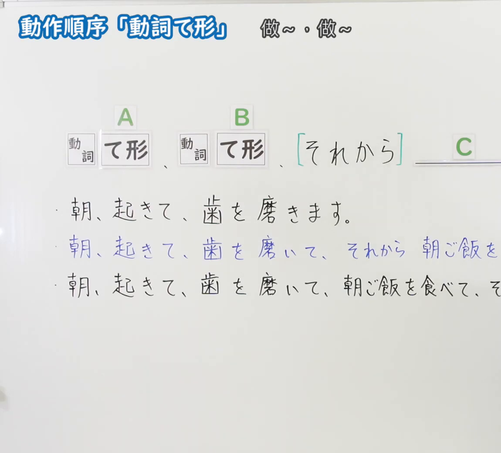
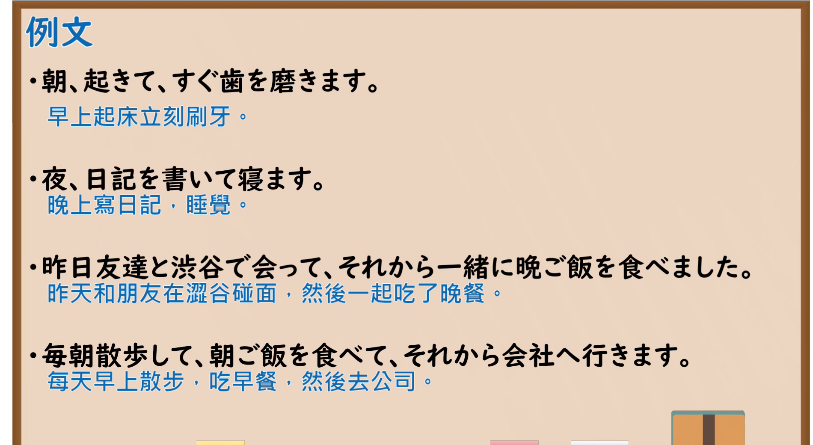

---
{
  "id": "N5-G-0062",
  "kind": "grammar",
  "level": "N5",
  "title": "动作顺序「动词て形」",
  "card_revision": 2,
  "schema_version": 1,
  "source": {
    "lesson": "N5 第62个语法",
    "material": "出口日語原视频板书（学习者截取的接续图与例句图）与东京外国语大学「VてVます：解説」正文",
    "video": "https://www.youtube.com/watch?v=7AGztuenMYY",
    "screenshot": "assets/grammar/n5/N5-G-0062-connection.png",
    "screenshot_crop": {
      "x": 0,
      "y": 0,
      "width": 1150,
      "height": 1040
    }
  },
  "tags": [
    "て形",
    "动作顺序",
    "それから",
    "N5"
  ],
  "confusions": [
    "て形连接",
    "て形／てから",
    "それから",
    "同一主语"
  ]
}
---

# N5 第62个语法：动作顺序「动词て形」

# 视频学习资料整理

- 课程：[出口日語「動作順序「動詞て形」」](https://www.youtube.com/watch?v=7AGztuenMYY)
- 视频 ID：`7AGztuenMYY`
- 视频时长：4分26秒

## 接续图

- 实际时间：未记录（图片由学习者从原视频截取并提供）
- 成品图尺寸：1150×1040，固定左上角 `(0, 0)`，右下角 `(1150, 1040)`
- 板书内容：标题「動作順序「動詞て形」」，右侧标注“做～、做～”；公式「A：動詞 て形、B：動詞 て形、［それから］C：＿＿」；例句：「朝、起きて、歯を磨きます。」「朝、起きて、歯を磨いて、それから朝ご飯を(食べます)」（蓝字）「朝、起きて、歯を磨いて、朝ご飯を食べて、そ(れから…)」，后两行句末被画面右缘截断，未补写。

## 例句图

- 实际时间：未记录（图片由学习者从原视频截取并提供）
- 成品图尺寸：1900×1040，固定左上角 `(0, 0)`，右下角 `(1900, 1040)`
- 板书内容：课程「例文」页，含四条例句及中文翻译（朝、起きて、すぐ歯を磨きます／夜、日記を書いて寝ます／昨日友達と渋谷で会って、それから一緒に晩ご飯を食べました／毎朝散歩して、朝ご飯を食べて、それから会社へ行きます）。四条例句均完整可见。

# 核心

## 功能一：做～、做～（按顺序叙述动作）

**くわしい意味記述：**

- **VてVます（動作の順序）：** 動詞の「て形」で２つ以上の文をつなぐことができます。「VてVます」は順に起こる動作を述べるときに使います。このとき、V1とV2の「Nは／が」は同一です。（可以用动词的「て形」连接两个以上的句子。「VてVます」用于叙述依次发生的动作。此时V1与V2的「Nは／が」相同。）
- **作り方：** 「V1ます」を「V1て」にします。V2の形（「ます」「ました」「ています」「ましょう」「たいです」「てください」など）に関係なく、V1は「て形」にします。（把「V1ます」改为「V1て」。无论V2是什么形式（「ます」「ました」「ています」「ましょう」「たいです」「てください」等），V1都用「て形」。）

### 例句

1. あしたわたしは駅で友だちに会って、いっしょにコンサートに行きます。

   （明天我在车站见朋友，然后一起去听音乐会。）

2. 朝７時に起きて、食堂で朝ごはんを食べて、８時から練習します。

   （早上7点起床，在食堂吃早饭，8点开始练习。）

3. わたしは日本へ行って、すもうを見たいです。

   （我想去日本看相扑。）

4. ２つに折って、はさみで切ってください。

   （请对折成两份，然后用剪刀剪开。）

# 来源

- [出口日語原视频](https://www.youtube.com/watch?v=7AGztuenMYY)
- [东京外国语大学「日本語 文法 VてVます：解説」](https://www.coelang.tufs.ac.jp/mt/ja/gmod/contents/explanation/051.html)（查询日期：2026-10-16；Hagoromo、毎日のんびり日本語教師、日本語NET 均未找到直接对应条目，按流程采用互联网检索所得的该页；该页没有「それから」的解说，例句译文为整理者所译）
