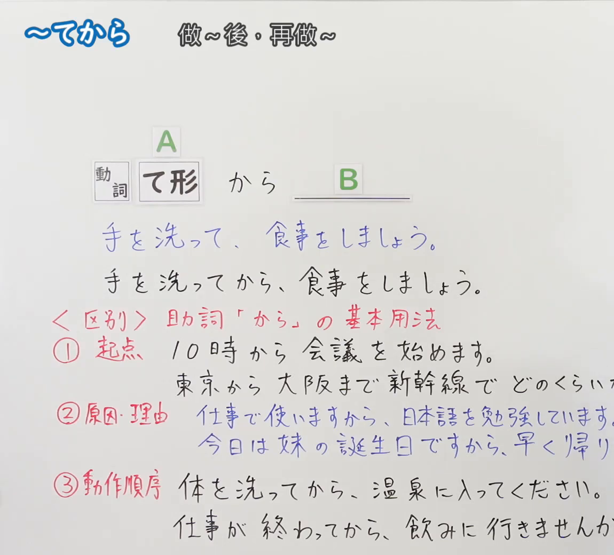
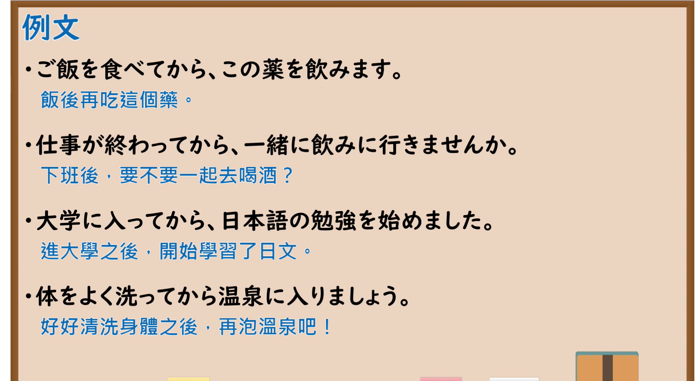

---
{
  "id": "N5-G-0063",
  "kind": "grammar",
  "level": "N5",
  "title": "～てから",
  "card_revision": 2,
  "schema_version": 1,
  "source": {
    "lesson": "N5 第63个语法",
    "material": "出口日語原视频板书（学习者截取的接续图与例句图）与毎日のんびり日本語教師「【Ｎ５文法】～てから」正文",
    "video": "https://www.youtube.com/watch?v=GSSeKB1pb14",
    "screenshot": "assets/grammar/n5/N5-G-0063-connection.png",
    "screenshot_crop": {
      "x": 0,
      "y": 0,
      "width": 1150,
      "height": 1040
    }
  },
  "tags": [
    "てから",
    "动作顺序",
    "て形",
    "N5"
  ],
  "confusions": [
    "てから／あとで",
    "て形／てから",
    "から（起点・原因）",
    "后项意志动词"
  ]
}
---

# N5 第63个语法：～てから

# 视频学习资料整理

- 课程：[出口日語「～てから」](https://www.youtube.com/watch?v=GSSeKB1pb14)
- 视频 ID：`GSSeKB1pb14`
- 视频时长：7分15秒

## 接续图

- 实际时间：未记录（图片由学习者从原视频截取并提供）
- 成品图尺寸：1150×1040，固定左上角 `(0, 0)`，右下角 `(1150, 1040)`
- 板书内容：标题「～てから」，右侧标注“做～後、再做～”；公式「A：動詞 て形 から B：＿＿」；例句：「手を洗って、食事をしましょう。」（蓝字）「手を洗ってから、食事をしましょう。」；红字「＜区別＞助詞「から」の基本用法」：「①起点」「10時から会議を始めます。」「東京から大阪まで新幹線でどのくらいか(かりますか)」、「②原因・理由」「仕事で使いますから、日本語を勉強しています。」「今日は妹の誕生日ですから、早く帰り(ます)」、「③動作順序」「体を洗ってから、温泉に入ってください。」「仕事が終わってから、飲みに行きませんか。」。右侧多处句末被画面右缘截断，未补写。

## 例句图

- 实际时间：未记录（图片由学习者从原视频截取并提供）
- 成品图尺寸：1900×1040，固定左上角 `(0, 0)`，右下角 `(1900, 1040)`
- 板书内容：课程「例文」页，含四条例句及中文翻译（ご飯を食べてから、この薬を飲みます／仕事が終わってから、一緒に飲みに行きませんか／大学に入ってから、日本語の勉強を始めました／体をよく洗ってから温泉に入りましょう）。四条例句均完整可见。

# 核心

## 功能一：做～之后，再做～

**くわしい意味記述：**

- **～てから：** 前項の動作を行った後に後項の動作を行うことを表します。その動作の順序を強調する表現です。後項に接続できるのは意志動詞のみです。接続は 動詞て形＋から。（表示做完前项动作之后再做后项动作。是强调动作顺序的表达。后项只能接意志动词。接续为 动词て形＋から。）

### 例句

1. 代金は商品が届いてからお支払いください。

   （货款请在货物送达后付款。）

2. 日本に来てから日本語の勉強を始めました。

   （来到日本之后开始学习日语。）

3. ご飯を食べてから勉強する。

   （吃完饭后学习。）

4. 今日の内容を復習してから寝る。

   （复习今天的内容后睡觉。）

5. 一旦まずは様子を見てからどうするか決めようと思います。

   （我想先看看情况再决定怎么办。）

# 来源

- [出口日語原视频](https://www.youtube.com/watch?v=GSSeKB1pb14)
- [毎日のんびり日本語教師「【Ｎ５文法】～てから」](https://mainichi-nonbiri.com/grammar/n5-tekara/)（查询日期：2026-10-16；Hagoromo 未收录，故按流程采用优先级最高的备选网站条目；中文译文取自该页；板书中的助词「から」的起点、原因・理由用法对比该页未解说，卡内未写）
