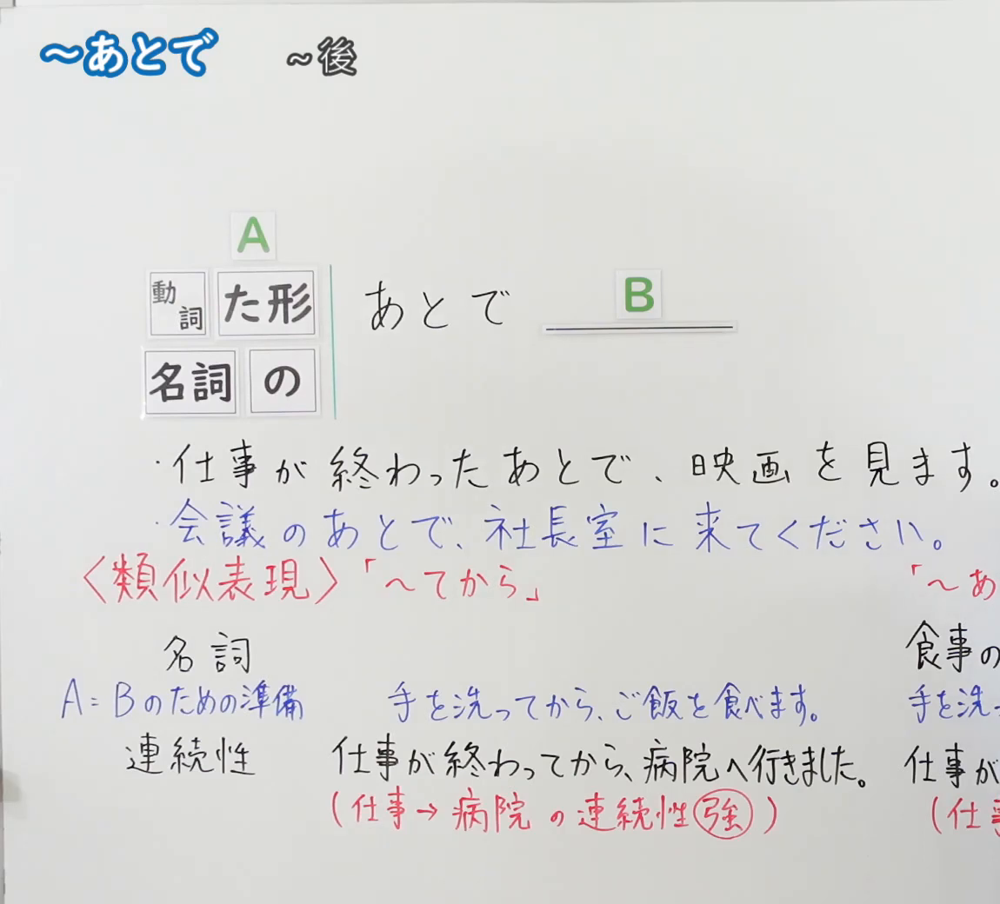
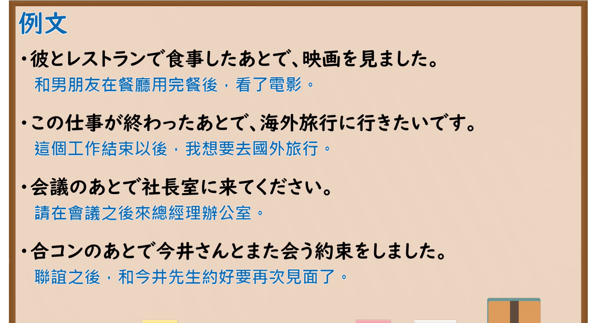

---
{
  "id": "N5-G-0064",
  "kind": "grammar",
  "level": "N5",
  "title": "～あとで",
  "card_revision": 2,
  "schema_version": 1,
  "source": {
    "lesson": "N5 第64个语法",
    "material": "出口日語原视频板书（学习者截取的接续图与例句图）与毎日のんびり日本語教師「【Ｎ５文法】～後に／後で」正文",
    "video": "https://www.youtube.com/watch?v=iPvPSYS3AKE",
    "screenshot": "assets/grammar/n5/N5-G-0064-connection.png",
    "screenshot_crop": {
      "x": 0,
      "y": 0,
      "width": 1150,
      "height": 1040
    }
  },
  "tags": [
    "あとで",
    "时间顺序",
    "之后",
    "N5"
  ],
  "confusions": [
    "あとで／てから",
    "后／後で",
    "連続性（强弱）",
    "準備"
  ]
}
---

# N5 第64个语法：～あとで

# 视频学习资料整理

- 课程：[出口日語「～あとで」](https://www.youtube.com/watch?v=iPvPSYS3AKE)
- 视频 ID：`iPvPSYS3AKE`
- 视频时长：5分46秒

## 接续图

- 实际时间：未记录（图片由学习者从原视频截取并提供）
- 成品图尺寸：1150×1040，固定左上角 `(0, 0)`，右下角 `(1150, 1040)`
- 板书内容：标题「～あとで」，右侧标注“～後”；公式「A：動詞 た形／名詞 の あとで B：＿＿」；例句：「仕事が終わったあとで、映画を見ます。」「会議のあとで、社長室に来てください。」（蓝字）；红字「＜類似表現＞「～てから」」下：名词标签（右半被截断，疑为「～あとで」栏）、「A＝Bのための準備　手を洗ってから、ご飯を食べます。」（蓝字）、「連続性　仕事が終わってから、病院へ行きました。」「（仕事→病院の連続性強）」（强字圈红）；右侧「～あ…」「食事の…」「手を洗…」「仕事が…」「（仕…」各行被画面右缘截断，未补写。

## 例句图

- 实际时间：未记录（图片由学习者从原视频截取并提供）
- 成品图尺寸：1900×1040，固定左上角 `(0, 0)`，右下角 `(1900, 1040)`
- 板书内容：课程「例文」页，含四条例句及中文翻译（彼とレストランで食事したあとで、映画を見ました／この仕事が終わったあとで、海外旅行に行きたいです／会議のあとで社長室に来てください／合コンのあとで今井さんとまた会う約束をしました）。四条例句均完整可见。

# 核心

## 功能一：～之后

**くわしい意味記述：**

- **～後に／後で：** 動作Ａが終わってからＢの動作を行ったり、Ｂの状態が残っていることを表します。「後に」は後件である状態が残っていることを表し、「後で」は動作Ｂを行うことを表します。（表示动作Ａ结束后进行动作Ｂ，或Ｂ的状态持续。「後に」表示后项状态持续，「後で」表示进行动作Ｂ。）
- **接続：** 名詞＋の後で、動詞た形＋後で。（名词＋の後で，动词た形＋後で。）

### 例句

1. トイレに行った後は必ず手を洗うこと。

   （上完厕所后必须洗手。）

2. 家を出た後で忘れ物をしたことに気づいた。

   （离开家后意识到忘了东西。）

3. 仕事の後のお風呂は最高だ。

   （下班后洗澡是最好的。）

4. アイスクリームを食べた後には必ずお腹が痛くなる。

   （吃完冰淇淋后一定会肚子痛。）

5. ５分後に出発します。

   （五分钟后出发。）

# 来源

- [出口日語原视频](https://www.youtube.com/watch?v=iPvPSYS3AKE)
- [毎日のんびり日本語教師「【Ｎ５文法】～後に／後で」](https://mainichi-nonbiri.com/grammar/n5-atoni/)（查询日期：2026-10-16；Hagoromo 未收录，故按流程采用优先级最高的备选网站条目；中文译文取自该页；板书中与「～てから」的区别（準備・連続性）该页未解说，卡内未写）
