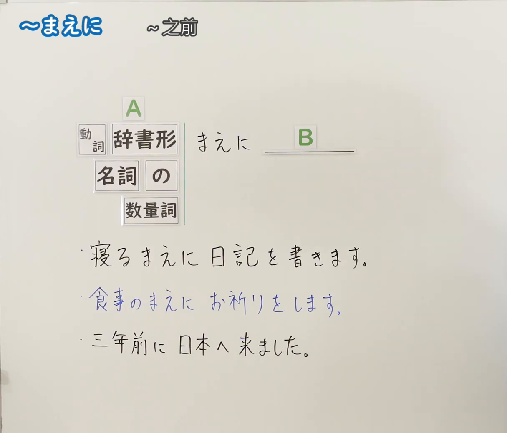
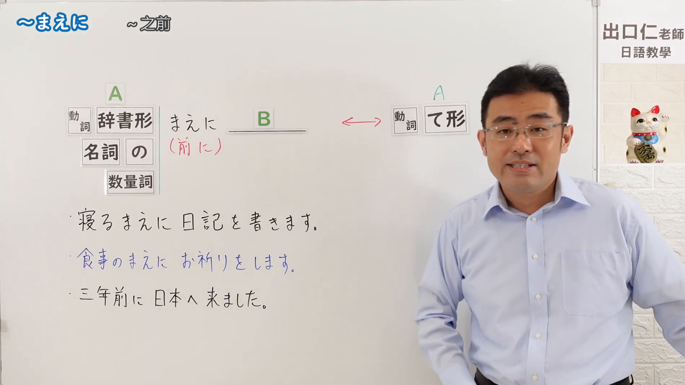

---
{
  "id": "N5-G-0065",
  "kind": "grammar",
  "level": "N5",
  "title": "～まえに",
  "card_revision": 2,
  "schema_version": 1,
  "source": {
    "lesson": "N5 第65个语法",
    "material": "出口日語原视频板书（学习者截取的接续图与例句图）与毎日のんびり日本語教師「【Ｎ５文法】～前に／前で」正文",
    "video": "https://www.youtube.com/watch?v=_b61ETBoZvo",
    "screenshot": "assets/grammar/n5/N5-G-0065-connection.png",
    "screenshot_crop": {
      "x": 0,
      "y": 0,
      "width": 1215,
      "height": 1040
    }
  },
  "tags": [
    "まえに",
    "时间顺序",
    "之前",
    "N5"
  ],
  "confusions": [
    "まえに／あとで",
    "辞書形／て形",
    "名词＋の／数量词",
    "時間・空間"
  ]
}
---

# N5 第65个语法：～まえに

# 视频学习资料整理

- 课程：[出口日語「～まえに」](https://www.youtube.com/watch?v=_b61ETBoZvo)
- 视频 ID：`_b61ETBoZvo`
- 视频时长：4分56秒

## 接续图

- 实际时间：未记录（图片由学习者从原视频截取并提供）
- 成品图尺寸：1215×1040，固定左上角 `(0, 0)`，右下角 `(1215, 1040)`
- 板书内容：标题「～まえに」，右侧标注“～之前”；公式「A：動詞 辞書形／名詞 の／数量詞 まえに B：＿＿」；例句：「寝るまえに日記を書きます。」「食事のまえにお祈りをします。」（蓝字）「三年前に日本へ来ました。」。板书完整，无遮挡。

## 例句图

- 实际时间：未记录（图片由学习者从原视频截取并提供）
- 成品图尺寸：1900×1070，固定左上角 `(0, 0)`，右下角 `(1900, 1070)`
- 板书内容：（注：本课例句图是整张板书画面，不是「例文」页。）成品图尺寸含黑板全貌，老师入画，位于右侧，对板书无遮挡。板书内容：在接续图内容之外，补充「まえに」下红字「（前に）」，及右侧红色双向箭头指向公式「A：動詞 て形」，表示与「～てから」互为对照（右半该对照公式的后续内容未写出）。

# 核心

## 功能一：～之前

**くわしい意味記述：**

- **～前に：** 動詞や動作を表す名詞につくと、前項の動作を行う前に後項の動作を行うことを表します。前件に制約はありませんが、後項は意志動詞のみ接続できます。（接在动词或表示动作的名词后，表示在进行前项动作之前进行后项动作。前项没有限制，后项只能接意志动词。）
- **時間・空間：** 空間や時間を表す名詞につくと、物理的、時間的位置関係の前方を表します。単独で「前に」と言うと、以前を表します。（接在表示空间或时间的名词后，表示物理上、时间上位置关系的前方。单独说「前に」时表示以前。）

### 例句

1. 寝る前に歯を磨く。

   （睡觉前刷牙。）

2. 雨が強くなる前に家に帰りたい。

   （我想在雨变大之前回家。）

3. 出発前に荷物の確認をする。

   （出发前确认行李。）

4. 卒業する前に友達と卒業旅行に行きたい。

   （想在毕业前和朋友一起去毕业旅行。）

5. 数日前に降った雪がまだ残っている。

   （几天前下的雪还留着。）

# 来源

- [出口日語原视频](https://www.youtube.com/watch?v=_b61ETBoZvo)
- [毎日のんびり日本語教師「【Ｎ５文法】～前に／前で」](https://mainichi-nonbiri.com/grammar/n5-maeni/)（查询日期：2026-10-16；Hagoromo 未收录，故按流程采用优先级最高的备选网站条目；中文译文取自该页）
