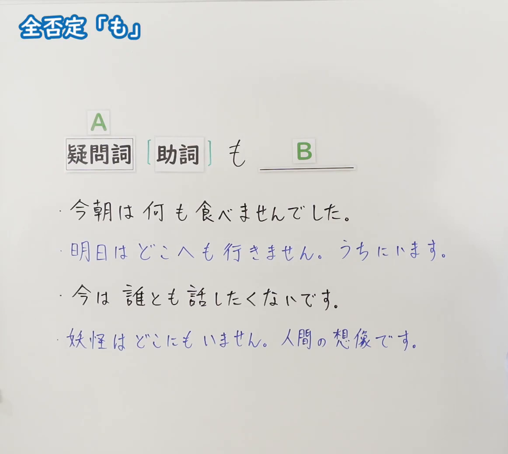
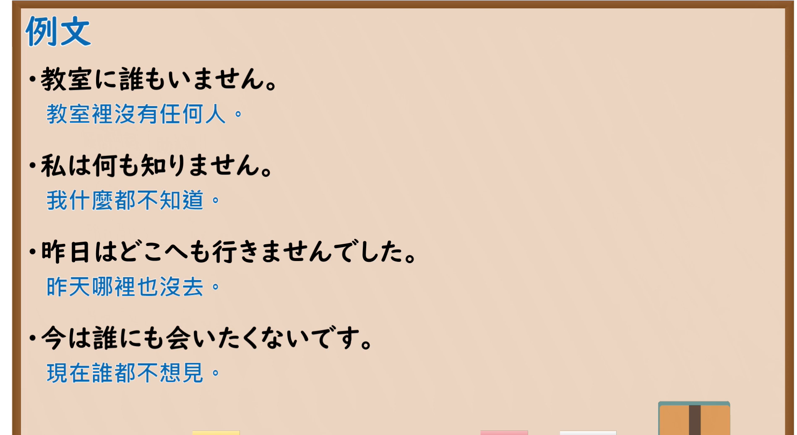

---
{
  "id": "N5-G-0066",
  "kind": "grammar",
  "level": "N5",
  "title": "助词：全否定「も」",
  "card_revision": 2,
  "schema_version": 1,
  "source": {
    "lesson": "N5 第66个语法",
    "material": "出口日語原视频板书（学习者截取的接续图与例句图）与Iku老師日文「何も〜ません／ませんでした」正文",
    "video": "https://www.youtube.com/watch?v=3ClpSZM-8L4",
    "screenshot": "assets/grammar/n5/N5-G-0066-connection.png",
    "screenshot_crop": {
      "x": 0,
      "y": 0,
      "width": 1162,
      "height": 1040
    }
  },
  "tags": [
    "も",
    "全否定",
    "疑问词",
    "N5"
  ],
  "confusions": [
    "疑问词＋も＋否定",
    "何も／何か",
    "どこへも／どこにも",
    "誰とも／誰にも"
  ]
}
---

# N5 第66个语法：助词「も」（全否定）

# 视频学习资料整理

- 课程：[出口日語「助詞：全否定「も」」](https://www.youtube.com/watch?v=3ClpSZM-8L4)
- 视频 ID：`3ClpSZM-8L4`
- 视频时长：5分16秒

## 接续图

- 实际时间：未记录（图片由学习者从原视频截取并提供）
- 成品图尺寸：1162×1040，固定左上角 `(0, 0)`，右下角 `(1162, 1040)`
- 板书内容：标题「全否定「も」」；公式「A：疑問詞［助詞］も B：＿＿」；例句：「今朝は何も食べませんでした。」「明日はどこへも行きません。うちにいます。」（蓝字）「今は誰とも話したくないです。」「妖怪はどこにもいません。人間の想像です。」（蓝字）。板书完整，无遮挡。

## 例句图

- 实际时间：未记录（图片由学习者从原视频截取并提供）
- 成品图尺寸：1900×1040，固定左上角 `(0, 0)`，右下角 `(1900, 1040)`
- 板书内容：课程「例文」页，含四条例句及中文翻译（教室に誰もいません／私は何も知りません／昨日はどこへも行きませんでした／今は誰にも会いたくないです）。四条例句均完整可见。

# 核心

## 功能一：什么都不～；哪里都不～；谁都不～（全部否定）

**くわしい意味記述：**

- **疑問詞＋も＋否定：** （该页说明为中文）「疑問詞＋も＋否定動詞」。「何も＋否定」表示“什么都不～”，「どこ（へ）も＋否定」表示“哪里都不去”，「誰にも＋否定」表示“谁都不（见面）”。重点在于后面一定要接否定形「〜ません／〜ませんでした」。「も」是加强语气的助词，原本的助词（へ／に／を）通常可以省略或保留。

### 例句

1. わたしは何も食べません。

   （我什么都不吃。）

2. 何も食べませんでした。

   （什么都没吃。）

3. どこ（へ）も行きません。

   （哪里都不去。）

4. 何もしません。

   （什么都不做。）

5. コンビニで何も買いません。

   （在便利店什么都不买。）

# 来源

- [出口日語原视频](https://www.youtube.com/watch?v=3ClpSZM-8L4)
- [Iku老師日文「N5日文文法第33課「何も〜ません／ませんでした」」](https://jp.ikuchannel.com/lessons/6-2-nanimo-masen)（查询日期：2026-10-16；Hagoromo、毎日のんびり日本語教師、日本語NET 均未找到直接对应条目，按流程采用互联网检索所得的该页；该页的意义说明是繁体中文而非日文原文，「くわしい意味記述」中的说明直接采用该页中文，例句的中文译文取自该页；「誰も」「誰にも」「誰とも」等具体例句该页没有）
