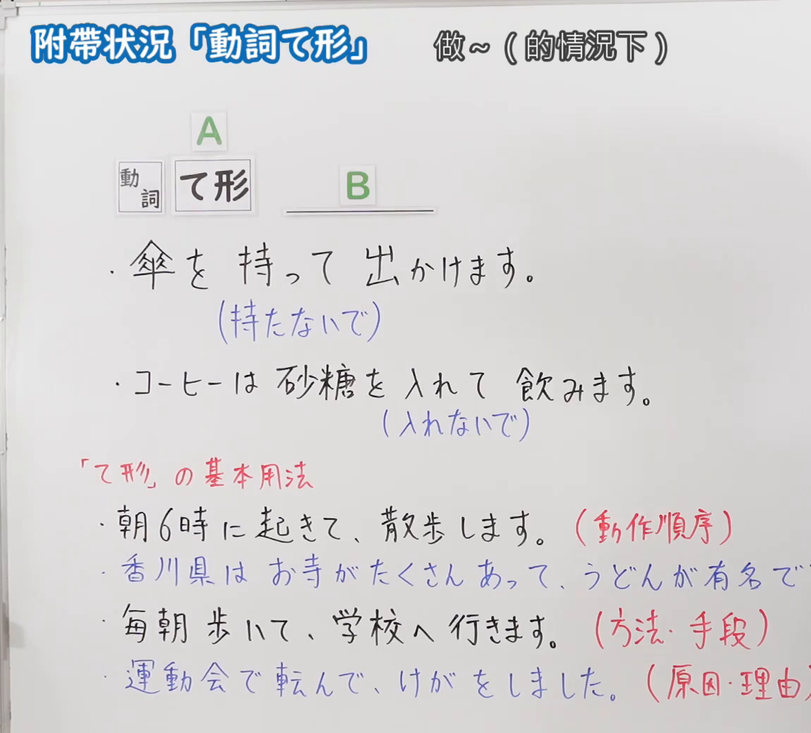
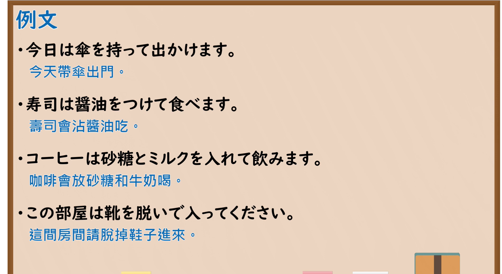

---
{
  "id": "N5-G-0067",
  "kind": "grammar",
  "level": "N5",
  "title": "附带状况「动词て形」",
  "card_revision": 2,
  "schema_version": 1,
  "source": {
    "lesson": "N5 第67个语法",
    "material": "出口日語原视频板书（学习者截取的接续图与例句图）与东京外国语大学「VてVます：解説」正文",
    "video": "https://www.youtube.com/watch?v=rG1EgtKxFQQ",
    "screenshot": "assets/grammar/n5/N5-G-0067-connection.png",
    "screenshot_crop": {
      "x": 0,
      "y": 0,
      "width": 1150,
      "height": 1040
    }
  },
  "tags": [
    "て形",
    "附带状况",
    "基本用法",
    "N5"
  ],
  "confusions": [
    "て形／ないで",
    "附带状况／动作顺序",
    "附带状况／方法手段",
    "原因・理由"
  ]
}
---

# N5 第67个语法：附带状况「动词て形」

# 视频学习资料整理

- 课程：[出口日語「附帯状況「動詞て形」」](https://www.youtube.com/watch?v=rG1EgtKxFQQ)
- 视频 ID：`rG1EgtKxFQQ`
- 视频时长：5分45秒

## 接续图

- 实际时间：未记录（图片由学习者从原视频截取并提供）
- 成品图尺寸：1150×1040，固定左上角 `(0, 0)`，右下角 `(1150, 1040)`
- 板书内容：标题「附帯状況「動詞て形」」，右侧标注“做～（的情況下）”；公式「A：動詞 て形、B：＿＿」；例句：「傘を持って出かけます。」（其下蓝字「（持たないで）」）「コーヒーは砂糖を入れて飲みます。」（其下蓝字「（入れないで）」）；红字「「て形」の基本用法」下：「朝6時に起きて、散歩します。（動作順序）」「香川県はお寺がたくさんあって、うどんが有名で(す)」（蓝字，句末被截断）「毎朝歩いて、学校へ行きます。（方法・手段）」「運動会で転んで、けがをしました。（原因・理由）」（蓝字，括号末被截断）。

## 例句图

- 实际时间：未记录（图片由学习者从原视频截取并提供）
- 成品图尺寸：1900×1040，固定左上角 `(0, 0)`，右下角 `(1900, 1040)`
- 板书内容：课程「例文」页，含四条例句及中文翻译（今日は傘を持って出かけます／寿司は醤油をつけて食べます／コーヒーは砂糖とミルクを入れて飲みます／この部屋は靴を脱いで入ってください）。四条例句均完整可见。

# 核心

## 功能一：做～（在……的情况下）

**くわしい意味記述：**

- **動作が行なわれる状態：** 「VてVます」は動作が行なわれる状態を述べるときにも使います。このとき、V1とV2の「Nは／が」は同一です。（「VてVます」也用于叙述动作进行时的状态。此时V1与V2的「Nは／が」相同。）
- **「て形」の基本用法：** 「VてVます」は、順に起こる動作、動作が行なわれるときの方法や手段を表わす場合にも使います。また、「V1て」が原因、「Vます」が結果であることを表わす場合があります。（「VてVます」也用于依次发生的动作、进行动作时的方法或手段；也有「V1て」表示原因、「Vます」表示结果的情况。）

### 例句

1. あそこに座って、お弁当を食べましょう。

   （我们坐在那里吃便当吧。）

2. わたしは毎日歩いて学校へ行きます。

   （我每天走路去学校。）

3. テープを聞いて、日本語を勉強します。

   （听录音学习日语。）

4. 雨が降って、野球の試合を中止しました。

   （下雨了，棒球比赛取消了。）

5. 大きい台風が来て、電車が止まりました。

   （来了大台风，电车停了。）

# 来源

- [出口日語原视频](https://www.youtube.com/watch?v=rG1EgtKxFQQ)
- [东京外国语大学「日本語 文法 VてVます：解説」](https://www.coelang.tufs.ac.jp/mt/ja/gmod/contents/explanation/051.html)（查询日期：2026-10-16；Hagoromo、毎日のんびり日本語教師、日本語NET 均未找到直接对应条目，按流程采用互联网检索所得的该页；该页中“动作进行时的状态”（附带状况）只有第 1 条例句，其余 4 条例句属方法・手段、原因・理由用法，是对应板书「基本用法」部分的例句；板书中否定形「～ないで」的用法该页未解说；例句译文为整理者所译）
