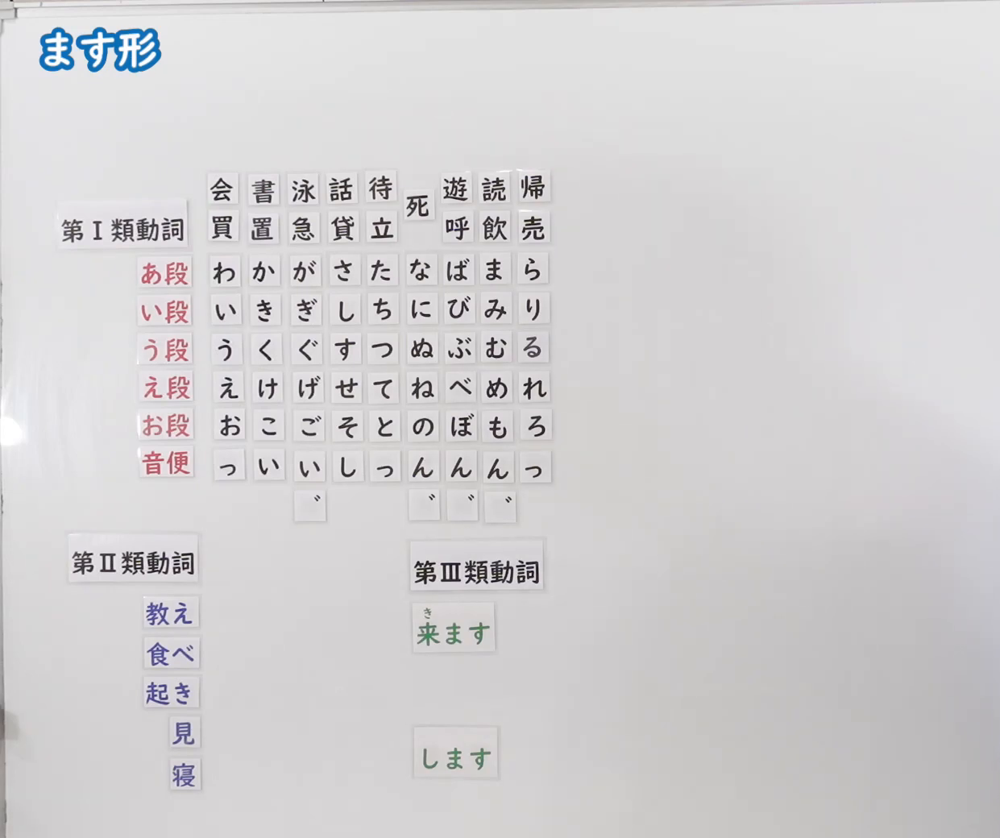
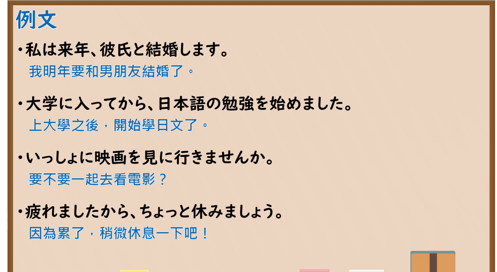

---
{
  "id": "N5-G-0068",
  "kind": "grammar",
  "level": "N5",
  "title": "ます形",
  "card_revision": 2,
  "schema_version": 1,
  "source": {
    "lesson": "N5 第68个语法",
    "material": "出口日語原视频板书（学习者截取的接续图与例句图）与东京外国语大学「動詞の３種類：解説」正文",
    "video": "https://www.youtube.com/watch?v=AsEvNl4Cad0",
    "screenshot": "assets/grammar/n5/N5-G-0068-connection.png",
    "screenshot_crop": {
      "x": 0,
      "y": 0,
      "width": 1241,
      "height": 1040
    }
  },
  "tags": [
    "ます形",
    "动词分类",
    "活用",
    "N5"
  ],
  "confusions": [
    "第Ⅰ类／第Ⅱ类／第Ⅲ类动词",
    "い段变化",
    "去掉る",
    "する／来る"
  ]
}
---

# N5 第68个语法：ます形

# 视频学习资料整理

- 课程：[出口日語「ます形」](https://www.youtube.com/watch?v=AsEvNl4Cad0)
- 视频 ID：`AsEvNl4Cad0`
- 视频时长：14分53秒

## 接续图

- 实际时间：未记录（图片由学习者从原视频截取并提供）
- 成品图尺寸：1241×1040，固定左上角 `(0, 0)`，右下角 `(1241, 1040)`
- 板书内容：标题「ます形」，无接续公式；板书为动词分类的磁贴图：「第Ⅰ類動詞」下列出例词（会・買、書・置、泳・急、話・貸、待・立、死、遊・呼、読・飲、帰・売），其下为五十音行表（あ段：わ・か・が・さ・た・な・ば・ま・ら；い段：い・き・ぎ・し・ち・に・び・み・り；う段：う・く・ぐ・す・つ・ぬ・ぶ・む・る；え段：え・け・げ・せ・て・ね・べ・め・れ；お段：お・こ・ご・そ・と・の・ぼ・も・ろ；音便：っ・い・い・し・っ・ん・ん・ん・っ，以及浊点标记）；「第Ⅱ類動詞」下「教え・食べ・起き・見・寝」；「第Ⅲ類動詞」下「来ます（き）」「します」。板书完整，无遮挡；「い段」行与「ます」磁贴（用于演示ます形）在本图中尚未摆出。

## 例句图

- 实际时间：未记录（图片由学习者从原视频截取并提供）
- 成品图尺寸：1900×1040，固定左上角 `(0, 0)`，右下角 `(1900, 1040)`
- 板书内容：课程「例文」页，含四条例句及中文翻译（私は来年、彼氏と結婚します／大学に入ってから、日本語の勉強を始めました／いっしょに映画を見に行きませんか／疲れましたから、ちょっと休みましょう）。四条例句均完整可见。

# 核心

## 功能一：动词ます形的构成（按动词类别）

**くわしい意味記述：**

- **グループ1：** グループ1の動詞は、ます形、ない形を作るときに、辞書形の最後のuをそれぞれi、aに変化させ、そこに「ます」「ない」をつけます。（第1类动词构成ます形、ない形时，把辞书形末尾的u分别变成i、a，再接「ます」「ない」。）
- **グループ2：** グループ2の動詞は、辞書形がすべて-iru、-eruという形になっています。ます形、ない形を作るときには、辞書形の最後のruをとって、そこに「ます」「ない」をつけます。（第2类动词的辞书形都是-iru、-eru的形式。构成ます形、ない形时，去掉辞书形末尾的ru，再接「ます」「ない」。）
- **グループ3：** グループ3の動詞は「する」と「くる」です。この２つの動詞は、不規則活用だということでひとまとめにされています。ます形は「します」「きます」になります。（第3类动词是「する」和「くる」。这两个动词因为是不规则活用而归为一类。ます形是「します」「きます」。）

### 例句

1. 読む → 読みます

   （读／看）

2. 書く → 書きます

   （写）

3. 起きる → 起きます

   （起床）

4. 食べる → 食べます

   （吃）

5. する → します／くる → きます

   （做／来）

# 来源

- [出口日語原视频](https://www.youtube.com/watch?v=AsEvNl4Cad0)
- [东京外国语大学「日本語 文法 動詞の３種類：解説」](https://www.coelang.tufs.ac.jp/mt/ja/gmod/contents/explanation/039.html)（查询日期：2026-10-16；Hagoromo、毎日のんびり日本語教師、日本語NET 均未找到直接对应条目，按流程采用互联网检索所得的该页；该页的活用表用罗马字（yom-u→yom-i-masu 等），卡内的「例句」是把该页表中的词转写为假名、按其规则列出的词形变化，不是完整句子；该页没有板书中的“い段”五十音行表和音便表的完整解说）
