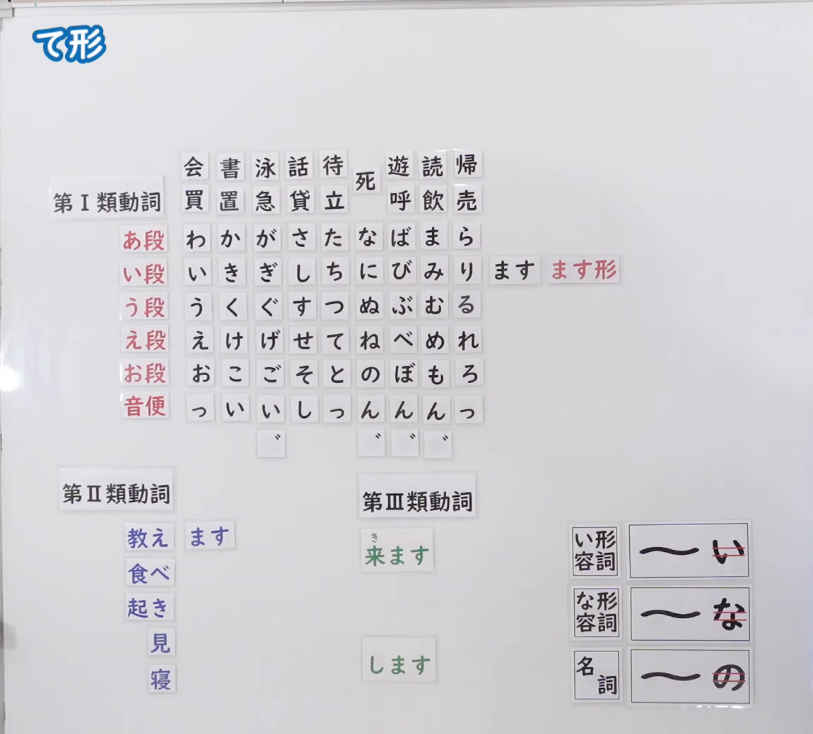
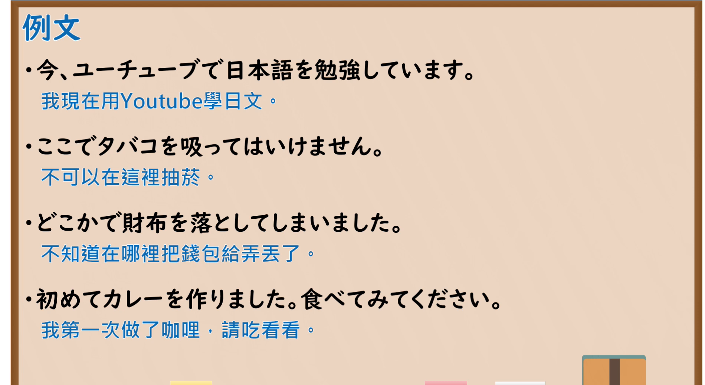

---
{
  "id": "N5-G-0069",
  "kind": "grammar",
  "level": "N5",
  "title": "て形",
  "card_revision": 2,
  "schema_version": 1,
  "source": {
    "lesson": "N5 第69个语法",
    "material": "出口日語原视频板书（学习者截取的接续图与例句图）与东京外国语大学「Vて（て形）：解説」「AくてA・NAでNA・NでN：解説」正文",
    "video": "https://www.youtube.com/watch?v=3YdwZ_xRB3g",
    "screenshot": "assets/grammar/n5/N5-G-0069-connection.png",
    "screenshot_crop": {
      "x": 0,
      "y": 0,
      "width": 1150,
      "height": 1040
    }
  },
  "tags": [
    "て形",
    "动词活用",
    "音便",
    "N5"
  ],
  "confusions": [
    "て形／た形",
    "音便（って・んで・いて・して）",
    "動詞／い形容词／な形容词／名词",
    "て形的用法"
  ]
}
---

# N5 第69个语法：て形

# 视频学习资料整理

- 课程：[出口日語「て形」](https://www.youtube.com/watch?v=3YdwZ_xRB3g)
- 视频 ID：`3YdwZ_xRB3g`
- 视频时长：19分10秒

## 接续图

- 实际时间：未记录（图片由学习者从原视频截取并提供）
- 成品图尺寸：1150×1040，固定左上角 `(0, 0)`，右下角 `(1150, 1040)`
- 板书内容：标题「て形」，无接续公式；板书为与「ます形」相同的磁贴图：「第Ⅰ類動詞」下列出例词及五十音行表，い段行右侧摆出「ます」「ます形」（红字）磁贴；「第Ⅱ類動詞」下「教え」旁摆出「ます」磁贴；「第Ⅲ類動詞」下「来ます」「します」；右下角另有三个词类磁贴：「い形容詞：〜い（「い」红线划去）」「な形容詞：〜な（「な」红线划去）」「名詞：〜の（「の」红线划去）」，表示形容词、名词的て形需去掉末尾的「い」「な」「の」再接「くて」「で」。板书完整，无遮挡。

## 例句图

- 实际时间：未记录（图片由学习者从原视频截取并提供）
- 成品图尺寸：1900×1040，固定左上角 `(0, 0)`，右下角 `(1900, 1040)`
- 板书内容：课程「例文」页，含四条例句及中文翻译（今、ユーチューブで日本語を勉強しています／ここでタバコを吸ってはいけません／どこかで財布を落としてしまいました／初めてカレーを作りました。食べてみてください）。四条例句均完整可见。

# 核心

## 功能一：て形的构成及用法

**くわしい意味記述：**

- **Vて（て形）：** 「て形」は動詞の活用形の一つです。さまざまな文法形式を作るときに使われる重要な形ですので、特に学習が必要です。（「て形」是动词活用形之一。是构成各种语法形式时使用的重要形式，需要特别学习。）
- **グループ1の「ます形」と「て形」の対応：** 〇います・〇ちます・〇ります→〇って、〇にます・〇びます・〇みます→〇んで、〇きます→〇いて、〇ぎます→〇いで、〇します→〇して。（第1类：「〇います・〇ちます・〇ります」→「〇って」，「〇にます・〇びます・〇みます」→「〇んで」，「〇きます」→「〇いて」，「〇ぎます」→「〇いで」，「〇します」→「〇して」。）
- **グループ2・3：** グループ2は「〇ます」→「〇て」（おきます→おきて、たべます→たべて）、グループ3は「します→して」「きます→きて」です。（第2类「〇ます」→「〇て」，第3类「します→して」「きます→きて」。）
- **形容詞・名詞：** 「A1い」は「A1くて」、「NA1な」は「NA1で」、「N1の」は「N1で」にして、名詞や形容詞をつなぎます。（「A1い」变「A1くて」，「NA1な」变「NA1で」，「N1の」变「N1で」，用来连接名词、形容词。）

### 例句

1. ６時に起きて、ジョギングをしました。

   （6点起床，去慢跑了。）

2. ごはんを食べてから、歯をみがきます。

   （吃完饭之后刷牙。）

3. 立ってください。

   （请站起来。）

4. あした、休んでもいいですか。

   （明天可以休息吗？）

5. 食べてみます。

   （我试着吃吃看。）

# 来源

- [出口日語原视频](https://www.youtube.com/watch?v=3YdwZ_xRB3g)
- 东京外国语大学「日本語 文法」解说：[「Vて（て形）」](https://www.coelang.tufs.ac.jp/mt/ja/gmod/courses/c02/lesson23/step1/explanation/043.html)、[「AくてA・NAでNA・NでN」](https://www.coelang.tufs.ac.jp/mt/ja/gmod/contents/explanation/049.html)（查询日期：2026-10-16；Hagoromo、毎日のんびり日本語教師、日本語NET 均未找到直接对应条目，按流程采用互联网检索所得的两页；例句取自第一页；例句译文为整理者所译；板书中「第Ⅰ類動詞」的音便规则（かく→いて 等）按页面「ます形とて形の対応」表整理，板书上的磁贴并非逐一对应）
