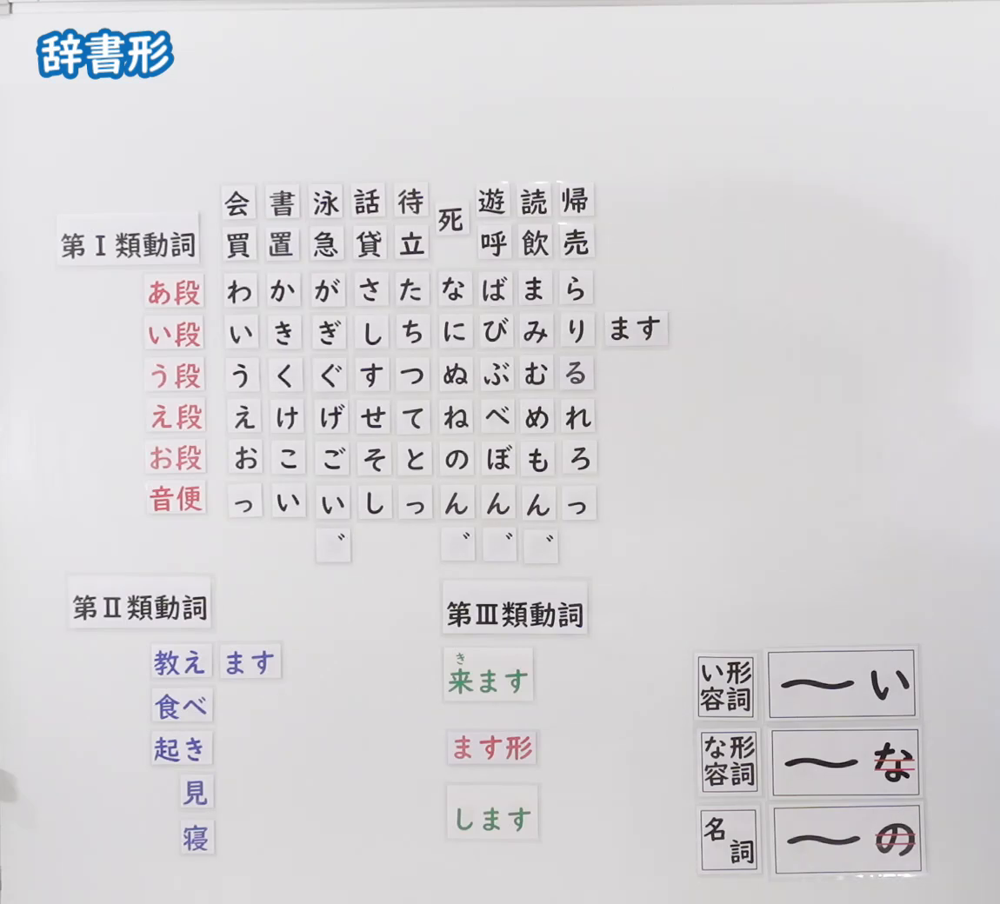
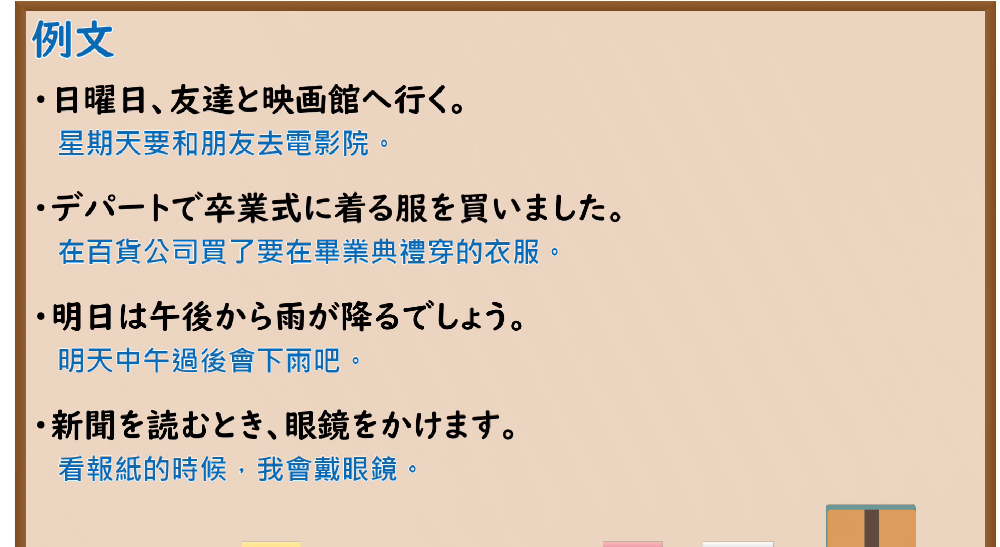

---
{
  "id": "N5-G-0070",
  "kind": "grammar",
  "level": "N5",
  "title": "辞书形",
  "card_revision": 2,
  "schema_version": 1,
  "source": {
    "lesson": "N5 第70个语法",
    "material": "出口日語原视频板书（学习者截取的接续图与例句图）与东京外国语大学「動詞の３種類：解説」正文",
    "video": "https://www.youtube.com/watch?v=VXTA-hsnJEY",
    "screenshot": "assets/grammar/n5/N5-G-0070-connection.png",
    "screenshot_crop": {
      "x": 0,
      "y": 0,
      "width": 1150,
      "height": 1040
    }
  },
  "tags": [
    "辞书形",
    "动词分类",
    "活用",
    "N5"
  ],
  "confusions": [
    "辞書形／ます形",
    "動詞／い形容詞／な形容詞／名詞",
    "第Ⅰ類／第Ⅱ類／第Ⅲ類",
    "-iru／-eru结尾的第Ⅰ类动词"
  ]
}
---

# N5 第70个语法：辞书形

# 视频学习资料整理

- 课程：[出口日語「辞書形」](https://www.youtube.com/watch?v=VXTA-hsnJEY)
- 视频 ID：`VXTA-hsnJEY`
- 视频时长：12分15秒

## 接续图

- 实际时间：未记录（图片由学习者从原视频截取并提供）
- 成品图尺寸：1150×1040，固定左上角 `(0, 0)`，右下角 `(1150, 1040)`
- 板书内容：标题「辞書形」，无接续公式；板书为与「ます形」「て形」相同的磁贴图（第Ⅰ類動詞五十音行表、第Ⅱ類動詞「教え・食べ・起き・見・寝」、第Ⅲ類動詞「来ます」「します」），い段行右侧摆出「ます」磁贴，第Ⅲ類下摆出红字「ます形」；右下角词类磁贴：「い形容詞：〜い」「な形容詞：〜な（「な」红线划去）」「名詞：〜の（「の」红线划去）」。板书完整，无遮挡。

## 例句图

- 实际时间：未记录（图片由学习者从原视频截取并提供）
- 成品图尺寸：1900×1040，固定左上角 `(0, 0)`，右下角 `(1900, 1040)`
- 板书内容：课程「例文」页，含四条例句及中文翻译（日曜日、友達と映画館へ行く／デパートで卒業式に着る服を買いました／明日は午後から雨が降るでしょう／新聞を読むとき、眼鏡をかけます）。四条例句均完整可见。

# 核心

## 功能一：动词的辞书形（基本形）与分类

**くわしい意味記述：**

- **動詞の３種類：** 動詞は活用の仕方によって３種類に分かれます。「Aい」は辞書の見出しに出る形でもあります。これを辞書形と言います。（动词按活用方式分为三类。「Aい」是词典里出现的形式，称为辞书形。）
- **グループの見分け方：** 「する」と「くる」はグループ3です。-ru以外で終わるものはグループ1です。-aru、-uru、-oruで終わるものもグループ1です。-iru、-eruで終わるものの多くはグループ2です。（「する」和「くる」是第3类。以-ru以外结尾的是第1类。以-aru、-uru、-oru结尾的也是第1类。以-iru、-eru结尾的多数是第2类。）
- **-iru／-eruで終わるグループ1：** 切る、走る、知る、帰る、入る、減る、要る などは、-iru、-eruで終わるがグループ1の動詞です。（「切る、走る、知る、帰る、入る、減る、要る」等虽以-iru、-eru结尾，但属于第1类动词。）

### 例句

1. 買う、書く、泳ぐ、話す、待つ、死ぬ、遊ぶ、読む（第1类）

   （买、写、游泳、说话、等、死、玩、读）

2. 計る、降る、通る（第1类）

   （测量、下（雨雪）、通过）

3. 見る、起きる、増える、買える（第2类）

   （看、起床、增加、能买）

4. 切る、走る、知る、帰る（-iru／-eru结尾的第1类）

   （切、跑、知道、回去）

5. する、くる（第3类）

   （做、来）

# 来源

- [出口日語原视频](https://www.youtube.com/watch?v=VXTA-hsnJEY)
- [东京外国语大学「日本語 文法 動詞の３種類：解説」](https://www.coelang.tufs.ac.jp/mt/ja/gmod/contents/explanation/039.html)（查询日期：2026-10-16；Hagoromo、毎日のんびり日本語教師、日本語NET 均未找到直接对应条目，按流程采用互联网检索所得的该页；该页没有「辞書形」的单独解说，只在动词分类中提到，卡内「例句」是该页列出的各类动词词例，不是完整句子；该页没有板书中形容词、名词的辞书形说明，也没有「な」「の」划去的含义；词例译文为整理者所译）
