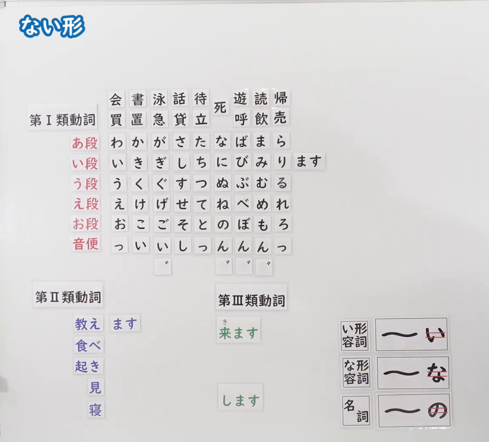
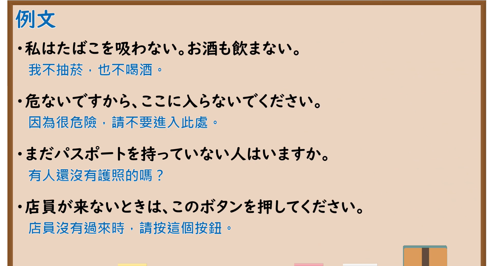

---
{
  "id": "N5-G-0071",
  "kind": "grammar",
  "level": "N5",
  "title": "ない形",
  "card_revision": 2,
  "schema_version": 1,
  "source": {
    "lesson": "N5 第71个语法",
    "material": "出口日語原视频板书（学习者截取的接续图与例句图）与东京外国语大学「動詞の３種類」「普通形の体系」「形容詞の普通形」「名詞述語の普通形」解说正文",
    "video": "https://www.youtube.com/watch?v=VtZa9KbrpM0",
    "screenshot": "assets/grammar/n5/N5-G-0071-connection.png",
    "screenshot_crop": {
      "x": 0,
      "y": 0,
      "width": 1150,
      "height": 1040
    }
  },
  "tags": [
    "ない形",
    "动词活用",
    "否定",
    "N5"
  ],
  "confusions": [
    "ない形／ます形",
    "第Ⅰ类的わない",
    "ある的ない形",
    "い形容词・な形容词・名词的否定"
  ]
}
---

# N5 第71个语法：ない形

# 视频学习资料整理

- 课程：[出口日語「ない形」](https://www.youtube.com/watch?v=VtZa9KbrpM0)
- 视频 ID：`VtZa9KbrpM0`
- 视频时长：10分34秒

## 接续图

- 实际时间：未记录（图片由学习者从原视频截取并提供）
- 成品图尺寸：1150×1040，固定左上角 `(0, 0)`，右下角 `(1150, 1040)`
- 板书内容：标题「ない形」，无接续公式；板书为与「ます形」「て形」相同的磁贴图（第Ⅰ類動詞五十音行表、第Ⅱ類動詞「教え・食べ・起き・見・寝」、第Ⅲ類動詞「来ます」「します」），い段行右侧摆出「ます」磁贴；右下角词类磁贴：「い形容詞：〜い（「い」红线划去）」「な形容詞：〜な（「な」红线划去）」「名詞：〜の（「の」红线划去）」，表示形容词、名词的ない形需去掉末尾的「い」「な」「の」再接对应否定形。板书完整，无遮挡。

## 例句图

- 实际时间：未记录（图片由学习者从原视频截取并提供）
- 成品图尺寸：1900×1040，固定左上角 `(0, 0)`，右下角 `(1900, 1040)`
- 板书内容：课程「例文」页，含四条例句及中文翻译（私はたばこを吸わない。お酒も飲まない／危ないですから、ここに入らないでください／まだパスポートを持っていない人はいますか／店員が来ないときは、このボタンを押してください）。四条例句均完整可见。

# 核心

## 功能一：不～（ない形：普通形的非过去否定）

**くわしい意味記述：**

- **ない形の作り方：** グループ１は、ます形、ない形を作るときに、辞書形の最後のuをそれぞれi、aに変化させ、そこに「ます」「ない」をつけます。「〇う」型の「かう」「いう」「おもう」などは、「u」を「wanai」に置き換えます。グループ２は、辞書形の最後のruをとって、そこに「ない」をつけます。グループ３は「する→しない」「くる→こない」です。（第1类：把辞书形末尾的u变成a再接「ない」；「〇う」型动词变为「わない」；第2类：去掉末尾的「る」再接「ない」；第3类：「する→しない」「くる→こない」。）
- **い形容詞・な形容詞・名詞：** イ形容詞の普通形・非過去否定形は「あつくない」「おいしくない」、ナ形容詞は「きれいではない」「しずかではない」、名詞は「大学生ではない」「先生ではない」です。（い形容词的普通形非过去否定为「あつくない」「おいしくない」，な形容词为「きれいではない」「しずかではない」，名词为「大学生ではない」「先生ではない」。）

### 例句

1. かう → かわない

   （买 → 不买）

2. かく → かかない

   （写 → 不写）

3. よむ → よまない

   （读 → 不读）

4. おきる → おきない

   （起床 → 不起床）

5. たべる → たべない

   （吃 → 不吃）

# 来源

- [出口日語原视频](https://www.youtube.com/watch?v=VtZa9KbrpM0)
- 东京外国语大学「日本語 文法」解说：[「普通形の体系」](https://www.coelang.tufs.ac.jp/mt/ja/gmod/contents/explanation/038.html)、[「形容詞の普通形」](https://www.coelang.tufs.ac.jp/mt/ja/gmod/contents/explanation/040.html)、[「名詞述語の普通形」](https://www.coelang.tufs.ac.jp/mt/ja/gmod/contents/explanation/041.html)（查询日期：2026-10-16；Hagoromo、毎日のんびり日本語教師、日本語NET 均未找到直接对应条目，按流程采用互联网检索所得的三页；这三页只有活用表，没有完整例句，卡内「例句」是页中活用表的词例转写为假名，不是完整句子；词例译文为整理者所译；板书中的「い段」「音便」磁贴与「ない形」的对应本卡未逐一转写）
