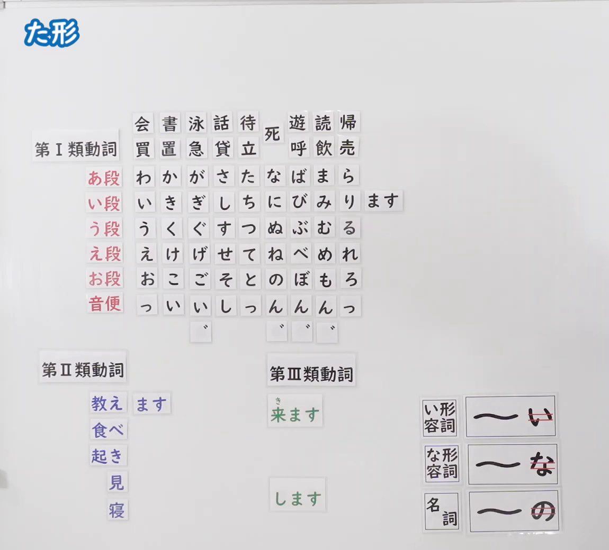
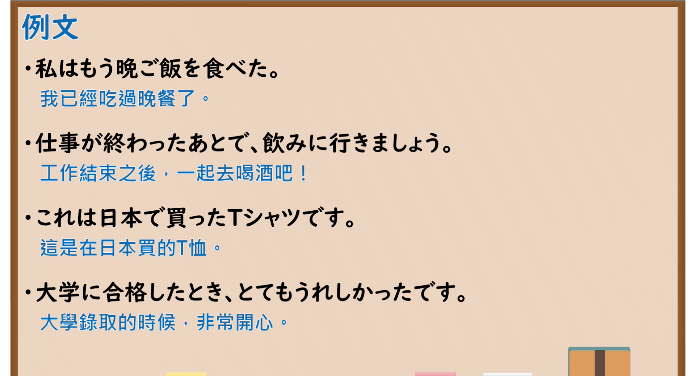

---
{
  "id": "N5-G-0072",
  "kind": "grammar",
  "level": "N5",
  "title": "た形",
  "card_revision": 2,
  "schema_version": 1,
  "source": {
    "lesson": "N5 第72个语法",
    "material": "出口日語原视频板书（学习者截取的接续图与例句图）与东京外国语大学「普通形の体系」「形容詞の普通形」「名詞述語の普通形」解说正文",
    "video": "https://www.youtube.com/watch?v=0SSUlNir4X8",
    "screenshot": "assets/grammar/n5/N5-G-0072-connection.png",
    "screenshot_crop": {
      "x": 0,
      "y": 0,
      "width": 1150,
      "height": 1040
    }
  },
  "tags": [
    "た形",
    "动词活用",
    "过去",
    "N5"
  ],
  "confusions": [
    "た形／て形",
    "音便（った・んだ・いた・した）",
    "行く的た形（行った）",
    "い形容词・な形容词・名词的过去形"
  ]
}
---

# N5 第72个语法：た形

# 视频学习资料整理

- 课程：[出口日語「た形」](https://www.youtube.com/watch?v=0SSUlNir4X8)
- 视频 ID：`0SSUlNir4X8`
- 视频时长：11分4秒

## 接续图

- 实际时间：未记录（图片由学习者从原视频截取并提供）
- 成品图尺寸：1150×1040，固定左上角 `(0, 0)`，右下角 `(1150, 1040)`
- 板书内容：标题「た形」，无接续公式；板书为与「ます形」相同的磁贴图（第Ⅰ類動詞五十音行表及「音便」行：っ・い・い・し・っ・ん・ん・ん・っ，以及浊点标记；第Ⅱ類動詞「教え・食べ・起き・見・寝」；第Ⅲ類動詞「来ます」「します」），い段行右侧摆出「ます」磁贴；右下角词类磁贴同「ない形」：「い形容詞：〜い（「い」红线划去）」「な形容詞：〜な（「な」红线划去）」「名詞：〜の（「の」红线划去）」。板书完整，无遮挡。

## 例句图

- 实际时间：未记录（图片由学习者从原视频截取并提供）
- 成品图尺寸：1900×1040，固定左上角 `(0, 0)`，右下角 `(1900, 1040)`
- 板书内容：课程「例文」页，含四条例句及中文翻译（私はもう晩ご飯を食べた／仕事が終わったあとで、飲みに行きましょう／これは日本で買ったTシャツです／大学に合格したとき、とてもうれしかったです）。四条例句均完整可见。

# 核心

## 功能一：做了～（た形：普通形的过去肯定）

**くわしい意味記述：**

- **た形の作り方：** グループ１は、辞書形の最後のuを含む音節を「っ」「ん」「い」「し」に変化させ、そこに「た」をつけます。「〇う・〇つ・〇る→〇った」「〇ぬ・〇ぶ・〇む→〇んだ」「〇く→〇いた」「〇ぐ→〇いだ」「〇す→〇した」。「行く」は「いった」になります。グループ２は「〇る→〇た」、グループ３は「する→した」「くる→きた」です。（第1类：「〇う・〇つ・〇る→〇った」「〇ぬ・〇ぶ・〇む→〇んだ」「〇く→〇いた」「〇ぐ→〇いだ」「〇す→〇した」；「行く」例外，作「いった」。第2类：「〇る→〇た」。第3类：「する→した」「くる→きた」。）
- **い形容詞・な形容詞・名詞：** イ形容詞の過去は「あつかった」、ナ形容詞は「きれいだった」、名詞は「大学生だった」です。（い形容词的过去为「あつかった」，な形容词为「きれいだった」，名词为「大学生だった」。）

### 例句

1. かう → かった

   （买 → 买了）

2. よむ → よんだ

   （读 → 读了）

3. かく → かいた

   （写 → 写了）

4. たべる → たべた

   （吃 → 吃了）

5. する → した／くる → きた

   （做 → 做了／来 → 来了）

# 来源

- [出口日語原视频](https://www.youtube.com/watch?v=0SSUlNir4X8)
- 东京外国语大学「日本語 文法」解说：[「普通形の体系」](https://www.coelang.tufs.ac.jp/mt/ja/gmod/contents/explanation/038.html)、[「形容詞の普通形」](https://www.coelang.tufs.ac.jp/mt/ja/gmod/contents/explanation/040.html)、[「名詞述語の普通形」](https://www.coelang.tufs.ac.jp/mt/ja/gmod/contents/explanation/041.html)（查询日期：2026-10-16；Hagoromo、毎日のんびり日本語教師、日本語NET 均未找到直接对应条目，按流程采用互联网检索所得的三页；这三页只有活用表，没有完整例句，卡内「例句」是页中活用表的词例转写为假名，不是完整句子；词例译文为整理者所译）
