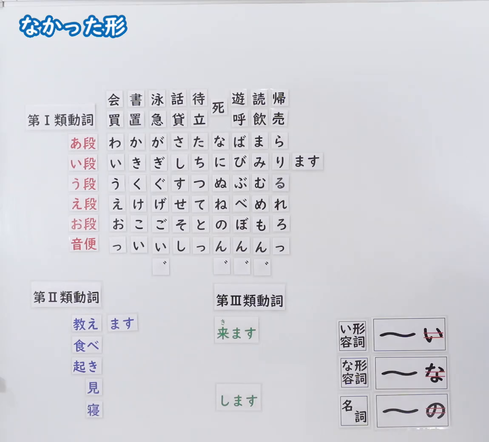
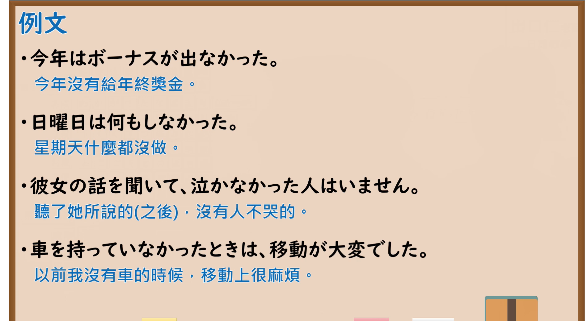

---
{
  "id": "N5-G-0073",
  "kind": "grammar",
  "level": "N5",
  "title": "なかった形",
  "card_revision": 2,
  "schema_version": 1,
  "source": {
    "lesson": "N5 第73个语法",
    "material": "出口日語原视频板书（学习者截取的接续图与例句图）与东京外国语大学「普通形の体系」「形容詞の普通形」「名詞述語の普通形」解说正文",
    "video": "https://www.youtube.com/watch?v=i8796RPeBtQ",
    "screenshot": "assets/grammar/n5/N5-G-0073-connection.png",
    "screenshot_crop": {
      "x": 0,
      "y": 0,
      "width": 1150,
      "height": 1040
    }
  },
  "tags": [
    "なかった形",
    "动词活用",
    "过去否定",
    "N5"
  ],
  "confusions": [
    "なかった形／ませんでした",
    "ない形／なかった形",
    "い形容词・な形容词・名词的过去否定",
    "〜ではなかった／〜じゃなかった"
  ]
}
---

# N5 第73个语法：なかった形

# 视频学习资料整理

- 课程：[出口日語「なかった形」](https://www.youtube.com/watch?v=i8796RPeBtQ)
- 视频 ID：`i8796RPeBtQ`
- 视频时长：9分23秒

## 接续图

- 实际时间：未记录（图片由学习者从原视频截取并提供）
- 成品图尺寸：1150×1040，固定左上角 `(0, 0)`，右下角 `(1150, 1040)`
- 板书内容：标题「なかった形」，无接续公式；板书为与「ます形」相同的磁贴图（第Ⅰ類動詞五十音行表、「音便」行，以及第Ⅱ類・第Ⅲ類动词磁贴），い段行右侧摆出「ます」磁贴；右下角词类磁贴同「ない形」：「い形容詞：〜い（「い」红线划去）」「な形容詞：〜な（「な」红线划去）」「名詞：〜の（「の」红线划去）」。板书完整，无遮挡。

## 例句图

- 实际时间：未记录（图片由学习者从原视频截取并提供）
- 成品图尺寸：1900×1040，固定左上角 `(0, 0)`，右下角 `(1900, 1040)`
- 板书内容：课程「例文」页，含四条例句及中文翻译（今年はボーナスが出なかった／日曜日は何もしなかった／彼女の話を聞いて、泣かなかった人はいません／車を持っていなかったときは、移動が大変でした）。四条例句均完整可见。

# 核心

## 功能一：没～（なかった形：普通形的过去否定）

**くわしい意味記述：**

- **なかった形の作り方：** ない形の「ない」を「なかった」に変えて作ります。イ形容詞は「あつくなかった」「おいしくなかった」、ナ形容詞は「きれいではなかった」「しずかではなかった」、名詞は「大学生ではなかった」「先生ではなかった」です。（把ない形的「ない」换成「なかった」构成。い形容词为「あつくなかった」「おいしくなかった」，な形容词为「きれいではなかった」「しずかではなかった」，名词为「大学生ではなかった」「先生ではなかった」。）

### 例句

1. あつい → あつくなかった

   （热 → 以前不热）

2. おいしい → おいしくなかった

   （好吃 → 以前不好吃）

3. きれい → きれいではなかった

   （漂亮／干净 → 以前不漂亮）

4. しずか → しずかではなかった

   （安静 → 以前不安静）

5. 大学生 → 大学生ではなかった

   （大学生 → 以前不是大学生）

# 来源

- [出口日語原视频](https://www.youtube.com/watch?v=i8796RPeBtQ)
- 东京外国语大学「日本語 文法」解说：[「形容詞の普通形」](https://www.coelang.tufs.ac.jp/mt/ja/gmod/contents/explanation/040.html)、[「名詞述語の普通形」](https://www.coelang.tufs.ac.jp/mt/ja/gmod/contents/explanation/041.html)（查询日期：2026-10-16；Hagoromo、毎日のんびり日本語教師、日本語NET 均未找到直接对应条目，按流程采用互联网检索所得的两页；这两页只有形容词、名词的活用表，没有动词「なかった形」的专门解说和完整例句，卡内「例句」是页中活用表的词例，不是完整句子；词例译文为整理者所译）
