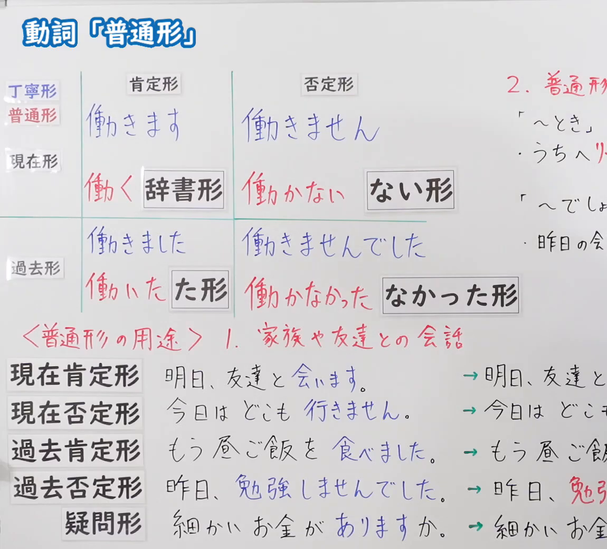
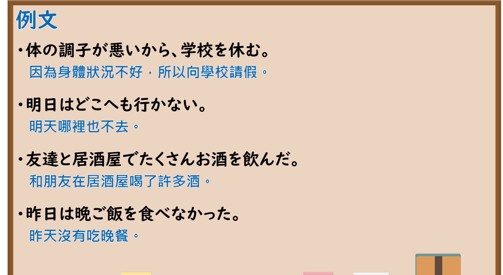

---
{
  "id": "N5-G-0074",
  "kind": "grammar",
  "level": "N5",
  "title": "动词「普通形」",
  "card_revision": 2,
  "schema_version": 1,
  "source": {
    "lesson": "N5 第74个语法",
    "material": "出口日語原视频板书（学习者截取的接续图与例句图）与东京外国语大学「普通形の体系」解说正文",
    "video": "https://www.youtube.com/watch?v=R5HI0jxURz0",
    "screenshot": "assets/grammar/n5/N5-G-0074-connection.png",
    "screenshot_crop": {
      "x": 0,
      "y": 0,
      "width": 1150,
      "height": 1040
    }
  },
  "tags": [
    "普通形",
    "动词",
    "丁宁形",
    "N5"
  ],
  "confusions": [
    "普通形／丁寧形",
    "辞書形・ない形・た形・なかった形",
    "ある的活用",
    "普通形的用途"
  ]
}
---

# N5 第74个语法：动词「普通形」

# 视频学习资料整理

- 课程：[出口日語「動詞「普通形」」](https://www.youtube.com/watch?v=R5HI0jxURz0)
- 视频 ID：`R5HI0jxURz0`
- 视频时长：10分11秒

## 接续图

- 实际时间：未记录（图片由学习者从原视频截取并提供）
- 成品图尺寸：1150×1040，固定左上角 `(0, 0)`，右下角 `(1150, 1040)`
- 板书内容：标题「動詞「普通形」」，无接续公式；板书为活用表：纵列「肯定形／否定形」，横行「丁寧形（蓝字）／普通形（红字）」与「現在形」「過去形」：現在形 丁寧形「働きます／働きません」，普通形「働く（辞書形）／働かない（ない形）」；過去形 丁寧形「働きました／働きませんでした」，普通形「働いた（た形）／働かなかった（なかった形）」。下方红字「＜普通形の用途＞1．家族や友達との会話」，左列标签「現在肯定形／現在否定形／過去肯定形／過去否定形／疑問形」，对应例句：「明日、友達と会います。→明日、友達と…」「今日はどこも行きません。→今日はどこも…」「もう昼ご飯を食べました。→もう昼ご飯を…」「昨日、勉強しませんでした。→昨日、勉強…」「細かいお金がありますか。→細かいお金が…」（丁宁形蓝字，箭头后为普通形改写，被画面右缘截断）；右上红字「2．普通形（…」下「「～とき」うちへ帰…」「「～でしょう」昨日の会…」，均被画面右缘截断，未补写。

## 例句图

- 实际时间：未记录（图片由学习者从原视频截取并提供）
- 成品图尺寸：1900×1040，固定左上角 `(0, 0)`，右下角 `(1900, 1040)`
- 板书内容：课程「例文」页，含四条例句及中文翻译（体の調子が悪いから、学校を休む／明日はどこへも行かない／友達と居酒屋でたくさんお酒を飲んだ／昨日は晩ご飯を食べなかった）。四条例句均完整可见。

# 核心

## 功能一：动词普通形（简体）的构成与用途

**くわしい意味記述：**

- **普通形：** 動詞は「Vます」「Vません」などの形（丁寧形）のほかに、「普通形」と呼ばれる形があります。普通形は、親しい友人間の会話や、小説や日記・論文・レポートなどで使います。普通形は文の部分としても使われます。（动词除了「Vます」「Vません」等形式（礼貌形）以外，还有称为「普通形」的形式。普通形用于关系亲近的朋友之间的会话，以及小说、日记、论文、报告等。普通形也用作句子的一部分。）
- **辞書形：** 一番左にある語形を辞書形と言います。辞書の見出しに使われる形であり、またさまざまな活用形を作るときの基本になります。（最左边的词形称为辞书形。是词典词条使用的形式，也是构成各种活用形的基础。）
- **活用形の名：** 辞書形、ます形、連用形（ます形から「ます」をとった形）、ない形（普通形非過去否定の形）、た形（普通形過去肯定の形）、て形（た形の「た」を「て」に変えた形）。（辞书形、ます形、连用形（去掉ます形的「ます」的形式）、ない形（普通形非过去否定形式）、た形（普通形过去肯定形式）、て形（把た形的「た」改成「て」的形式）。）

### 例句

1. かう → かわない／かった

   （买 → 不买／买了）

2. よむ → よまない／よんだ

   （读 → 不读／读了）

3. おきる → おきない／おきた

   （起床 → 不起床／起床了）

4. たべる → たべない／たべた

   （吃 → 不吃／吃了）

5. する → しない／した

   （做 → 不做／做了）

# 来源

- [出口日語原视频](https://www.youtube.com/watch?v=R5HI0jxURz0)
- [东京外国语大学「日本語 文法 普通形の体系：解説」](https://www.coelang.tufs.ac.jp/mt/ja/gmod/contents/explanation/038.html)（查询日期：2026-10-16；Hagoromo、毎日のんびり日本語教師、日本語NET 均未找到直接对应条目，按流程采用互联网检索所得的该页；该页只有活用表，没有完整例句，卡内「例句」是该页活用表的词例转写为假名，不是完整句子；该页没有板书里「普通形的用途」的例句，也没有「～とき」「～でしょう」的用法；词例译文为整理者所译）
