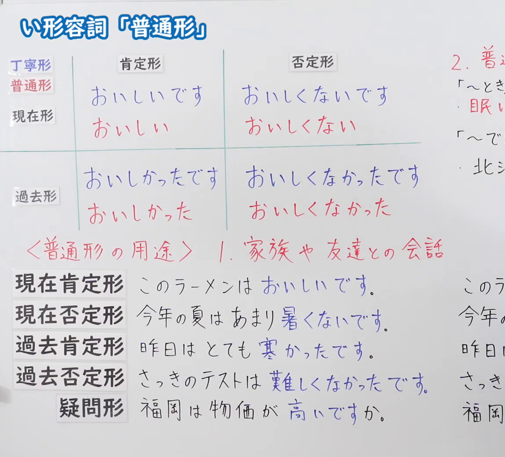
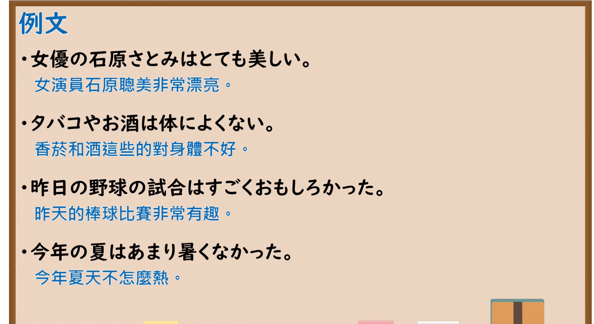

---
{
  "id": "N5-G-0075",
  "kind": "grammar",
  "level": "N5",
  "title": "い形容词「普通形」",
  "card_revision": 2,
  "schema_version": 1,
  "source": {
    "lesson": "N5 第75个语法",
    "material": "出口日語原视频板书（学习者截取的接续图与例句图）与东京外国语大学「形容詞の普通形」解说正文",
    "video": "https://www.youtube.com/watch?v=rKQWoxJvzrE",
    "screenshot": "assets/grammar/n5/N5-G-0075-connection.png",
    "screenshot_crop": {
      "x": 0,
      "y": 0,
      "width": 1150,
      "height": 1040
    }
  },
  "tags": [
    "普通形",
    "い形容词",
    "丁宁形",
    "N5"
  ],
  "confusions": [
    "いい→よくない",
    "丁寧形／普通形",
    "い形容词的过去形",
    "〜かったです／〜かった"
  ]
}
---

# N5 第75个语法：い形容词「普通形」

# 视频学习资料整理

- 课程：[出口日語「い形容詞「普通形」」](https://www.youtube.com/watch?v=rKQWoxJvzrE)
- 视频 ID：`rKQWoxJvzrE`
- 视频时长：8分2秒

## 接续图

- 实际时间：未记录（图片由学习者从原视频截取并提供）
- 成品图尺寸：1150×1040，固定左上角 `(0, 0)`，右下角 `(1150, 1040)`
- 板书内容：标题「い形容詞「普通形」」，无接续公式；板书为活用表：纵列「肯定形／否定形」，横行「丁寧形（蓝字）／普通形（红字）」与「現在形」「過去形」：現在形 丁寧形「おいしいです／おいしくないです」，普通形「おいしい／おいしくない」；過去形 丁寧形「おいしかったです／おいしくなかったです」，普通形「おいしかった／おいしくなかった」。下方红字「＜普通形の用途＞1．家族や友達との会話」，对应例句：「このラーメンはおいしいです。」「今年の夏はあまり暑くないです。」「昨日はとても寒かったです。」「さっきのテストは難しくなかったです。」「福岡は物価が高いですか。」（丁宁形蓝字，右侧改写为普通形的部分被画面右缘截断）；右上红字「2．普通形（…」下「「～とき」眠い…」「「～でしょう」北…」，被截断，未补写。

## 例句图

- 实际时间：未记录（图片由学习者从原视频截取并提供）
- 成品图尺寸：1900×1040，固定左上角 `(0, 0)`，右下角 `(1900, 1040)`
- 板书内容：课程「例文」页，含四条例句及中文翻译（女優の石原さとみはとても美しい／タバコやお酒は体によくない／昨日の野球の試合はすごくおもしろかった／今年の夏はあまり暑くなかった）。四条例句均完整可见。

# 核心

## 功能一：い形容词普通形（简体）的构成

**くわしい意味記述：**

- **普通形の活用：** イ形容詞の普通形は、非過去肯定「あつい」「おいしい」、非過去否定「あつくない」「おいしくない」、過去肯定「あつかった」「おいしかった」、過去否定「あつくなかった」「おいしくなかった」です。「いい」は「よくない」「よかった」「よくなかった」となります。（い形容词的普通形：非过去肯定「あつい」「おいしい」，非过去否定「あつくない」「おいしくない」，过去肯定「あつかった」「おいしかった」，过去否定「あつくなかった」「おいしくなかった」。「いい」变为「よくない」「よかった」「よくなかった」。）
- **使われる文型：** 普通形は「AいN」「Aいとおもいます」「Aいとき」「Aいでしょう」などに使われます。て形は「Aくて」、副詞用法の形は「AくVます」「Aくなります」に使われます。（普通形用于「AいN」「Aいとおもいます」「Aいとき」「Aいでしょう」等句型。て形用于「Aくて」，副词用法用于「AくVます」「Aくなります」。）

### 例句

1. あつい／あつくない／あつかった／あつくなかった

   （热／不热／热过／以前不热）

2. おいしい／おいしくない／おいしかった／おいしくなかった

   （好吃／不好吃／好吃过／以前不好吃）

3. いたい／いたくない／いたかった／いたくなかった

   （疼／不疼／疼过／以前不疼）

4. いい／よくない／よかった／よくなかった

   （好／不好／以前好／以前不好）

# 来源

- [出口日語原视频](https://www.youtube.com/watch?v=rKQWoxJvzrE)
- [东京外国语大学「日本語 文法 形容詞の普通形：解説」](https://www.coelang.tufs.ac.jp/mt/ja/gmod/contents/explanation/040.html)（查询日期：2026-10-16；Hagoromo、毎日のんびり日本語教師、日本語NET 均未找到直接对应条目，按流程采用互联网检索所得的该页；该页只有活用表，没有完整例句，卡内「例句」是该页活用表的词例，不是完整句子，且只有 4 条；词例译文为整理者所译）
