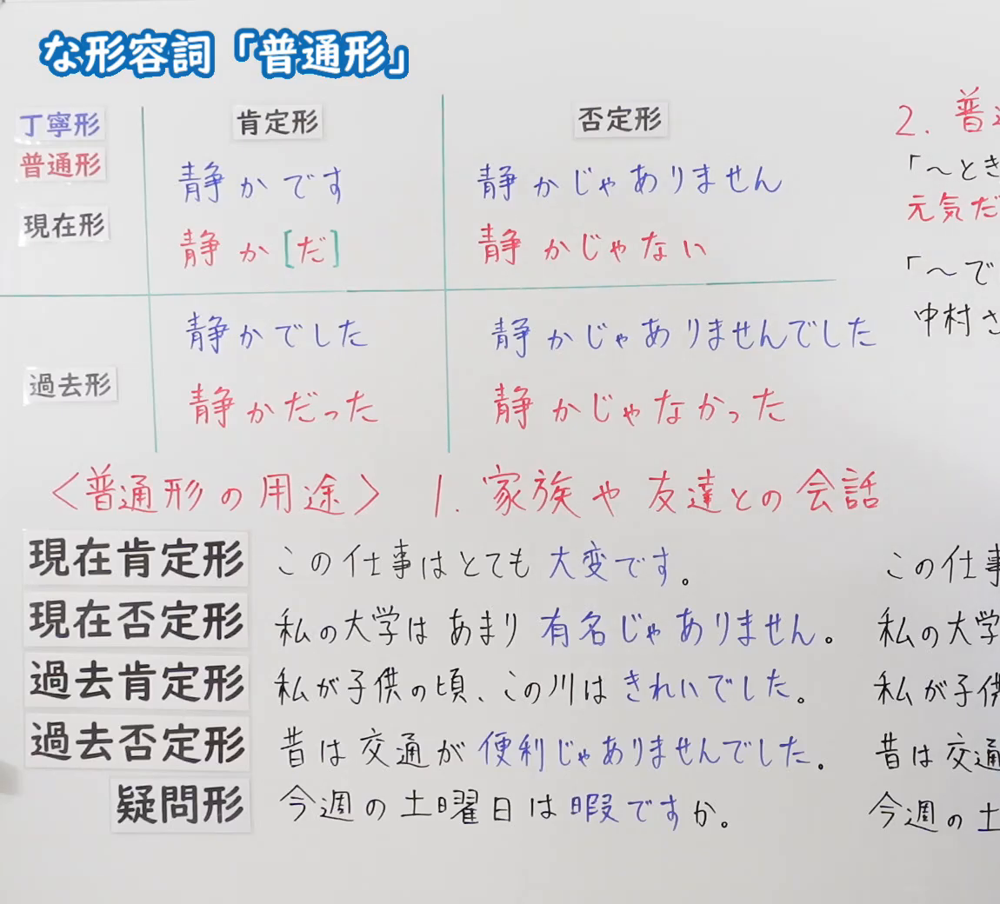
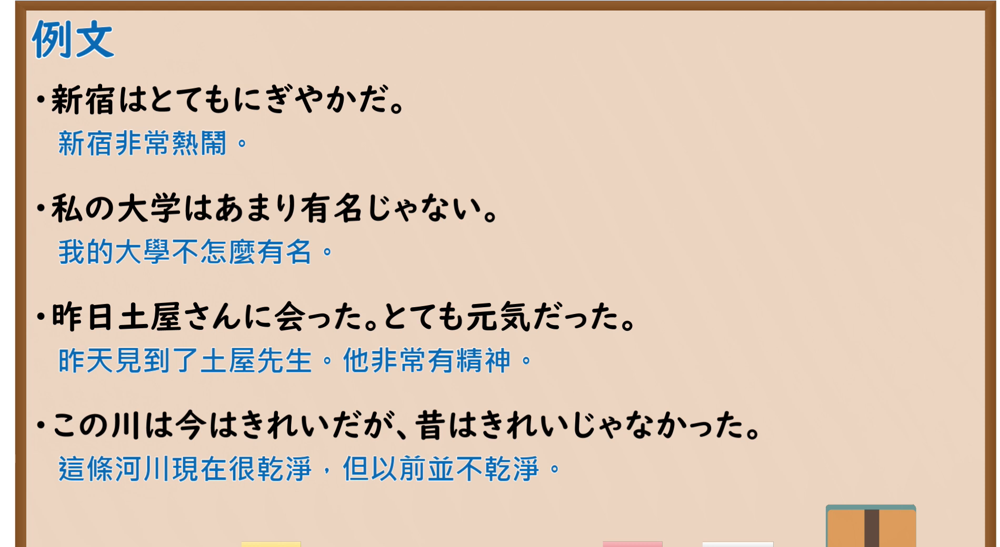

---
{
  "id": "N5-G-0076",
  "kind": "grammar",
  "level": "N5",
  "title": "な形容词「普通形」",
  "card_revision": 2,
  "schema_version": 1,
  "source": {
    "lesson": "N5 第76个语法",
    "material": "出口日語原视频板书（学习者截取的接续图与例句图）与东京外国语大学「形容詞の普通形」解说正文",
    "video": "https://www.youtube.com/watch?v=ckd01Su3YNY",
    "screenshot": "assets/grammar/n5/N5-G-0076-connection.png",
    "screenshot_crop": {
      "x": 0,
      "y": 0,
      "width": 1150,
      "height": 1040
    }
  },
  "tags": [
    "普通形",
    "な形容词",
    "丁宁形",
    "N5"
  ],
  "confusions": [
    "静かだ／静かな",
    "丁寧形／普通形",
    "〜ではない／〜じゃない",
    "な形容词・名词的区别"
  ]
}
---

# N5 第76个语法：な形容词「普通形」

# 视频学习资料整理

- 课程：[出口日語「な形容詞「普通形」」](https://www.youtube.com/watch?v=ckd01Su3YNY)
- 视频 ID：`ckd01Su3YNY`
- 视频时长：8分57秒

## 接续图

- 实际时间：未记录（图片由学习者从原视频截取并提供）
- 成品图尺寸：1150×1040，固定左上角 `(0, 0)`，右下角 `(1150, 1040)`
- 板书内容：标题「な形容詞「普通形」」，无接续公式；板书为活用表：纵列「肯定形／否定形」，横行「丁寧形（蓝字）／普通形（红字）」与「現在形」「過去形」：現在形 丁寧形「静かです／静かじゃありません」，普通形「静か［だ］／静かじゃない」；過去形 丁寧形「静かでした／静かじゃありませんでした」，普通形「静かだった／静かじゃなかった」。下方红字「＜普通形の用途＞1．家族や友達との会話」，对应例句：「この仕事はとても大変です。」「私の大学はあまり有名じゃありません。」「私が子供の頃、この川はきれいでした。」「昔は交通が便利じゃありませんでした。」「今週の土曜日は暇ですか。」（丁宁形蓝字，右侧改写为普通形的部分被画面右缘截断）；右上红字「2．普…」下「「～とき」元気だ…」「「～でしょ…」中村さ…」，被截断，未补写。

## 例句图

- 实际时间：未记录（图片由学习者从原视频截取并提供）
- 成品图尺寸：1900×1040，固定左上角 `(0, 0)`，右下角 `(1900, 1040)`
- 板书内容：课程「例文」页，含四条例句及中文翻译（新宿はとてもにぎやかだ／私の大学はあまり有名じゃない／昨日土屋さんに会った。とても元気だった／この川は今はきれいだが、昔はきれいじゃなかった）。四条例句均完整可见。

# 核心

## 功能一：な形容词普通形（简体）的构成

**くわしい意味記述：**

- **普通形の活用：** ナ形容詞の普通形は、非過去肯定「すきだ」「きれいだ」、非過去否定「すきではない」「きれいではない」、過去肯定「すきだった」「きれいだった」、過去否定「すきではなかった」「きれいではなかった」です。名詞を修飾するときの非過去肯定形は「すきな」「きれいな」を使います。（な形容词的普通形：非过去肯定「すきだ」「きれいだ」，非过去否定「すきではない」「きれいではない」，过去肯定「すきだった」「きれいだった」，过去否定「すきではなかった」「きれいではなかった」。修饰名词时的非过去肯定形使用「すきな」「きれいな」。）
- **て形・副詞用法：** て形は「すきで」「きれいで」、副詞用法の形は「すきに」「きれいに」です。（て形为「すきで」「きれいで」，副词用法为「すきに」「きれいに」。）

### 例句

1. きれい／きれいだ／きれいではない

   （漂亮／漂亮（普通形）／不漂亮）

2. きれいだった／きれいではなかった

   （以前漂亮／以前不漂亮）

3. しずか／しずかだ／しずかではない

   （安静／安静（普通形）／不安静）

4. べんり／べんりだ／べんりではない

   （方便／方便（普通形）／不方便）

5. べんりだった／べんりではなかった

   （以前方便／以前不方便）

# 来源

- [出口日語原视频](https://www.youtube.com/watch?v=ckd01Su3YNY)
- [东京外国语大学「日本語 文法 形容詞の普通形：解説」](https://www.coelang.tufs.ac.jp/mt/ja/gmod/contents/explanation/040.html)（查询日期：2026-10-16；Hagoromo、毎日のんびり日本語教師、日本語NET 均未找到直接对应条目，按流程采用互联网检索所得的该页；该页只有活用表，没有完整例句，卡内「例句」是该页活用表的词例，不是完整句子；词例译文为整理者所译；该页的否定形写作「〜ではない」，板书写作「〜じゃない」，卡内保留页面原文）
