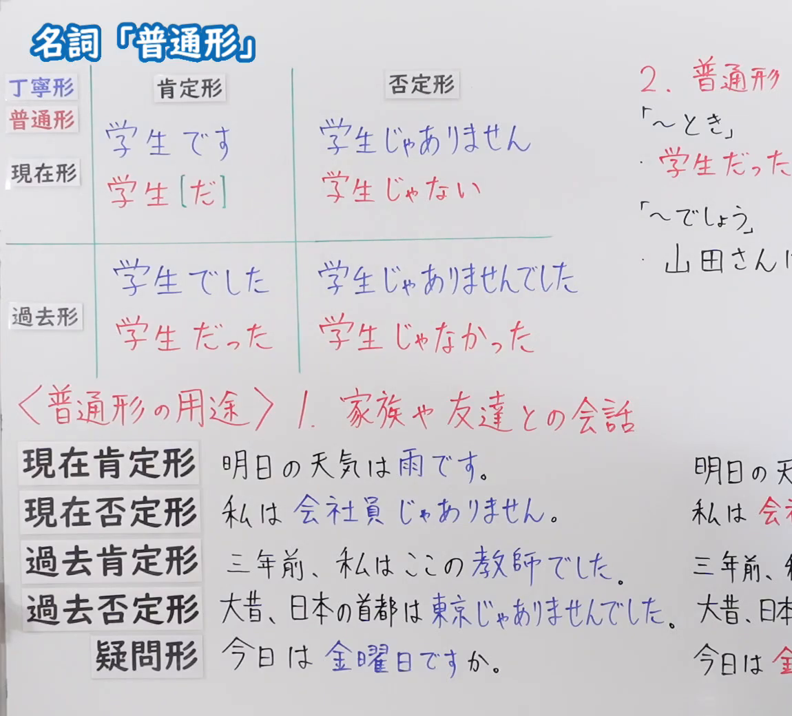
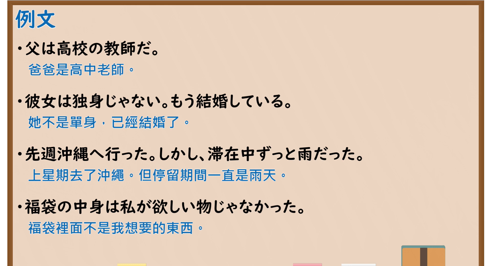

---
{
  "id": "N5-G-0077",
  "kind": "grammar",
  "level": "N5",
  "title": "名词「普通形」",
  "card_revision": 2,
  "schema_version": 1,
  "source": {
    "lesson": "N5 第77个语法",
    "material": "出口日語原视频板书（学习者截取的接续图与例句图）与东京外国语大学「名詞述語の普通形」解说正文",
    "video": "https://www.youtube.com/watch?v=dlqTPC91x1E",
    "screenshot": "assets/grammar/n5/N5-G-0077-connection.png",
    "screenshot_crop": {
      "x": 0,
      "y": 0,
      "width": 1150,
      "height": 1040
    }
  },
  "tags": [
    "普通形",
    "名词",
    "丁宁形",
    "N5"
  ],
  "confusions": [
    "学生だ／学生の",
    "丁寧形／普通形",
    "名词／な形容词的区别",
    "〜ではない／〜じゃない"
  ]
}
---

# N5 第77个语法：名词「普通形」

# 视频学习资料整理

- 课程：[出口日語「名詞「普通形」」](https://www.youtube.com/watch?v=dlqTPC91x1E)
- 视频 ID：`dlqTPC91x1E`
- 视频时长：10分36秒

## 接续图

- 实际时间：未记录（图片由学习者从原视频截取并提供）
- 成品图尺寸：1150×1040，固定左上角 `(0, 0)`，右下角 `(1150, 1040)`
- 板书内容：标题「名詞「普通形」」，无接续公式；板书为活用表：纵列「肯定形／否定形」，横行「丁寧形（蓝字）／普通形（红字）」与「現在形」「過去形」：現在形 丁寧形「学生です／学生じゃありません」，普通形「学生［だ］／学生じゃない」；過去形 丁寧形「学生でした／学生じゃありませんでした」，普通形「学生だった／学生じゃなかった」。下方红字「＜普通形の用途＞1．家族や友達との会話」，对应例句：「明日の天気は雨です。」「私は会社員じゃありません。」「三年前、私はここの教師でした。」「大昔、日本の首都は東京じゃありませんでした。」「今日は金曜日ですか。」（丁宁形蓝字，右侧改写为普通形的部分被画面右缘截断）；右上红字「2．普通形」下「「～とき」学生だった…」「「～でしょう」山田さんに…」，被截断，未补写。

## 例句图

- 实际时间：未记录（图片由学习者从原视频截取并提供）
- 成品图尺寸：1900×1040，固定左上角 `(0, 0)`，右下角 `(1900, 1040)`
- 板书内容：课程「例文」页，含四条例句及中文翻译（父は高校の教師だ／彼女は独身じゃない。もう結婚している／先週沖縄へ行った。しかし、滞在中ずっと雨だった／福袋の中身は私が欲しい物じゃなかった）。四条例句均完整可见。

# 核心

## 功能一：名词普通形（简体）的构成

**くわしい意味記述：**

- **普通形の例：** 名詞の普通形は、非過去肯定「大学生だ」、非過去否定「大学生ではない」、過去肯定「大学生だった」、過去否定「大学生ではなかった」です。（名词的普通形：非过去肯定「大学生だ」，非过去否定「大学生ではない」，过去肯定「大学生だった」，过去否定「大学生ではなかった」。）
- **ナ形容詞との区別：** 名詞はナ形容詞とよく似ているので注意しましょう。名詞を修飾するときに「～の」の形を取るものが名詞、「～な」の形を取るものがナ形容詞です。名詞：病気だ→○病気の人、×病気な人。ナ形容詞：元気だ→×元気の人、○元気な人。（名词与な形容词很相似，需要注意。修饰名词时取「～の」形的是名词，取「～な」形的是な形容词。名词：病気だ→○病気の人、×病気な人。な形容词：元気だ→×元気の人、○元気な人。）

### 例句

1. 大学生だ／大学生ではない

   （是大学生／不是大学生）

2. 先生だった／先生ではなかった

   （以前是老师／以前不是老师）

3. 公園だ／公園ではない

   （是公园／不是公园）

4. 病気だ／病気の人

   （生病／生病的人）

5. 元気だ／元気な人

   （精神好／精神好的人）

# 来源

- [出口日語原视频](https://www.youtube.com/watch?v=dlqTPC91x1E)
- [东京外国语大学「日本語 文法 名詞述語の普通形：解説」](https://www.coelang.tufs.ac.jp/mt/ja/gmod/contents/explanation/041.html)（查询日期：2026-10-16；Hagoromo、毎日のんびり日本語教師、日本語NET 均未找到直接对应条目，按流程采用互联网检索所得的该页；该页只有活用表和两组词例，没有完整例句，卡内「例句」是该页的词例，不是完整句子；词例译文为整理者所译；该页的否定形写作「〜ではない」，板书写作「〜じゃない」，卡内保留页面原文）
