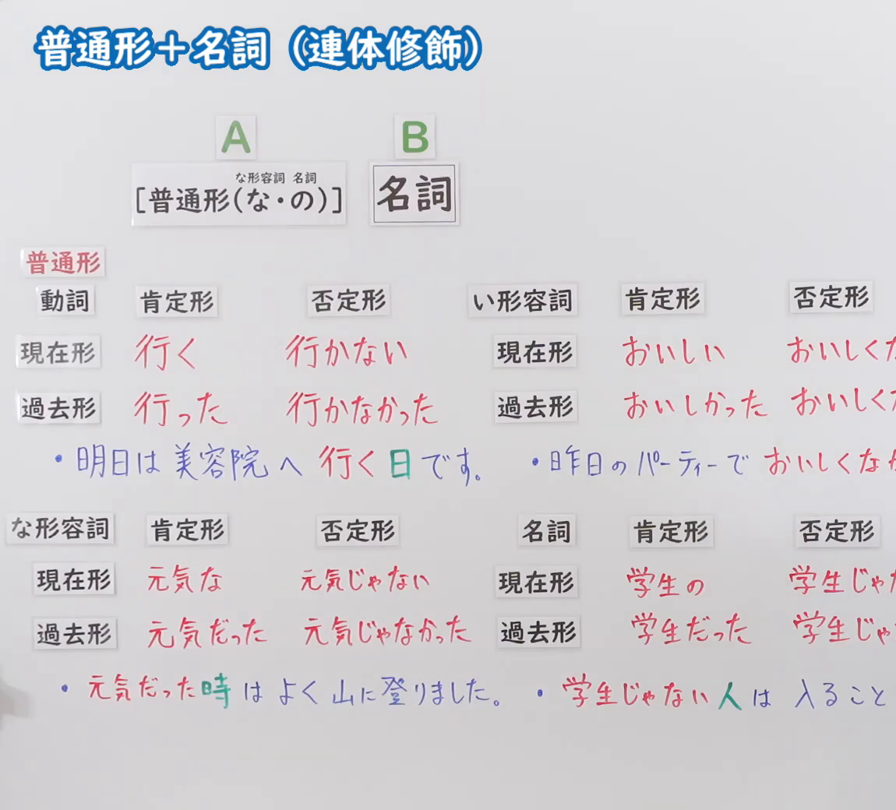
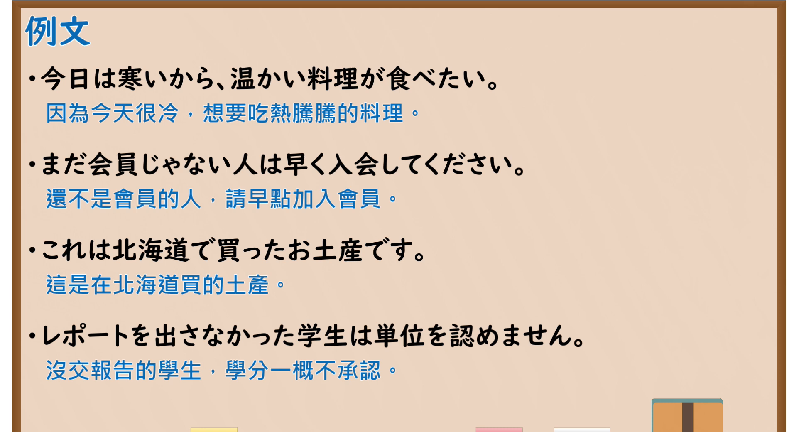

---
{
  "id": "N5-G-0078",
  "kind": "grammar",
  "level": "N5",
  "title": "普通形＋名词（连体修饰）",
  "card_revision": 2,
  "schema_version": 1,
  "source": {
    "lesson": "N5 第78个语法",
    "material": "出口日語原视频板书（学习者截取的接续图与例句图）与日本語教師の広場「連体修飾（名詞修飾）・その１」正文",
    "video": "https://www.youtube.com/watch?v=fuNoYEBG-Bw",
    "screenshot": "assets/grammar/n5/N5-G-0078-connection.png",
    "screenshot_crop": {
      "x": 0,
      "y": 0,
      "width": 1150,
      "height": 1040
    }
  },
  "tags": [
    "连体修饰",
    "名词修饰",
    "普通形",
    "N5"
  ],
  "confusions": [
    "普通形＋名词",
    "な形容词＋な／名词＋の",
    "い形容词＋名词",
    "动词修饰名词"
  ]
}
---

# N5 第78个语法：普通形＋名词（连体修饰）

# 视频学习资料整理

- 课程：[出口日語「普通形＋名詞（連体修飾）」](https://www.youtube.com/watch?v=fuNoYEBG-Bw)
- 视频 ID：`fuNoYEBG-Bw`
- 视频时长：9分18秒

## 接续图

- 实际时间：未记录（图片由学习者从原视频截取并提供）
- 成品图尺寸：1150×1040，固定左上角 `(0, 0)`，右下角 `(1150, 1040)`
- 板书内容：标题「普通形＋名詞（連体修飾）」；公式「A：［普通形（な・の）］（な形容词接「な」，名词接「の」，字小标注在方括号上方）B：名詞」；活用表分四块：動詞（肯定形「行く」「行った」，否定形「行かない」「行かなかった」）、い形容詞（「おいしい」「おいしかった」，否定形「おいしくな…」被截断）、な形容詞（「元気な」「元気だった」，否定「元気じゃない」「元気じゃなかった」）、名詞（「学生の」「学生だった」，否定「学生じゃ…」被截断）；例句：「明日は美容院へ行く日です。」（「日」绿字）「昨日のパーティーでおいしくな…」「元気だった時はよく山に登りました。」（「時」绿字）「学生じゃない人は入ること…」（「人」绿字）。右侧多处被画面右缘截断，未补写。

## 例句图

- 实际时间：未记录（图片由学习者从原视频截取并提供）
- 成品图尺寸：1900×1040，固定左上角 `(0, 0)`，右下角 `(1900, 1040)`
- 板书内容：课程「例文」页，含四条例句及中文翻译（今日は寒いから、温かい料理が食べたい／まだ会員じゃない人は早く入会してください／これは北海道で買ったお土産です／レポートを出さなかった学生は単位を認めません）。四条例句均完整可见。

# 核心

## 功能一：用普通形修饰名词（连体修饰）

**くわしい意味記述：**

- **連体修飾（名詞修飾）：** 「日本語を教える仕事」のように、「日本語を教える」が「仕事」という名詞を修飾していることを、国文法では「連体修飾」、日本語文法では「名詞修飾」と言います。（像「日本語を教える仕事」这样，「日本語を教える」修饰名词「仕事」，在日本国语语法中称为「連体修飾」，在日语教学语法中称为「名詞修飾」。）
- **名詞修飾語と名詞修飾節：** 名詞修飾は（１）名詞修飾語（学生の自転車、あの人、白い花、きれいな花、太った人）と（２）名詞修飾節（コンビニで買ったコーヒー、王さんがくれたパン）に分けられます。（名词修饰分为（1）名词修饰语（学生の自転車、あの人、白い花、きれいな花、太った人）和（2）名词修饰节（コンビニで買ったコーヒー、王さんがくれたパン）。）

### 例句

1. 日本語を教える仕事

   （教日语的工作）

2. 学生の自転車

   （学生的自行车）

3. 白い花

   （白色的花）

4. きれいな花

   （漂亮的花）

5. コンビニで買ったコーヒー

   （在便利店买的咖啡）

# 来源

- [出口日語原视频](https://www.youtube.com/watch?v=fuNoYEBG-Bw)
- [日本語教師の広場「連体修飾（名詞修飾）・その１」](https://www.tomojuku.com/blog/modifier/)（查询日期：2026-10-16；Hagoromo、毎日のんびり日本語教師、日本語NET 均未找到直接对应条目，按流程采用互联网检索所得的该页；该页是教师向的术语说明，没有按“动词、い形容词、な形容词、名词的普通形各自修饰名词”整理的规则，也没有完整例句，卡内「例句」是该页的词组例，不是完整句子；词组译文为整理者所译）
