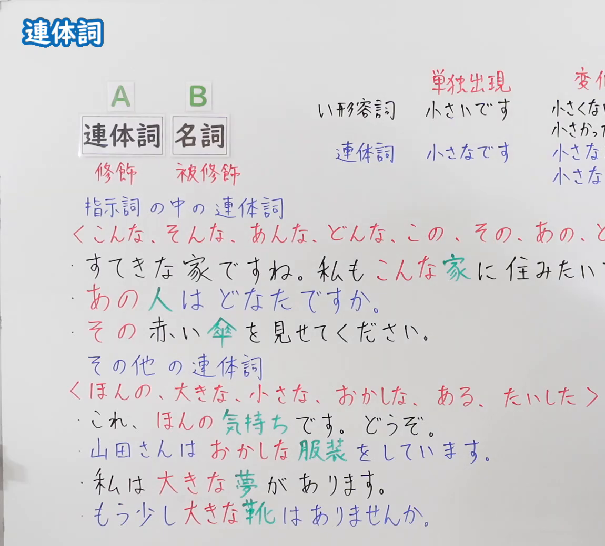
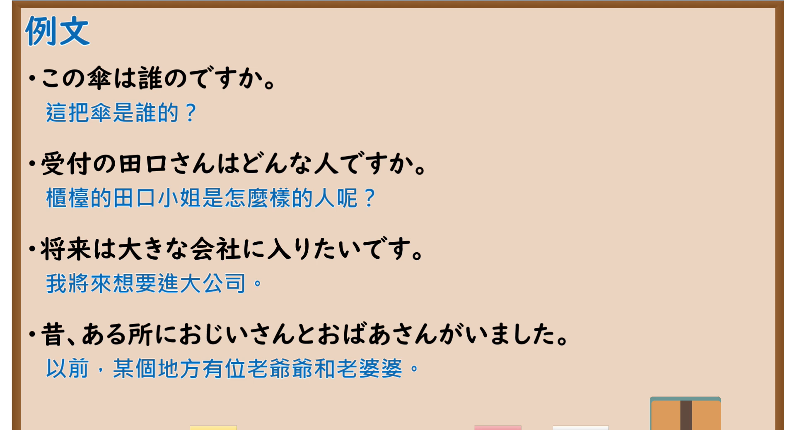

---
{
  "id": "N5-G-0079",
  "kind": "grammar",
  "level": "N5",
  "title": "连体词",
  "card_revision": 2,
  "schema_version": 1,
  "source": {
    "lesson": "N5 第79个语法",
    "material": "出口日語原视频板书（学习者截取的接续图与例句图）与wordrabbit「連体詞とは」正文",
    "video": "https://www.youtube.com/watch?v=Tg7rIpkBiPA",
    "screenshot": "assets/grammar/n5/N5-G-0079-connection.png",
    "screenshot_crop": {
      "x": 0,
      "y": 0,
      "width": 1150,
      "height": 1040
    }
  },
  "tags": [
    "连体词",
    "名词修饰",
    "指示词",
    "N5"
  ],
  "confusions": [
    "大きな／大きい",
    "この／その／あの",
    "連体詞／形容動詞",
    "ある／ほんの"
  ]
}
---

# N5 第79个语法：连体词

# 视频学习资料整理

- 课程：[出口日語「連体詞」](https://www.youtube.com/watch?v=Tg7rIpkBiPA)
- 视频 ID：`Tg7rIpkBiPA`
- 视频时长：13分16秒

## 接续图

- 实际时间：未记录（图片由学习者从原视频截取并提供）
- 成品图尺寸：1150×1040，固定左上角 `(0, 0)`，右下角 `(1150, 1040)`
- 板书内容：标题「連体詞」；公式「A：連体詞（红字「修飾」）B：名詞（红字「被修飾」）」；右上红字表头「単独出現」「変化…」，对比「い形容詞：小さいです／小さくな…／小さかっ…」与「連体詞：小さなです（划掉）／小さな／小さな…」；红字「指示詞の中の連体詞」「〈こんな、そんな、あんな、どんな、この、その、あの、ど…〉」下：「すてきな家ですね。私もこんな家に住みたい」（「こんな」红字，「家」绿字）「あの人はどなたですか。」「その赤い傘を見せてください。」；红字「その他の連体詞」「〈ほんの、大きな、小さな、おかしな、ある、たいした〉」下：「これ、ほんの気持ちです。どうぞ。」「山田さんはおかしな服装をしています。」「私は大きな夢があります。」「もう少し大きな靴はありませんか。」。右侧多处被画面右缘截断，未补写。

## 例句图

- 实际时间：未记录（图片由学习者从原视频截取并提供）
- 成品图尺寸：1900×1040，固定左上角 `(0, 0)`，右下角 `(1900, 1040)`
- 板书内容：课程「例文」页，含四条例句及中文翻译（この傘は誰のですか／受付の田口さんはどんな人ですか／将来は大きな会社に入りたいです／昔、ある所におじいさんとおばあさんがいました）。四条例句均完整可见。

# 核心

## 功能一：连体词（只能修饰名词、没有活用的词）

**くわしい意味記述：**

- **連体詞とは：** 連体詞は、体言（名詞）を修飾して意味をくわしく説明する語です。自立語で活用がなく、主に連体修飾語になります。（连体词是修饰体言（名词）、详细说明其意义的词。是自立词，没有活用，主要作连体修饰语。）
- **連体詞の種類：** 「〜の」型：この、その、あの、どの。「〜が」型：わが。「〜な」型：大きな、小さな、おかしな、いろんな。「〜た（だ）」型：たいした、とんだ。「〜る」型：ある、あらゆる、いわゆる、きたる。（「〜の」型：この、その、あの、どの。「〜が」型：わが。「〜な」型：大きな、小さな、おかしな、いろんな。「〜た（だ）」型：たいした、とんだ。「〜る」型：ある、あらゆる、いわゆる、きたる。）
- **形容動詞との違い：** 形容動詞は活用があるのに対して、連体詞は活用がありません。連体詞のあとには必ず名詞が続きます。（形容动词有活用，而连体词没有活用。连体词后面必须接名词。）

### 例句

1. この雑誌

   （这本杂志）

2. あらゆる角度から検証する

   （从各个角度验证）

3. 大きな古時計

   （大座钟）

4. わが国

   （我国）

5. たいした男だ

   （了不起的男人）

# 来源

- [出口日語原视频](https://www.youtube.com/watch?v=Tg7rIpkBiPA)
- [wordrabbit「連体詞とは」](https://wordrabbit.jp/grammar/pre-noun_adjectival)（查询日期：2026-10-16；Hagoromo、毎日のんびり日本語教師、日本語NET、东京外国语大学均未找到直接对应条目，按流程采用互联网检索所得的该页；该页的例句是词组而非完整句子，没有中文翻译，词组译文为整理者所译；板书中的「こんな／そんな／あんな／どんな」类指示词连体词该页只列到「この、その、あの、どの」）
