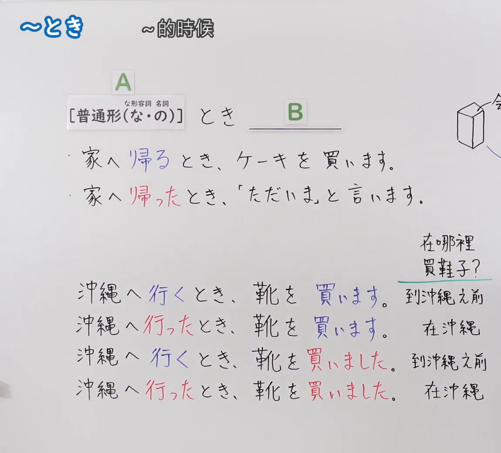
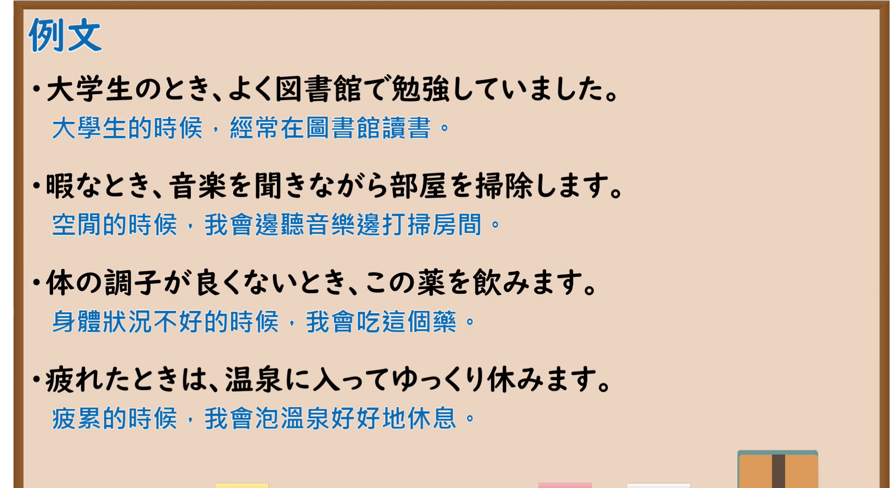

---
{
  "id": "N5-G-0080",
  "kind": "grammar",
  "level": "N5",
  "title": "～とき",
  "card_revision": 2,
  "schema_version": 1,
  "source": {
    "lesson": "N5 第80个语法",
    "material": "出口日語原视频板书（学习者截取的接续图与例句图）与日本語NET「【JLPT N5】文法・例文：〜とき」正文",
    "video": "https://www.youtube.com/watch?v=9MhRk-DsycA",
    "screenshot": "assets/grammar/n5/N5-G-0080-connection.png",
    "screenshot_crop": {
      "x": 0,
      "y": 0,
      "width": 1150,
      "height": 1040
    }
  },
  "tags": [
    "とき",
    "时间",
    "普通形",
    "N5"
  ],
  "confusions": [
    "辞書形／た形（とき）",
    "～とき／～ときに",
    "な形容词＋な／名词＋の",
    "～ときは／～ときも"
  ]
}
---

# N5 第80个语法：～とき

# 视频学习资料整理

- 课程：[出口日語「～とき」](https://www.youtube.com/watch?v=9MhRk-DsycA)
- 视频 ID：`9MhRk-DsycA`
- 视频时长：7分28秒

## 接续图

- 实际时间：未记录（图片由学习者从原视频截取并提供）
- 成品图尺寸：1150×1040，固定左上角 `(0, 0)`，右下角 `(1150, 1040)`
- 板书内容：标题「～とき」，右侧标注“～的時候”；公式「A：［普通形（な・の）］（な形容词接「な」，名词接「の」）とき B：＿＿」；例句：「家へ帰るとき、ケーキを買います。」（「帰る」蓝字）「家へ帰ったとき、「ただいま」と言います。」（「帰った」红字）；右上方有手绘长方体盒子及“会…”字样，被画面右缘截断；下方「在哪裡買鞋子？」（绿线下划）及四行对比：「沖縄へ行くとき、靴を買います。→到沖繩之前」「沖縄へ行ったとき、靴を買います。→在沖繩」「沖縄へ行くとき、靴を買いました。→到沖繩之前」「沖縄へ行ったとき、靴を買いました。→在沖繩」（「行く」蓝字，「行った」红字，「買います」蓝字，「買いました」红字）。板书完整，无遮挡。

## 例句图

- 实际时间：未记录（图片由学习者从原视频截取并提供）
- 成品图尺寸：1900×1040，固定左上角 `(0, 0)`，右下角 `(1900, 1040)`
- 板书内容：课程「例文」页，含四条例句及中文翻译（大学生のとき、よく図書館で勉強していました／暇なとき、音楽を聞きながら部屋を掃除します／体の調子が良くないとき、この薬を飲みます／疲れたときは、温泉に入ってゆっくり休みます）。四条例句均完整可见；第二句的画面中文翻译写作「空間的時候」（原画面用字，应为“空閒”），卡内按正确含义理解，不改动图片。

# 核心

## 功能一：～的时候

**くわしい意味記述：**

- **〜とき：** 「AときB」は、Bの状態、動作の時間をAで表す時に使われます。Aの動詞（V1）の時制は、主文の時制（V2）とは関係がありません。V1がV2より先に行われる場合、V1は過去形（タ形）になり、V1がV2より後に行われる場合は辞書形になります。（「AときB」用于用A表示B的状态、动作发生的时间。A的动词（V1）的时态与主句（V2）的时态无关。V1在V2之前进行时，V1用过去形（た形）；V1在V2之后进行时，用辞书形。）
- **接続：** V（普通形）＋とき、イAい＋とき、ナAな＋とき、Nの＋とき。（动词（普通形）＋とき、い形容词的い＋とき、な形容词的な＋とき、名词の＋とき。）

### 例句

1. ご飯を食べるとき、「いただきます」といいます。

   （吃饭时说「いただきます」。）

2. 寝るとき、私は電気を消しません。

   （睡觉时我不关灯。）

3. わからないときは、早く先生にききましょう。

   （不明白的时候，尽快问老师吧。）

4. 地震が起きたとき、まずは机の下に隠れましょう。

   （发生地震时，先躲到桌子下面。）

5. 若いとき、友達とよくカラオケに行きました。

   （年轻的时候，经常和朋友去唱卡拉OK。）

# 来源

- [出口日語原视频](https://www.youtube.com/watch?v=9MhRk-DsycA)
- [日本語NET「【JLPT N5】文法・例文：〜とき」](https://nihongokyoshi-net.com/2018/06/09/jlptn5-grammar-toki/)（查询日期：2026-10-16；Hagoromo 未收录，毎日のんびり日本語教師没有「とき」的 N5 条目，按优先级采用日本語NET 该条目；该页只有英文翻译，中文译文为整理者所译；板书的「沖縄へ行くとき／行ったとき」对比（到达前／到达后）与该页「V1とV2先后」的说明一致）
