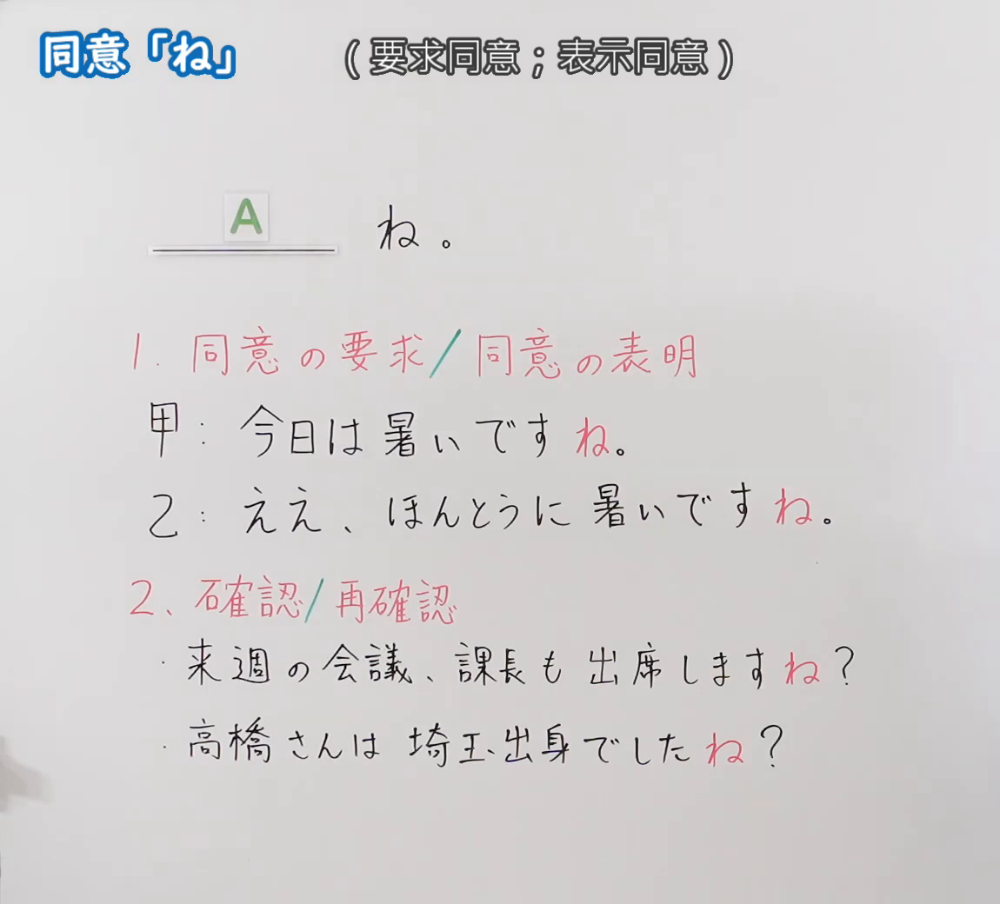
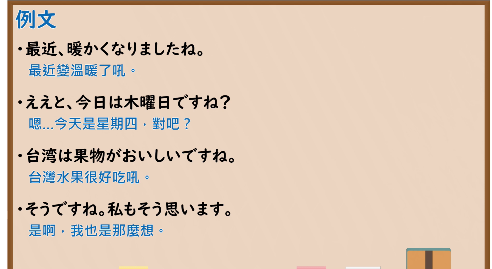

---
{
  "id": "N5-G-0081",
  "kind": "grammar",
  "level": "N5",
  "title": "助词：同意「ね」",
  "card_revision": 2,
  "schema_version": 1,
  "source": {
    "lesson": "N5 第81个语法",
    "material": "出口日語原视频板书（学习者截取的接续图与例句图）与东京外国语大学「終助詞：解説」正文",
    "video": "https://www.youtube.com/watch?v=e6sIQMLfj0w",
    "screenshot": "assets/grammar/n5/N5-G-0081-connection.png",
    "screenshot_crop": {
      "x": 0,
      "y": 0,
      "width": 1150,
      "height": 1040
    }
  },
  "tags": [
    "ね",
    "终助词",
    "同意",
    "确认",
    "N5"
  ],
  "confusions": [
    "ね／よ",
    "ね／よね",
    "同意／确认",
    "ね的语调"
  ]
}
---

# N5 第81个语法：助词「ね」（同意）

# 视频学习资料整理

- 课程：[出口日語「助詞：同意「ね」」](https://www.youtube.com/watch?v=e6sIQMLfj0w)
- 视频 ID：`e6sIQMLfj0w`
- 视频时长：5分25秒

## 接续图

- 实际时间：未记录（图片由学习者从原视频截取并提供）
- 成品图尺寸：1150×1040，固定左上角 `(0, 0)`，右下角 `(1150, 1040)`
- 板书内容：标题「同意「ね」」，右侧标注“（要求同意；表示同意）”；公式「A：＿＿ね。」；「1．同意の要求／同意の表明」：「甲：今日は暑いですね。」「乙：ええ、ほんとうに暑いですね。」（「ね」红字）；「2．確認／再確認」：「来週の会議、課長も出席しますね？」「高橋さんは埼玉出身でしたね？」（「ね」红字）。板书完整，无遮挡。

## 例句图

- 实际时间：未记录（图片由学习者从原视频截取并提供）
- 成品图尺寸：1900×1040，固定左上角 `(0, 0)`，右下角 `(1900, 1040)`
- 板书内容：课程「例文」页，含四条例句及中文翻译（最近、暖かくなりましたね／ええと、今日は木曜日ですね？／台湾は果物がおいしいですね／そうですね。私もそう思います）。四条例句均完整可见。

# 核心

## 功能一：要求同意；表示同意；确认

**くわしい意味記述：**

- **「ね（ねえ）」：** そのことがらを話し手の心の中で確認しなおしていることを表わします。また、聞き手に情報を確認したり、同意・共感を求めたりする場合にも用います。（表示说话人在心中重新确认该事项。也用于向听话人确认信息、寻求同意、共鸣。）

### 例句

1. （時間を聞かれて、時計を確かめながら）３時ですね。

   （（被问时间，一边看钟）3点了呢。）

2. わたしもそう思いますね。

   （我也这么觉得呢。）

3. あしたは日曜日ですね。

   （明天是星期日对吧。）

4. 暑いですね。

   （好热呢。）

# 来源

- [出口日語原视频](https://www.youtube.com/watch?v=e6sIQMLfj0w)
- [东京外国语大学「日本語 文法 終助詞：解説」「ね（ねえ）」](https://www.coelang.tufs.ac.jp/mt/ja/gmod/contents/explanation/096.html)（查询日期：2026-10-16；Hagoromo、毎日のんびり日本語教師、日本語NET 均未找到直接对应条目，按流程采用互联网检索所得的该页；该页该小节只有 4 条例句（达到下限），例句译文为整理者所译）
