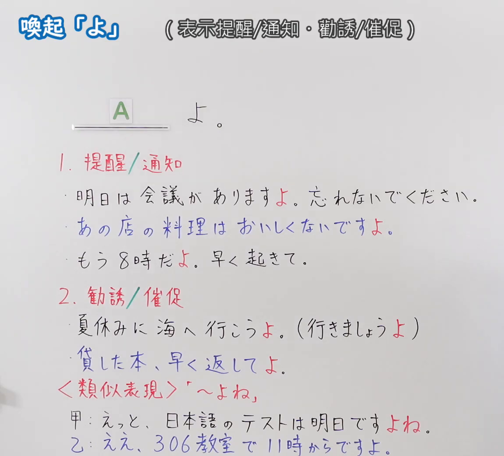
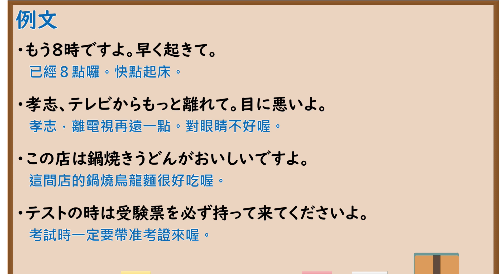

---
{
  "id": "N5-G-0082",
  "kind": "grammar",
  "level": "N5",
  "title": "助词：唤起「よ」",
  "card_revision": 2,
  "schema_version": 1,
  "source": {
    "lesson": "N5 第82个语法",
    "material": "出口日語原视频板书（学习者截取的接续图与例句图）与东京外国语大学「終助詞：解説」正文",
    "video": "https://www.youtube.com/watch?v=Bz9ARh7ataw",
    "screenshot": "assets/grammar/n5/N5-G-0082-connection.png",
    "screenshot_crop": {
      "x": 0,
      "y": 0,
      "width": 1150,
      "height": 1040
    }
  },
  "tags": [
    "よ",
    "终助词",
    "提醒",
    "劝诱",
    "N5"
  ],
  "confusions": [
    "よ／ね",
    "よね",
    "提醒／劝诱",
    "语气强弱"
  ]
}
---

# N5 第82个语法：助词「よ」（唤起）

# 视频学习资料整理

- 课程：[出口日語「助詞：喚起「よ」」](https://www.youtube.com/watch?v=Bz9ARh7ataw)
- 视频 ID：`Bz9ARh7ataw`
- 视频时长：6分1秒

## 接续图

- 实际时间：未记录（图片由学习者从原视频截取并提供）
- 成品图尺寸：1150×1040，固定左上角 `(0, 0)`，右下角 `(1150, 1040)`
- 板书内容：标题「喚起「よ」」，右侧标注“（表示提醒／通知・勸誘／催促）”；公式「A：＿＿よ。」；「1．提醒／通知」：「明日は会議がありますよ。忘れないでください。」「あの店の料理はおいしくないですよ。」「もう8時だよ。早く起きて。」；「2．勧誘／催促」：「夏休みに海へ行こうよ。（行きましょうよ）」「貸した本、早く返してよ。」；红字「＜類似表現＞「～よね」」：「甲：えっと、日本語のテストは明日ですよね。」「乙：ええ、306教室で11時からですよ。」（「よ」红字）。板书完整，无遮挡。

## 例句图

- 实际时间：未记录（图片由学习者从原视频截取并提供）
- 成品图尺寸：1900×1040，固定左上角 `(0, 0)`，右下角 `(1900, 1040)`
- 板书内容：课程「例文」页，含四条例句及中文翻译（もう8時ですよ。早く起きて／孝志、テレビからもっと離れて。目に悪いよ／この店は鍋焼きうどんがおいしいですよ／テストの時は受験票を必ず持って来てくださいよ）。四条例句均完整可见。

# 核心

## 功能一：提醒／通知；劝诱／催促

**くわしい意味記述：**

- **「よ」：** 聞き手の注意をうながしながら自分の発話内容を言い聞かせるという話し手の態度を表わします。（表示说话人一边促使听话人注意，一边把自己说的内容讲给对方听的态度。）
- **「よ」の印象：** 「よ」を使うと、「聞き手に言い聞かせる」という態度を表わすことから、しばしば「話し手のほうが立場が上、知識量が豊富」というニュアンスが出ます。（使用「よ」时，因为表示“对听话人讲给他听”的态度，常常带有“说话人地位更高、知识更丰富”的语气。）

### 例句

1. あしたは日曜日ですよ。

   （明天是星期日哦。）

2. 今行きますよ。

   （我现在就去哦。）

3. 早く行きましょうよ。

   （快点去吧。）

4. 早くやってくださいよ。

   （请快点做啊。）

# 来源

- [出口日語原视频](https://www.youtube.com/watch?v=Bz9ARh7ataw)
- [东京外国语大学「日本語 文法 終助詞：解説」「よ」](https://www.coelang.tufs.ac.jp/mt/ja/gmod/contents/explanation/096.html)（查询日期：2026-10-16；Hagoromo、毎日のんびり日本語教師、日本語NET 均未找到直接对应条目，按流程采用互联网检索所得的该页；该页该小节只有 4 条例句（达到下限），例句译文为整理者所译；板书中「～よね」的对比该页未解说）
