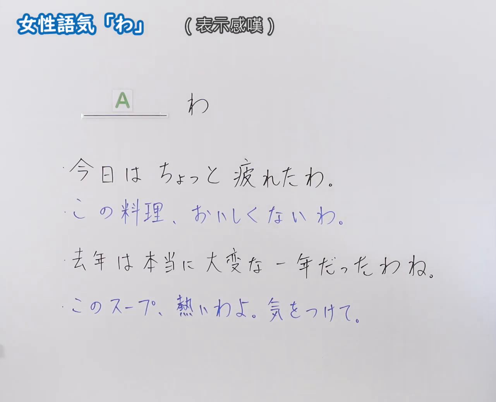
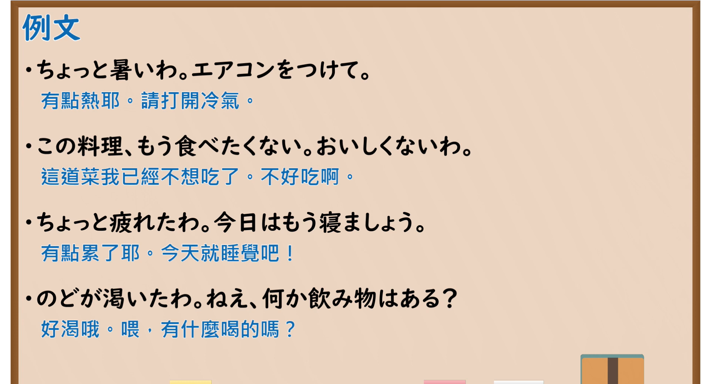

---
{
  "id": "N5-G-0083",
  "kind": "grammar",
  "level": "N5",
  "title": "助词：女性语气「わ」",
  "card_revision": 2,
  "schema_version": 1,
  "source": {
    "lesson": "N5 第83个语法",
    "material": "出口日語原视频板书（学习者截取的接续图与例句图）与おにぎり君の日本語教室「〜わ（終助詞）」正文",
    "video": "https://www.youtube.com/watch?v=ufIihSxC2Kc",
    "screenshot": "assets/grammar/n5/N5-G-0083-connection.png",
    "screenshot_crop": {
      "x": 0,
      "y": 0,
      "width": 1281,
      "height": 1040
    }
  },
  "tags": [
    "わ",
    "终助词",
    "女性语气",
    "感叹",
    "N5"
  ],
  "confusions": [
    "わ／よ／ね",
    "わよ／わね",
    "女性语气／男性也用",
    "感叹／确认"
  ]
}
---

# N5 第83个语法：助词「わ」（女性语气）

# 视频学习资料整理

- 课程：[出口日語「助詞：女性語気「わ」」](https://www.youtube.com/watch?v=ufIihSxC2Kc)
- 视频 ID：`ufIihSxC2Kc`
- 视频时长：5分24秒

## 接续图

- 实际时间：未记录（图片由学习者从原视频截取并提供）
- 成品图尺寸：1281×1040，固定左上角 `(0, 0)`，右下角 `(1281, 1040)`
- 板书内容：标题「女性語気「わ」」，右侧标注“（表示感嘆）”；公式「A：＿＿わ」；例句：「今日はちょっと疲れたわ。」「この料理、おいしくないわ。」（蓝字）「去年は本当に大変な一年だったわね。」「このスープ、熱いわよ。気をつけて。」（蓝字）。板书完整，无遮挡。

## 例句图

- 实际时间：未记录（图片由学习者从原视频截取并提供）
- 成品图尺寸：1900×1040，固定左上角 `(0, 0)`，右下角 `(1900, 1040)`
- 板书内容：课程「例文」页，含四条例句及中文翻译（ちょっと暑いわ。エアコンをつけて／この料理、もう食べたくない。おいしくないわ／ちょっと疲れたわ。今日はもう寝ましょう／のどが渇いたわ。ねえ、何か飲み物はある？）。四条例句均完整可见。

# 核心

## 功能一：表示感叹（女性语气）

**くわしい意味記述：**

- **〜わ：** 「〜わ」は、文末に置かれる終助詞で、主に女性が感情を込めて柔らかく述べるときに使います。話し手の感動や共感、確認を表すことができます。男性も使うことがありますが、一般的には女性の会話でよく使われます。（「〜わ」是置于句末的终助词，主要用于女性带着感情、柔和地叙述。可以表示说话人的感动、共鸣、确认。男性有时也使用，但一般多见于女性的会话。）

### 例句

1. このケーキ、美味しいわ。

   （这块蛋糕好好吃。）

2. お元気でいてくださいね、心配していますわ。

   （请保重身体，我很担心你。）

3. 今日は疲れたわ。早く寝よう。

   （今天累了。早点睡吧。）

4. 気をつけてね。ここは滑りやすいわよ。

   （要小心哦。这里容易滑。）

5. 簡単ではないわ。

   （不简单呢。）

# 来源

- [出口日語原视频](https://www.youtube.com/watch?v=ufIihSxC2Kc)
- [おにぎり君の日本語教室「〜わ（終助詞）」](https://aiueo.cc/pages_v2/ja/grammar/web/52.php)（查询日期：2026-10-16；Hagoromo、毎日のんびり日本語教師、日本語NET 均未找到直接对应条目，按流程采用互联网检索所得的该页；例句只有英文翻译，中文译文为整理者所译）
