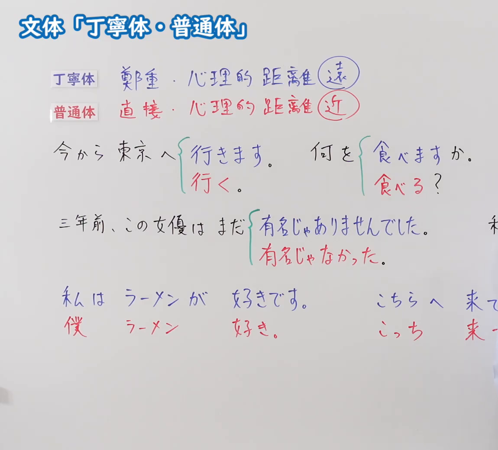
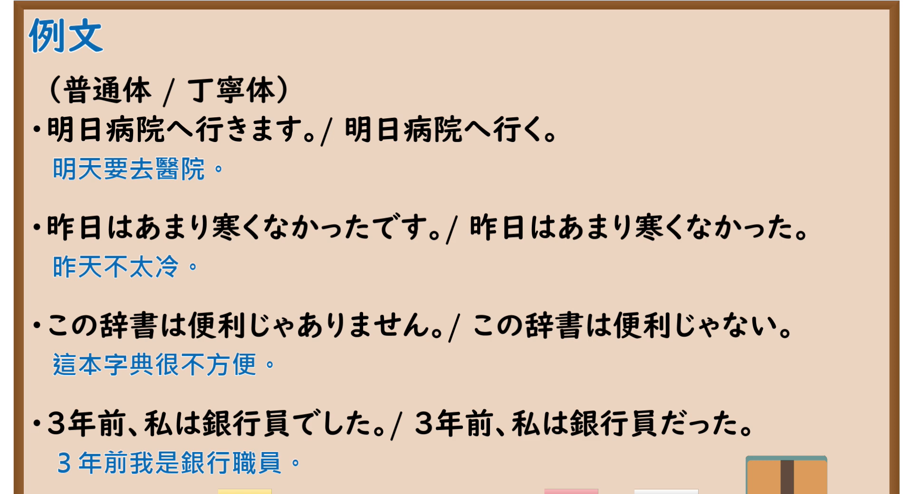

---
{
  "id": "N5-G-0084",
  "kind": "grammar",
  "level": "N5",
  "title": "文体「丁宁体・普通体」",
  "card_revision": 2,
  "schema_version": 1,
  "source": {
    "lesson": "N5 第84个语法",
    "material": "出口日語原视频板书（学习者截取的接续图与例句图）与东京外国语大学「スタイルとは：解説」正文",
    "video": "https://www.youtube.com/watch?v=u5YluISdV9s",
    "screenshot": "assets/grammar/n5/N5-G-0084-connection.png",
    "screenshot_crop": {
      "x": 0,
      "y": 0,
      "width": 1150,
      "height": 1040
    }
  },
  "tags": [
    "文体",
    "丁宁体",
    "普通体",
    "N5"
  ],
  "confusions": [
    "丁寧体／普通体",
    "だ／である",
    "心理的距离",
    "口语／书面语"
  ]
}
---

# N5 第84个语法：文体（丁宁体・普通体）

# 视频学习资料整理

- 课程：[出口日語「文体「丁寧体・普通体」」](https://www.youtube.com/watch?v=u5YluISdV9s)
- 视频 ID：`u5YluISdV9s`
- 视频时长：9分59秒

## 接续图

- 实际时间：未记录（图片由学习者从原视频截取并提供）
- 成品图尺寸：1150×1040，固定左上角 `(0, 0)`，右下角 `(1150, 1040)`
- 板书内容：标题「文体「丁寧体・普通体」」；两行说明：「丁寧体：鄭重・心理的距離（遠）」（蓝字，「遠」圈蓝）「普通体：直接・心理的距離（近）」（红字，「近」圈红）；对比例句（花括号并列）：「今から東京へ｛行きます。／行く。｝」「何を｛食べますか。／食べる？｝」「三年前、この女優はまだ｛有名じゃありませんでした。／有名じゃなかった。｝」；「私は ラーメンが 好きです。」对「僕 ラーメン 好き。」；「こちらへ来て…」对「こっち 来…」，右侧多处句末被画面右缘截断，未补写。

## 例句图

- 实际时间：未记录（图片由学习者从原视频截取并提供）
- 成品图尺寸：1900×1040，固定左上角 `(0, 0)`，右下角 `(1900, 1040)`
- 板书内容：课程「例文」页，含四组「普通体／丁寧体」对照句及中文翻译（明日病院へ行きます。／明日病院へ行く。／昨日はあまり寒くなかったです。／昨日はあまり寒くなかった。／この辞書は便利じゃありません。／この辞書は便利じゃない。／3年前、私は銀行員でした。／3年前、私は銀行員だった。）。四组均完整可见，画面中四组标题写作「（普通体／丁寧体）」，但每组实际排列为丁宁体在前、普通体在后。

# 核心

## 功能一：文体（丁宁体与普通体的区别和用途）

**くわしい意味記述：**

- **文体：** 文体とは、スタイルとも呼ばれるもので、同一の談話、文章の中でほぼ一定に保たれるある特徴のことです。主に、文末の述語の形式のことです。文体は、普通体と丁寧体に分けられます。（文体也称风格，指在同一段话语或文章中大致保持一致的某种特征，主要指句末谓语的形式。文体分为普通体和礼貌体。）
- **普通体：** 普通体は、「する」「した」「しない」「しよう」「た」「だった」「ではない」「だろう」などの普通形を用いる文体で、小説や日記、また親しい友人間の会話などで用いられます。（普通体是使用「する」「した」「しない」「しよう」「た」「だった」「ではない」「だろう」等普通形的文体，用于小说、日记以及关系亲近的朋友之间的会话等。）
- **丁寧体：** 丁寧体は、聞き手（読み手）に敬意を表わすときに用いられるため、目上の人や親しくない人と話すときや改まった場面、また手紙文などで使われます。（礼貌体用于对听话人（读者）表示敬意，所以用于与长辈或不熟的人交谈、郑重的场合，以及书信等。）

### 例句

1. わたしはこの前京都へ行ったよ。

   （我前些天去了京都哦。（普通体））

2. 彼は大学の教授だ。言語学を教えている。

   （他是大学教授。教语言学。（普通体））

3. 彼は大学の教授である。言語学を教えている。

   （他是大学教授。教语言学。（普通体，书面））

4. わたしは先日京都へ行きました。

   （我前几天去了京都。（丁宁体））

5. 彼は大学の教授です。言語学を教えています。

   （他是大学教授。教语言学。（丁宁体））

# 来源

- [出口日語原视频](https://www.youtube.com/watch?v=u5YluISdV9s)
- [东京外国语大学「日本語 文法 スタイルとは：解説」](https://www.coelang.tufs.ac.jp/mt/ja/gmod/contents/explanation/089.html)（查询日期：2026-10-16；Hagoromo、毎日のんびり日本語教師、日本語NET 均未找到直接对应条目，按流程采用互联网检索所得的该页；该页没有板书中的“心理距离远／近”说明；例句译文为整理者所译，括号中的文体标注是整理者按页面说明所加）
