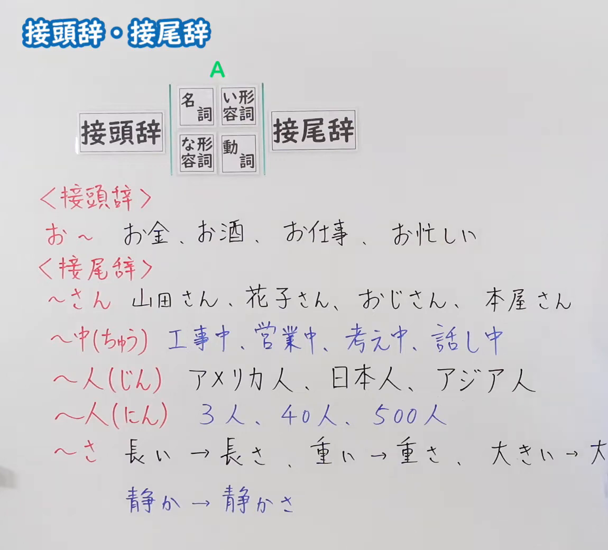
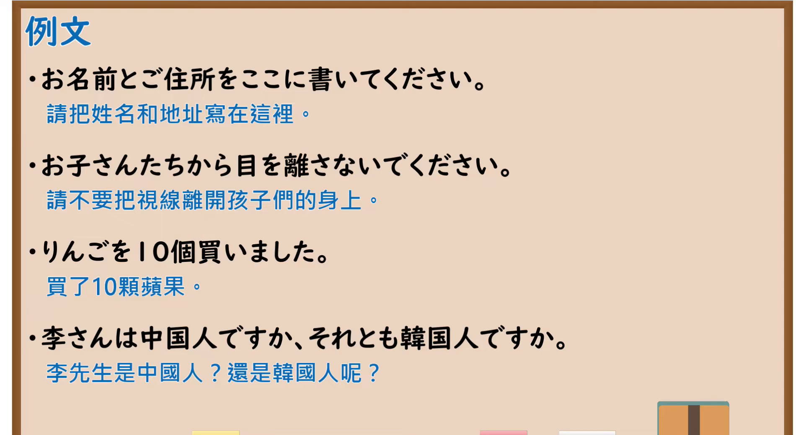

---
{
  "id": "N5-G-0085",
  "kind": "grammar",
  "level": "N5",
  "title": "接头辞・接尾辞",
  "card_revision": 2,
  "schema_version": 1,
  "source": {
    "lesson": "N5 第85个语法",
    "material": "出口日語原视频板书（学习者截取的接续图与例句图）与ハマ先生「【接頭辞と接尾辞】日本語の接辞とは？」正文",
    "video": "https://www.youtube.com/watch?v=qVEqeNEPpqA",
    "screenshot": "assets/grammar/n5/N5-G-0085-connection.png",
    "screenshot_crop": {
      "x": 0,
      "y": 0,
      "width": 1150,
      "height": 1040
    }
  },
  "tags": [
    "接头辞",
    "接尾辞",
    "构词",
    "N5"
  ],
  "confusions": [
    "お／ご",
    "～さん／～様",
    "～中（ちゅう）／～中（じゅう）",
    "～人（じん）／～人（にん）"
  ]
}
---

# N5 第85个语法：接头辞・接尾辞

# 视频学习资料整理

- 课程：[出口日語「接頭辞・接尾辞」](https://www.youtube.com/watch?v=qVEqeNEPpqA)
- 视频 ID：`qVEqeNEPpqA`
- 视频时长：8分57秒

## 接续图

- 实际时间：未记录（图片由学习者从原视频截取并提供）
- 成品图尺寸：1150×1040，固定左上角 `(0, 0)`，右下角 `(1150, 1040)`
- 板书内容：标题「接頭辞・接尾辞」；结构图「接頭辞｜名詞／い形容詞／な形容詞／動詞（A）｜接尾辞」；「＜接頭辞＞お～：お金、お酒、お仕事、お忙しい」；「＜接尾辞＞～さん：山田さん、花子さん、おじさん、本屋さん」「～中（ちゅう）：工事中、営業中、考え中、話し中」「～人（じん）：アメリカ人、日本人、アジア人」「～人（にん）：3人、40人、500人」「～さ：長い→長さ、重い→重さ、大きい→大…（被截断）、静か→静かさ」。板书完整，无遮挡。

## 例句图

- 实际时间：未记录（图片由学习者从原视频截取并提供）
- 成品图尺寸：1900×1040，固定左上角 `(0, 0)`，右下角 `(1900, 1040)`
- 板书内容：课程「例文」页，含四条例句及中文翻译（お名前とご住所をここに書いてください／お子さんたちから目を離さないでください／りんごを10個買いました／李さんは中国人ですか、それとも韓国人ですか）。四条例句均完整可见。

# 核心

## 功能一：接头辞与接尾辞（加在词的前面或后面的构词成分）

**くわしい意味記述：**

- **接辞：** 接辞とは、常に他の語に添加して用い、何らかの意味を付加するはたらきをもつものです。接辞は単独で語として使えません。前から付く接頭辞と後ろから付く接尾辞に分けられます。（接辞是总是附加在其他词上使用、附加某种意义的成分。接辞不能单独作为词使用。分为加在前面的接头辞和加在后面的接尾辞。）
- **接頭辞：** 接頭辞とは、語の頭につく接辞です。（接头辞是加在词头的接辞。）
- **接尾辞：** 接尾辞とは、語の尾につく接辞です。日本語では接尾辞が添加されると品詞が変化することが多いです。イ形容詞を名詞化する「さ」「み」などがあります。（接尾辞是加在词尾的接辞。日语中添加接尾辞后词类常常发生变化。有把い形容词名词化的「さ」「み」等。）

### 例句

1. お箸（接頭辞「お」）

   （筷子）

2. 無関係（接頭辞「無」）

   （无关）

3. 新幹線（接頭辞「新」）

   （新干线）

4. 基本的（接尾辞「的」）

   （基本的）

5. 高い → 高み（接尾辞「み」で名詞化）

   （高 → 高处（名词化））

# 来源

- [出口日語原视频](https://www.youtube.com/watch?v=qVEqeNEPpqA)
- [ハマ先生「【接頭辞と接尾辞】日本語の接辞とは？」](https://www.hamasensei.com/setsuji/)（查询日期：2026-10-16；Hagoromo、毎日のんびり日本語教師、日本語NET 均未找到直接对应条目，按流程采用互联网检索所得的该页；该页是日语教师考试向的术语说明，例句是词例（词组）而非完整句子，没有板书中「お」「さん」「中」「人」「さ」的专门说明和例句，例句译文为整理者所译）
