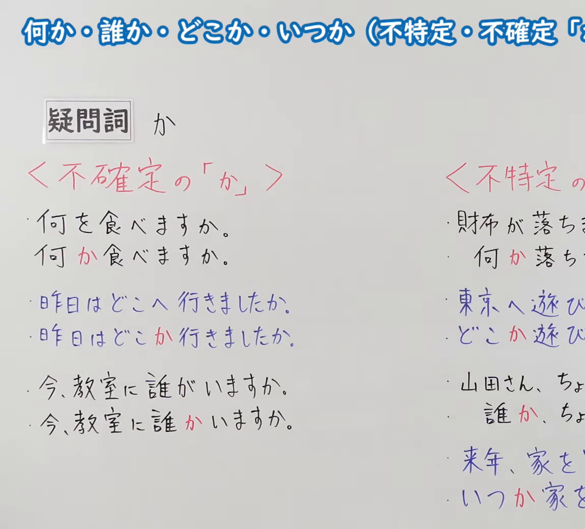
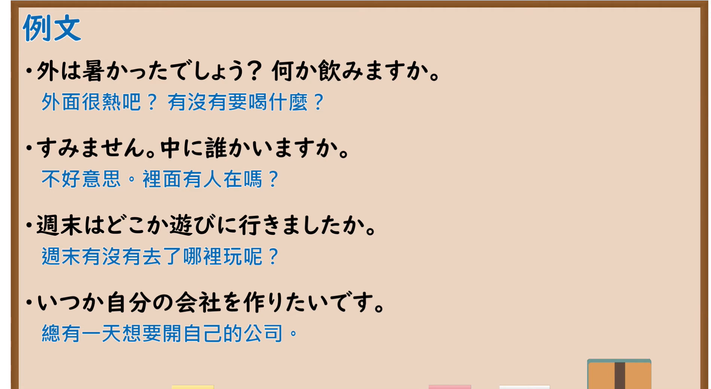

---
{
  "id": "N5-G-0086",
  "kind": "grammar",
  "level": "N5",
  "title": "何か・誰か・どこか・いつか",
  "card_revision": 2,
  "schema_version": 1,
  "source": {
    "lesson": "N5 第86个语法",
    "material": "出口日語原视频板书（学习者截取的接续图与例句图）与J-nihongo「疑問詞＋か（不定）の意味・使い方」正文",
    "video": "https://www.youtube.com/watch?v=Os6Bg84NCMo",
    "screenshot": "assets/grammar/n5/N5-G-0086-connection.png",
    "screenshot_crop": {
      "x": 0,
      "y": 0,
      "width": 1150,
      "height": 1040
    }
  },
  "tags": [
    "疑问词",
    "か",
    "不定",
    "不特定",
    "N5"
  ],
  "confusions": [
    "疑问词＋か／疑问词＋も",
    "不確定の「か」／不特定の「か」",
    "何か／何も",
    "誰か／誰も"
  ]
}
---

# N5 第86个语法：何か・誰か・どこか・いつか

# 视频学习资料整理

- 课程：[出口日語「何か・誰か・どこか・いつか（不特定・不確定「か」）」](https://www.youtube.com/watch?v=Os6Bg84NCMo)
- 视频 ID：`Os6Bg84NCMo`
- 视频时长：8分2秒

## 接续图

- 实际时间：未记录（图片由学习者从原视频截取并提供）
- 成品图尺寸：1150×1040，固定左上角 `(0, 0)`，右下角 `(1150, 1040)`
- 板书内容：标题「何か・誰か・どこか・いつか（不特定・不確定「か」）」（右端被画面右缘截断）；公式「疑問詞 か」；左栏红字「＜不確定の「か」＞」：「何を食べますか。／何か食べますか。」「昨日はどこへ行きましたか。／昨日はどこか行きましたか。」「今、教室に誰がいますか。／今、教室に誰かいますか。」（「か」红字）；右栏红字「＜不特定の…」（被截断）：「財布が落ちま…／何か落ち…」「東京へ遊び…／どこか遊び…」「山田さん、ちょ…／誰か、ちょ…」「来年、家を…／いつか家を…」，右栏均被画面右缘截断，未补写。

## 例句图

- 实际时间：未记录（图片由学习者从原视频截取并提供）
- 成品图尺寸：1900×1040，固定左上角 `(0, 0)`，右下角 `(1900, 1040)`
- 板书内容：课程「例文」页，含四条例句及中文翻译（外は暑かったでしょう？何か飲みますか／すみません。中に誰かいますか／週末はどこか遊びに行きましたか／いつか自分の会社を作りたいです）。四条例句均完整可见。

# 核心

## 功能一：疑问词＋か（表示不特定、不确定的人、物、场所、时间）

**くわしい意味記述：**

- **疑問詞＋か（不定）：** 疑問詞に「か」をつけ、人・物・場所・時などを特定しないで表します。（在疑问词后加「か」，不特定地表示人、物、场所、时间等。）
- **接続：** 疑問詞＋か：だれか／何か／どこか／いつか。（疑问词＋か：だれか／何か／どこか／いつか。）

### 例句

1. 教室に、だれかいますか。

   （教室里有人吗？）

2. いつか、日本へ行きたいです。

   （总有一天想去日本。）

3. 何か、飲みませんか。

   （要不要喝点什么？）

4. 週末、どこかへ出かけたいです。

   （周末想去哪里走走。）

5. 冷蔵庫に何かありますか。

   （冰箱里有什么吗？）

# 来源

- [出口日語原视频](https://www.youtube.com/watch?v=Os6Bg84NCMo)
- [J-nihongo「疑問詞＋か（不定）の意味・使い方」](https://j-nihongo.com/questionword-ka-indefinite/)（查询日期：2026-10-16；Hagoromo、毎日のんびり日本語教師、日本語NET、东京外国语大学均未找到直接对应条目，按流程采用互联网检索所得的该页；该页只有英文翻译，中文译文为整理者所译；板书中“不确定的か”与“不特定的か”的区分该页未解说）
