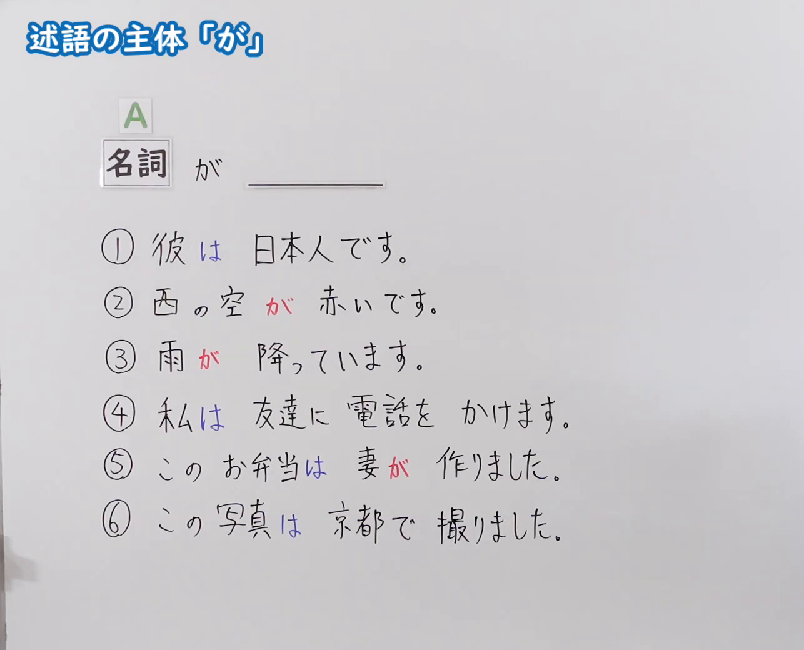
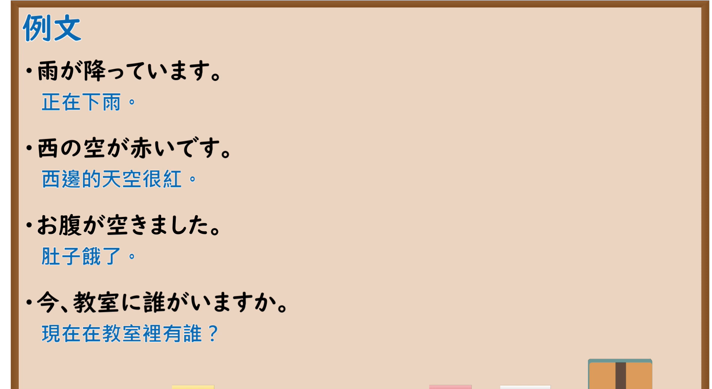

---
{
  "id": "N5-G-0087",
  "kind": "grammar",
  "level": "N5",
  "title": "助词：述语的主体「が」",
  "card_revision": 2,
  "schema_version": 1,
  "source": {
    "lesson": "N5 第87个语法",
    "material": "出口日語原视频板书（学习者截取的接续图与例句图）与毎日のんびり日本語教師「格助詞「が」の用法一覧」正文",
    "video": "https://www.youtube.com/watch?v=GjoasAi-dbA",
    "screenshot": "assets/grammar/n5/N5-G-0087-connection.png",
    "screenshot_crop": {
      "x": 0,
      "y": 0,
      "width": 1286,
      "height": 1040
    }
  },
  "tags": [
    "が",
    "助词",
    "主体",
    "主语",
    "N5"
  ],
  "confusions": [
    "は／が",
    "が／を",
    "新信息／旧信息",
    "自动词／他动词"
  ]
}
---

# N5 第87个语法：助词「が」（述语的主体）

# 视频学习资料整理

- 课程：[出口日語「助詞：述語の主体「が」」](https://www.youtube.com/watch?v=GjoasAi-dbA)
- 视频 ID：`GjoasAi-dbA`
- 视频时长：8分9秒

## 接续图

- 实际时间：未记录（图片由学习者从原视频截取并提供）
- 成品图尺寸：1286×1040，固定左上角 `(0, 0)`，右下角 `(1286, 1040)`
- 板书内容：标题「述語の主体「が」」；公式「A：名詞 が ＿＿」；六句例句：「①彼は日本人です。」「②西の空が赤いです。」「③雨が降っています。」「④私は友達に電話をかけます。」「⑤このお弁当は妻が作りました。」「⑥この写真は京都で撮りました。」（「は」蓝字，「が」红字，对比主题与主体）。板书完整，无遮挡。

## 例句图

- 实际时间：未记录（图片由学习者从原视频截取并提供）
- 成品图尺寸：1900×1040，固定左上角 `(0, 0)`，右下角 `(1900, 1040)`
- 板书内容：课程「例文」页，含四条例句及中文翻译（雨が降っています／西の空が赤いです／お腹が空きました／今、教室に誰がいますか）。四条例句均完整可见。

# 核心

## 功能一：表示述语的主体

**くわしい意味記述：**

- **主体：** 述語が動作、作用、変化などを表すとき、その主体を「が」で表します。述語が状態性の語のとき、その状態の主体を表します。（谓语表示动作、作用、变化等时，用「が」表示其主体。谓语是状态性词语时，表示该状态的主体。）
- **同定関係の主体：** 名詞述語文（コピュラ文）における同定関係の主体も「が」を使います。（名词谓语句（コピュラ句）中同定关系的主体也使用「が」。）

### 例句

1. 雪が降る。

   （下雪。）

2. 猫が走っている。

   （猫在跑。）

3. 猫が１匹いる。

   （有一只猫。）

4. 風が冷たい。

   （风很冷。）

5. 彼が山田です。

   （他是山田。）

# 来源

- [出口日語原视频](https://www.youtube.com/watch?v=GjoasAi-dbA)
- [毎日のんびり日本語教師「格助詞「が」の用法一覧」「主体」](https://mainichi-nonbiri.com/jltct/ga-case-particle/)（查询日期：2026-10-16；Hagoromo 未收录，按流程采用优先级最高的备选网站该页，中文译文取自该页；与第 40 课「焦点が」所用小节为同一页，本课取其「主体」部分；板书中「は」与「が」的主题／主体对比该页没有直接解说）
