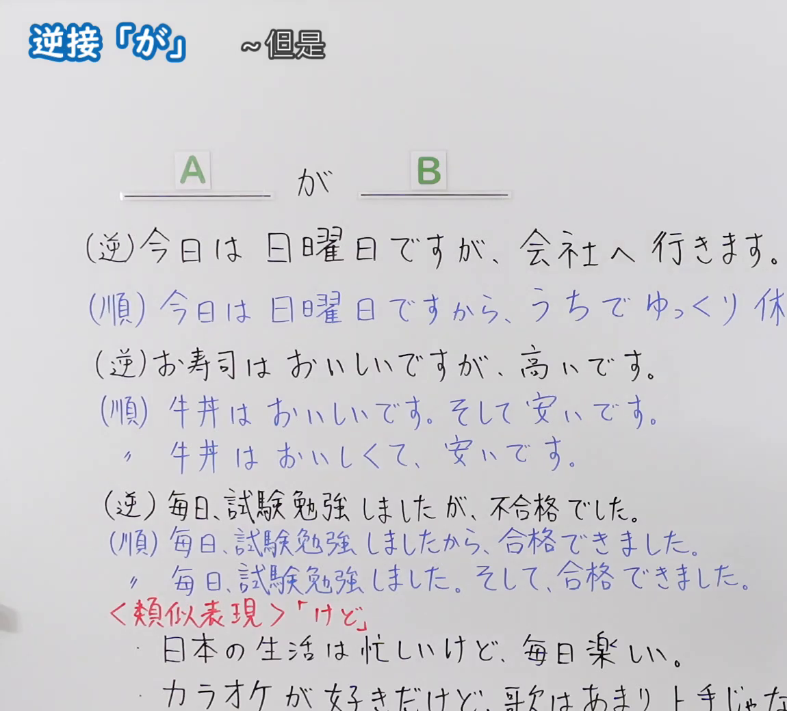
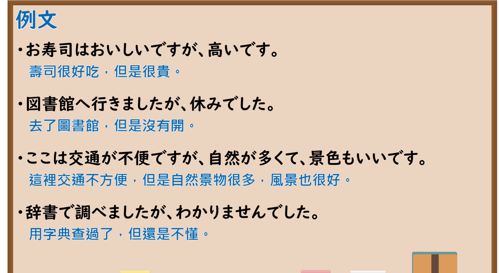

---
{
  "id": "N5-G-0088",
  "kind": "grammar",
  "level": "N5",
  "title": "助词：逆接「が」",
  "card_revision": 2,
  "schema_version": 1,
  "source": {
    "lesson": "N5 第88个语法",
    "material": "出口日語原视频板书（学习者截取的接续图与例句图）与东京外国语大学「逆接：解説」正文",
    "video": "https://www.youtube.com/watch?v=O1lrGDGSdpU",
    "screenshot": "assets/grammar/n5/N5-G-0088-connection.png",
    "screenshot_crop": {
      "x": 0,
      "y": 0,
      "width": 1150,
      "height": 1040
    }
  },
  "tags": [
    "が",
    "けど",
    "逆接",
    "但是",
    "N5"
  ],
  "confusions": [
    "が／けど／けれども",
    "逆接／顺接",
    "ので／のに",
    "が／のに"
  ]
}
---

# N5 第88个语法：助词「が」（逆接）

# 视频学习资料整理

- 课程：[出口日語「助詞：逆接「が」」](https://www.youtube.com/watch?v=O1lrGDGSdpU)
- 视频 ID：`O1lrGDGSdpU`
- 视频时长：7分48秒

## 接续图

- 实际时间：未记录（图片由学习者从原视频截取并提供）
- 成品图尺寸：1150×1040，固定左上角 `(0, 0)`，右下角 `(1150, 1040)`
- 板书内容：标题「逆接「が」」，右侧标注“～但是”；公式「A：＿＿が B：＿＿」；三组逆接／顺接对照：「（逆）今日は日曜日ですが、会社へ行きます。」对「（順）今日は日曜日ですから、うちでゆっくり休（みます）」（被截断）；「（逆）お寿司はおいしいですが、高いです。」对「（順）牛丼はおいしいです。そして安いです。／牛丼はおいしくて、安いです。」；「（逆）毎日、試験勉強しましたが、不合格でした。」对「（順）毎日、試験勉強しましたから、合格できました。／毎日、試験勉強しました。そして、合格できました。」；红字「＜類似表現＞「けど」」：「日本の生活は忙しいけど、毎日楽しい。」「カラオケが好きだけど、歌はあまり上手じゃな（い）」（被截断）。

## 例句图

- 实际时间：未记录（图片由学习者从原视频截取并提供）
- 成品图尺寸：1900×1040，固定左上角 `(0, 0)`，右下角 `(1900, 1040)`
- 板书内容：课程「例文」页，含四条例句及中文翻译（お寿司はおいしいですが、高いです／図書館へ行きましたが、休みでした／ここは交通が不便ですが、自然が多くて、景色もいいです／辞書で調べましたが、わかりませんでした）。四条例句均完整可见。

# 核心

## 功能一：～但是（逆接：前后内容相反或不符预期）

**くわしい意味記述：**

- **逆接：** 単文S1と単文S2を、矛盾・対立の関係でつないで複文を作るときには、「のに」「けれども」などの表現があります。「けれども」は普通形、丁寧形両方に接続します。（用矛盾、对立的关系连接单句S1与S2构成复句时，有「のに」「けれども」等表达。「けれども」可接普通形和礼貌形两种。）
- **「けれども」の類義表現：** 「けれども」と同じ意味で、「けれど、けど、が」という表現があります。「けれども」「けれど」「けど」の順で、より話しことば的になります。（与「けれども」意思相同的表达有「けれど、けど、が」。按「けれども」「けれど」「けど」的顺序，越来越口语化。）
- **意味：** 「けれども」はS2が予想と食い違うことがらであることに対する驚き・不満・意外感を表わしません。「けれども」は、逆接の意味自体があまり強くなく、S1とS2を対比的に並べて示している場合もあります。（「けれども」不表示对S2与预期不符的惊讶、不满、意外。「けれども」的逆接意义本身不强，也有把S1与S2对比并列的情况。）

### 例句

1. 毎日日本語を勉強しているけれども、なかなか漢字が覚えられません。

   （每天都在学日语，但是汉字怎么也记不住。）

2. 山田さんはいつも元気ですけれども、きょうは静かです。

   （山田总是很有精神，但是今天很安静。）

3. 雨が降ったけれども予定通り運動会をしました。

   （虽然下了雨，但运动会照常举行了。）

4. わたしは東京に住んでいるけれども、弟は京都に住んでいます。

   （我住在东京，而弟弟住在京都。）

5. もう夜の12時だけれども、もう少し勉強しよう。

   （虽然已经夜里12点了，但再学一会儿吧。）

# 来源

- [出口日語原视频](https://www.youtube.com/watch?v=O1lrGDGSdpU)
- [东京外国语大学「日本語 文法 逆接：解説」](https://www.coelang.tufs.ac.jp/mt/ja/gmod/contents/explanation/082.html)（查询日期：2026-10-16；Hagoromo、毎日のんびり日本語教師、日本語NET 均未找到直接对应条目，按流程采用互联网检索所得的该页；该页以「のに」「けれども」为主，「が」只作为「けれども」的类义表达一句带过，没有单独以「が」为例的解说，例句均用「けれども」，例句译文为整理者所译；板书中「が」与顺接「から」「そして」的对比该页未解说）
