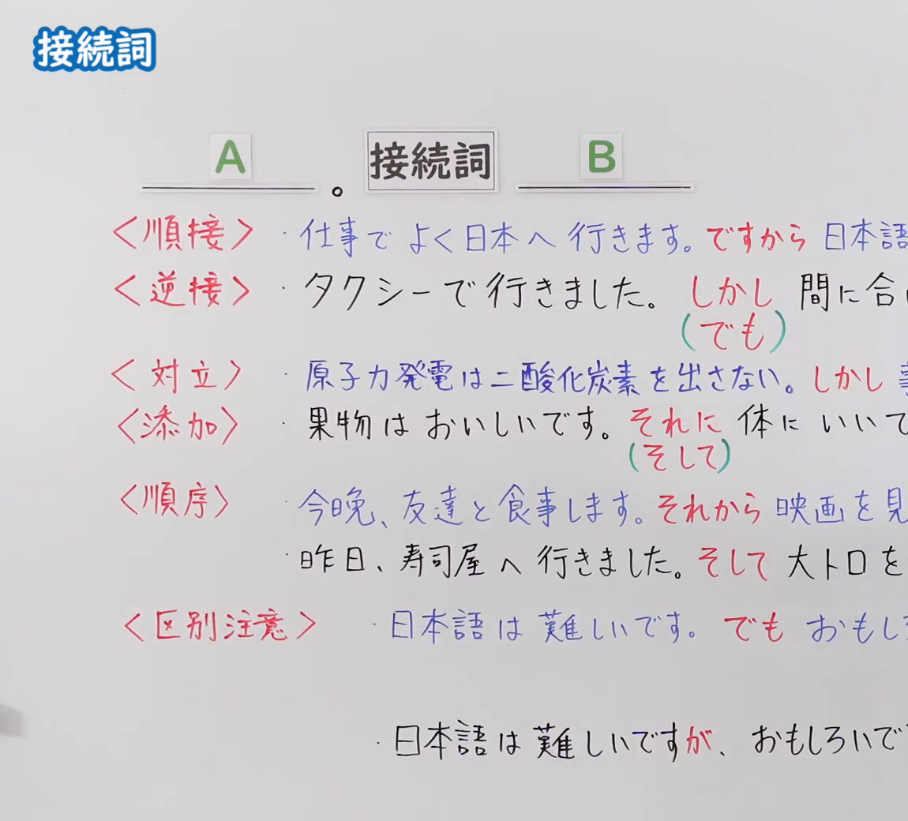
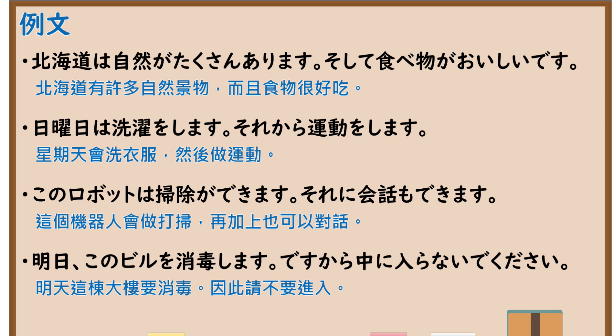

---
{
  "id": "N5-G-0089",
  "kind": "grammar",
  "level": "N5",
  "title": "接续词",
  "card_revision": 2,
  "schema_version": 1,
  "source": {
    "lesson": "N5 第89个语法",
    "material": "出口日語原视频板书（学习者截取的接续图与例句图）与wordrabbit「接続詞とは」正文",
    "video": "https://www.youtube.com/watch?v=bjcSp93qvhs",
    "screenshot": "assets/grammar/n5/N5-G-0089-connection.png",
    "screenshot_crop": {
      "x": 0,
      "y": 0,
      "width": 1150,
      "height": 1040
    }
  },
  "tags": [
    "接续词",
    "顺接",
    "逆接",
    "N5"
  ],
  "confusions": [
    "そして／それから",
    "しかし／でも／が",
    "それに／そして",
    "ですから／だから"
  ]
}
---

# N5 第89个语法：接续词

# 视频学习资料整理

- 课程：[出口日語「接続詞」](https://www.youtube.com/watch?v=bjcSp93qvhs)
- 视频 ID：`bjcSp93qvhs`
- 视频时长：9分1秒

## 接续图

- 实际时间：未记录（图片由学习者从原视频截取并提供）
- 成品图尺寸：1150×1040，固定左上角 `(0, 0)`，右下角 `(1150, 1040)`
- 板书内容：标题「接続詞」；公式「A：＿＿。接続詞 B：＿＿」；「＜順接＞」：「仕事でよく日本へ行きます。ですから日本語…」（被截断）；「＜逆接＞」：「タクシーで行きました。しかし間に合…」（「しかし」红字，其下绿括号「（でも）」）；「＜対立＞」：「原子力発電は二酸化炭素を出さない。しかし事…」；「＜添加＞」：「果物はおいしいです。それに体にいい…」（其下绿括号「（そして）」）；「＜順序＞」：「今晩、友達と食事します。それから映画を見…」「昨日、寿司屋へ行きました。そして大トロを…」；「＜区別注意＞」：「日本語は難しいです。でもおもし…」「日本語は難しいですが、おもしろいで…」。右侧句末均被画面右缘截断，未补写。

## 例句图

- 实际时间：未记录（图片由学习者从原视频截取并提供）
- 成品图尺寸：1900×1040，固定左上角 `(0, 0)`，右下角 `(1900, 1040)`
- 板书内容：课程「例文」页，含四条例句及中文翻译（北海道は自然がたくさんあります。そして食べ物がおいしいです／日曜日は洗濯をします。それから運動をします／このロボットは掃除ができます。それに会話もできます／明日、このビルを消毒します。ですから中に入らないでください）。四条例句均完整可见。

# 核心

## 功能一：连接前后句子，表示顺接、逆接、添加、顺序等逻辑关系

**くわしい意味記述：**

- **接続詞とは：** 接続詞は、前後の語や文をつなぐ語です。自立語で活用がなく、単独で接続語になります。（接续词是连接前后词语或句子的词。是自立词，没有活用，可单独作接续语。）
- **接続詞の種類：** 順接（それで、だから、そこで、すると）、逆接（しかし、だが、けれども、ところが）、並立・添加（また、そして、なお）、対比・選択（それとも、または、もしくは）、説明・補足（つまり、なぜなら、すなわち）、転換（ところで、さて、では、ときに）の６つに分けられます。（分为顺接（それで、だから、そこで、すると）、逆接（しかし、だが、けれども、ところが）、并列・添加（また、そして、なお）、对比・选择（それとも、または、もしくは）、说明・补充（つまり、なぜなら、すなわち）、转换（ところで、さて、では、ときに）六类。）

### 例句

1. 本は好きだ。しかし、国語は苦手だ。

   （喜欢书，但是不擅长语文。）

2. 彼女は練習をがんばった。しかし、試合には負けた。

   （她努力练习了，但是比赛输了。）

3. 母は起業家であり、また、画家でもある。

   （母亲是创业者，同时也是画家。）

4. 餃子にするか、それともラーメンにするか。

   （是选饺子，还是选拉面呢？）

# 来源

- [出口日語原视频](https://www.youtube.com/watch?v=bjcSp93qvhs)
- [wordrabbit「接続詞とは」](https://wordrabbit.jp/grammar/conjunction)（查询日期：2026-10-16；Hagoromo、毎日のんびり日本語教師、日本語NET、东京外国语大学均未找到直接对应条目，按流程采用互联网检索所得的该页；该页没有中文翻译，例句译文为整理者所译；该页的分类用語与板书（順接、逆接、対立、添加、順序）不完全一致，卡内「順序」「対立」类该页未单独解说，「ですから」「それに」「それから」的具体例句该页也没有）
