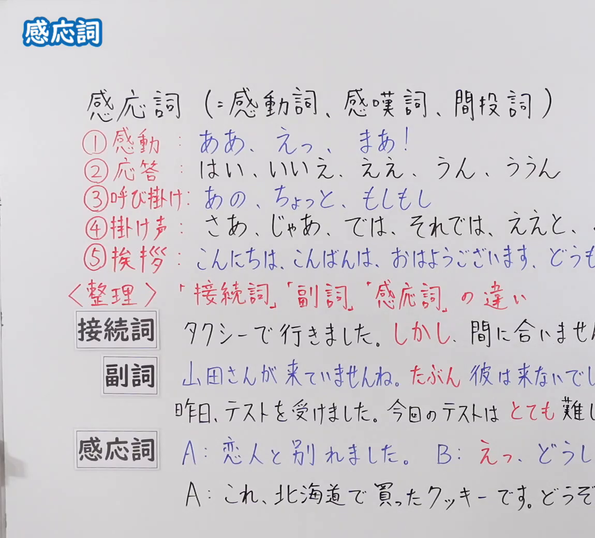
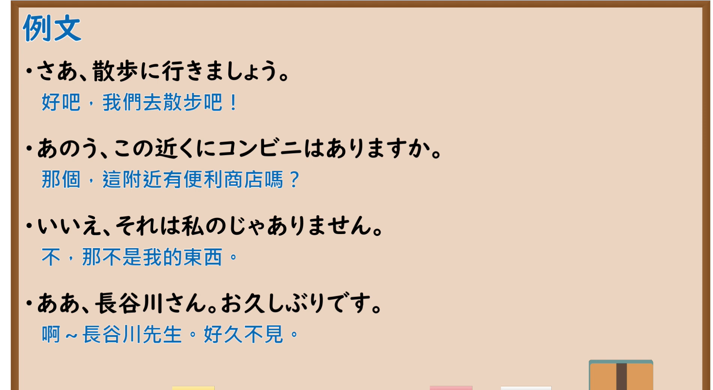

---
{
  "id": "N5-G-0090",
  "kind": "grammar",
  "level": "N5",
  "title": "感应词",
  "card_revision": 2,
  "schema_version": 1,
  "source": {
    "lesson": "N5 第90个语法",
    "material": "出口日語原视频板书（学习者截取的接续图与例句图）与wordrabbit「感動詞とは」正文",
    "video": "https://www.youtube.com/watch?v=yTM-G1xa63Q",
    "screenshot": "assets/grammar/n5/N5-G-0090-connection.png",
    "screenshot_crop": {
      "x": 0,
      "y": 0,
      "width": 1150,
      "height": 1040
    }
  },
  "tags": [
    "感应词",
    "感动词",
    "应答",
    "问候",
    "N5"
  ],
  "confusions": [
    "接続詞／副詞／感応詞",
    "感動／応答／呼びかけ／掛け声／挨拶",
    "はい／ええ／うん",
    "あの／ちょっと／もしもし"
  ]
}
---

# N5 第90个语法：感应词

# 视频学习资料整理

- 课程：[出口日語「感応詞」](https://www.youtube.com/watch?v=yTM-G1xa63Q)
- 视频 ID：`yTM-G1xa63Q`
- 视频时长：11分55秒

## 接续图

- 实际时间：未记录（图片由学习者从原视频截取并提供）
- 成品图尺寸：1150×1040，固定左上角 `(0, 0)`，右下角 `(1150, 1040)`
- 板书内容：标题「感応詞」；说明「感応詞（＝感動詞、感嘆詞、間投詞）」；分类：「①感動：ああ、えっ、まあ！」「②応答：はい、いいえ、ええ、うん、ううん」「③呼び掛け：あの、ちょっと、もしもし」「④掛け声：さあ、じゃあ、では、それでは、ええと、（被截断）」「⑤挨拶：こんにちは、こんばんは、おはようございます、どうも（被截断）」；「＜整理＞「接続詞」「副詞」「感応詞」の違い」：接続詞「タクシーで行きました。しかし、間に合いません…」、副詞「山田さんが来ていませんね。たぶん彼は来ないでし…」「昨日、テストを受けました。今日のテストはとても難し…」、感応詞「A：恋人と別れました。B：えっ、どうし…」「A：これ、北海道で買ったクッキーです。どうぞ…」，右侧多处句末被画面右缘截断，未补写。

## 例句图

- 实际时间：未记录（图片由学习者从原视频截取并提供）
- 成品图尺寸：1900×1040，固定左上角 `(0, 0)`，右下角 `(1900, 1040)`
- 板书内容：课程「例文」页，含四条例句及中文翻译（さあ、散歩に行きましょう／あのう、この近くにコンビニはありますか／いいえ、それは私のじゃありません／ああ、長谷川さん。お久しぶりです）。四条例句均完整可见。

# 核心

## 功能一：感应词（感动词）：表示感动、呼唤、应答、问候、吆喝

**くわしい意味記述：**

- **感動詞とは：** 感動詞は、「まあ」「さあ」のように、感動・呼びかけ・応答などをあらわします。自立語で活用がなく、普通は文頭にあるという特徴があります。（感动词像「まあ」「さあ」这样，表示感动、呼唤、应答等。是自立词，没有活用，通常位于句首。）
- **感動詞の種類：** 感動詞は、主に「感動・呼びかけ・応答・挨拶・掛け声」の5つの種類にわけられます。感動「あら・ああ・あれ・えっ・おお・おや・まあ・やれやれ」、呼びかけ「もしもし・こら・これ・これこれ・さあ・そら・それ・どれ・ね・ねえ・もし・やあ・やい」、応答「ああ・いいえ・いや・うん・ええ・はい」、あいさつ「こんにちは・こんばんは・さようなら・おはようございます」、かけ声「そら・どっこいしょ・よいしょ・ほいきた」。（感动词主要分为「感动・呼唤・应答・问候・吆喝」五类，各类词例如上。）

### 例句

1. やれやれ、やっと宿題が終わった。

   （唉，作业总算做完了。）

2. こんにちは、お元気ですか。

   （你好，你好吗？）

3. おや、これは珍しい。

   （咦，这可稀奇。）

4. ほら、私が言った通りだったじゃない。

   （你看，不是正如我说的那样吗。）

5. いや、そんなつもりはありません。

   （不，我没有那个意思。）

# 来源

- [出口日語原视频](https://www.youtube.com/watch?v=yTM-G1xa63Q)
- [wordrabbit「感動詞とは」](https://wordrabbit.jp/grammar/interjection)（查询日期：2026-10-16；Hagoromo、毎日のんびり日本語教師、日本語NET、东京外国语大学均未找到直接对应条目，按流程采用互联网检索所得的该页；课程名称「感応詞」是出口日語的用语，该页称「感動詞」，二者所指相同；该页没有中文翻译，例句译文为整理者所译；板书的「接続詞・副詞・感応詞」三者区别该页未解说）
