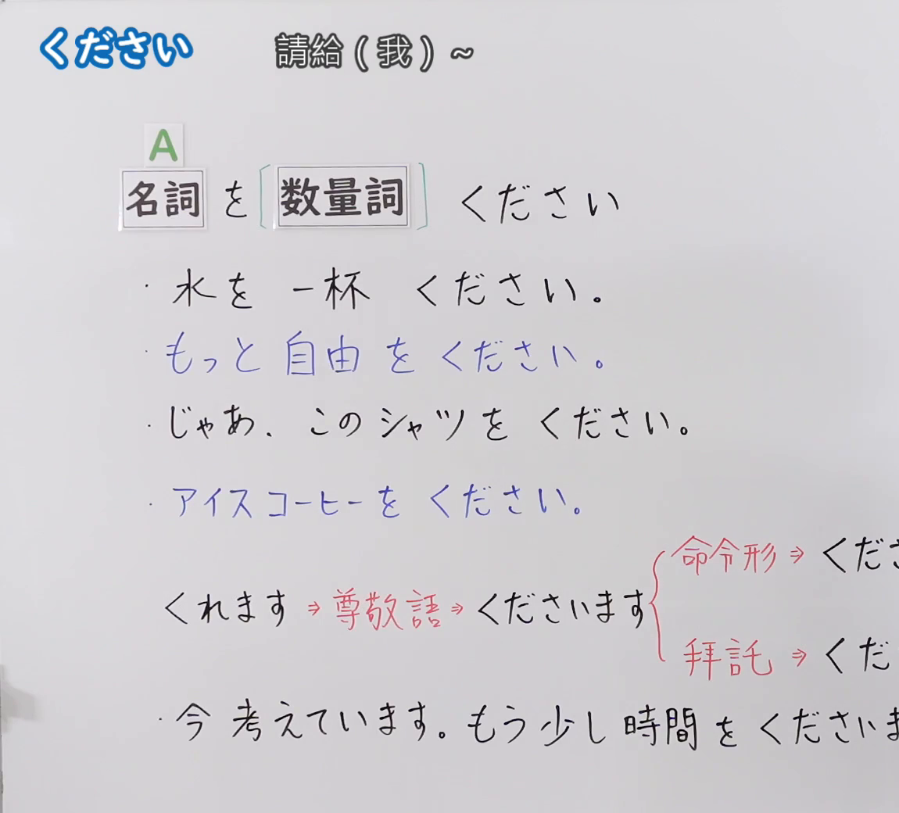
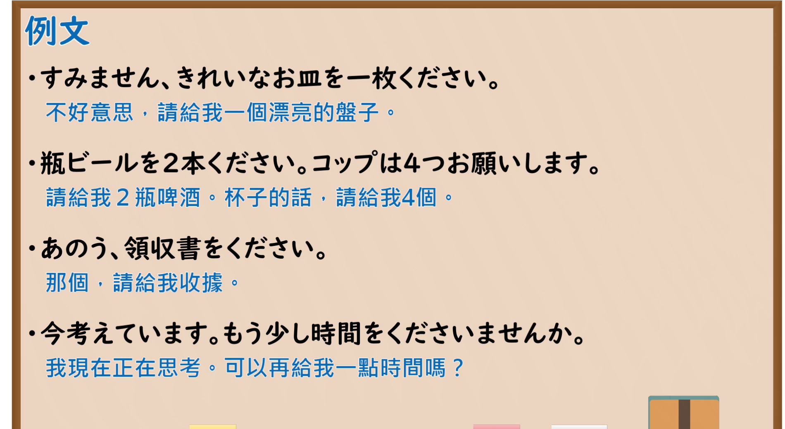

---
{
  "id": "N5-G-0091",
  "kind": "grammar",
  "level": "N5",
  "title": "ください",
  "card_revision": 2,
  "schema_version": 1,
  "source": {
    "lesson": "N5 第91个语法",
    "material": "出口日語原视频板书（学习者截取的接续图与例句图）与毎日のんびり日本語教師「【Ｎ５文法】～を下さい／をちょうだい／をくれ」正文",
    "video": "https://www.youtube.com/watch?v=esYAg50QUJI",
    "screenshot": "assets/grammar/n5/N5-G-0091-connection.png",
    "screenshot_crop": {
      "x": 0,
      "y": 0,
      "width": 1150,
      "height": 1040
    }
  },
  "tags": [
    "ください",
    "请求",
    "授受",
    "N5"
  ],
  "confusions": [
    "をください／てください",
    "くれます／くださいます",
    "ちょうだい",
    "お願いします"
  ]
}
---

# N5 第91个语法：ください

# 视频学习资料整理

- 课程：[出口日語「ください」](https://www.youtube.com/watch?v=esYAg50QUJI)
- 视频 ID：`esYAg50QUJI`
- 视频时长：6分41秒

## 接续图

- 实际时间：未记录（图片由学习者从原视频截取并提供）
- 成品图尺寸：1150×1040，固定左上角 `(0, 0)`，右下角 `(1150, 1040)`
- 板书内容：标题「ください」，右侧标注“請給（我）～”；公式「A：名詞 を［数量詞］ ください」；例句：「水を一杯ください。」「もっと自由をください。」（蓝字）「じゃあ、このシャツをください。」「アイスコーヒーをください。」（蓝字）；下方红字：「くれます⇒尊敬語⇒くださいます」，花括号分两支「命令形⇒くだ…」「拝託⇒くだ…」（被画面右缘截断）；末行「今考えています。もう少し時間をくださ…」（被截断）。

## 例句图

- 实际时间：未记录（图片由学习者从原视频截取并提供）
- 成品图尺寸：1900×1040，固定左上角 `(0, 0)`，右下角 `(1900, 1040)`
- 板书内容：课程「例文」页，含四条例句及中文翻译（すみません、きれいなお皿を一枚ください／瓶ビールを2本ください。コップは4つお願いします／あのう、領収書をください／今考えています。もう少し時間をくださいませんか）。四条例句均完整可见。

# 核心

## 功能一：请给我～

**くわしい意味記述：**

- **～を下さい：** 相手に物を要求する文型です。お店での注文などでも用いられます。口語では「を」を省略できます。接続は 名詞＋を下さい。（向对方索要物品的句型。也用于在店里点餐等。口语中可省略「を」。接续为 名词＋を下さい。）
- **より丁寧な表現・類似表現：** より丁寧な表現に「～を下さいませんか」「～を頂けますか」「～を頂けませんか」等があります。「～をくれ」は目上から目下に使われ、「～をちょうだい」は母親と子供、家族間、友達間など、親密な間柄で用いられます。（更礼貌的表达有「～を下さいませんか」「～を頂けますか」「～を頂けませんか」等。「～をくれ」用于上对下，「～をちょうだい」用于母子、家人、朋友等亲密关系。）

### 例句

1. メニューをください。

   （请给我菜单。）

2. 私に１回だけチャンスを下さい。

   （请只给我一次机会。）

3. ５時までに連絡をください。

   （请在5点之前联系我。）

4. 絵の才能を下さい。

   （请赋予我绘画的才能。）

5. 明日試験がある私に励ましの一言を下さい。

   （我明天有考试，请给我一句鼓励的话。）

# 来源

- [出口日語原视频](https://www.youtube.com/watch?v=esYAg50QUJI)
- [毎日のんびり日本語教師「【Ｎ５文法】～を下さい（ください）／をちょうだい／をくれ」](https://mainichi-nonbiri.com/grammar/n5-wokudasai/)（查询日期：2026-10-16；Hagoromo 未收录，故按流程采用优先级最高的备选网站条目；中文译文取自该页，第4、5例译文有改动；板书中「くださいます」「くれます⇒尊敬語」一行该页未解说）
