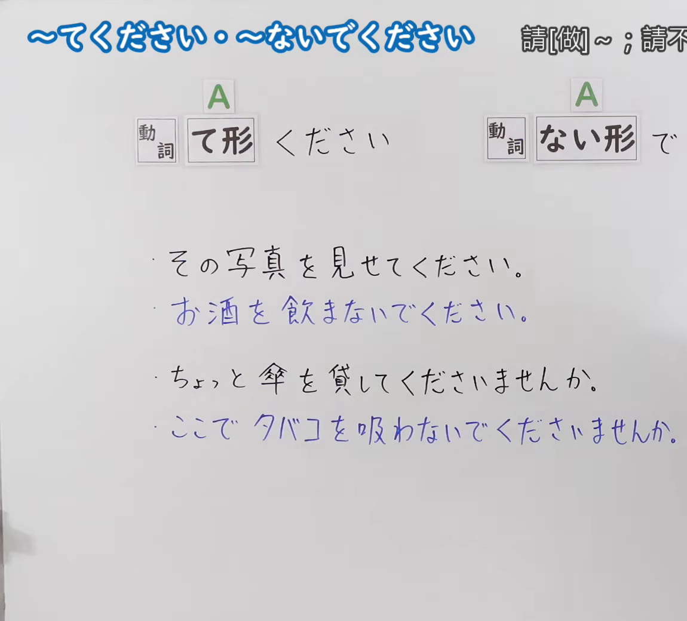
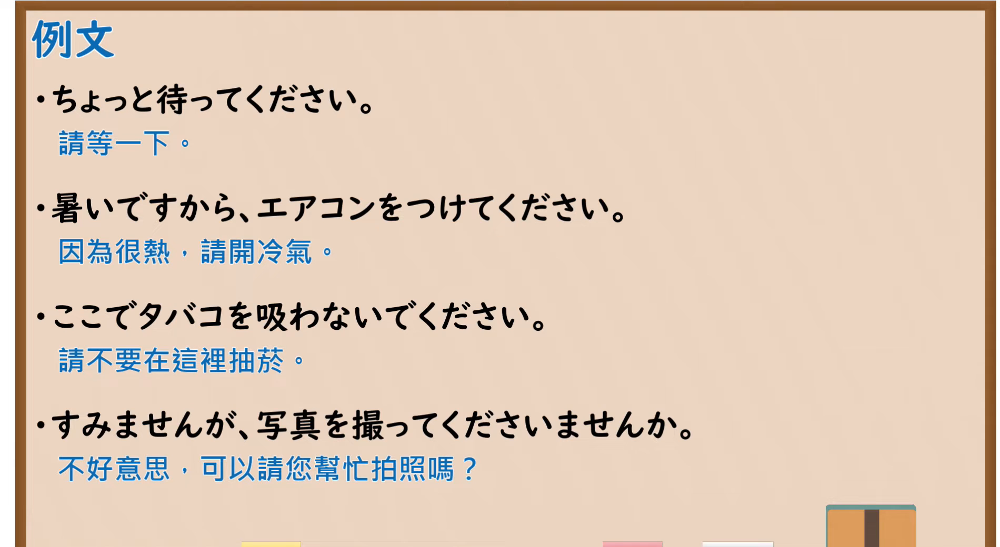

---
{
  "id": "N5-G-0092",
  "kind": "grammar",
  "level": "N5",
  "title": "～てください・～ないでください",
  "card_revision": 2,
  "schema_version": 1,
  "source": {
    "lesson": "N5 第92个语法",
    "material": "出口日語原视频板书（学习者截取的接续图与例句图）与毎日のんびり日本語教師「【Ｎ５文法】～てください／ないでください…」正文",
    "video": "https://www.youtube.com/watch?v=s4aJunA1Olk",
    "screenshot": "assets/grammar/n5/N5-G-0092-connection.png",
    "screenshot_crop": {
      "x": 0,
      "y": 0,
      "width": 1150,
      "height": 1040
    }
  },
  "tags": [
    "てください",
    "ないでください",
    "请求",
    "指示",
    "N5"
  ],
  "confusions": [
    "てください／ください",
    "てくださいませんか",
    "てください／てくれ",
    "ないでください／ないで"
  ]
}
---

# N5 第92个语法：～てください・～ないでください

# 视频学习资料整理

- 课程：[出口日語「～てください・～ないでください」](https://www.youtube.com/watch?v=s4aJunA1Olk)
- 视频 ID：`s4aJunA1Olk`
- 视频时长：5分50秒

## 接续图

- 实际时间：未记录（图片由学习者从原视频截取并提供）
- 成品图尺寸：1150×1040，固定左上角 `(0, 0)`，右下角 `(1150, 1040)`
- 板书内容：标题「～てください・～ないでください」，右侧标注“請[做]～；請不…”（右端被画面右缘截断）；公式「A：動詞 て形 ください」「A：動詞 ない形 で（右端被截断）」；例句：「その写真を見せてください。」「お酒を飲まないでください。」（蓝字）「ちょっと傘を貸してくださいませんか。」「ここでタバコを吸わないでくださいませんか。」（蓝字）。

## 例句图

- 实际时间：未记录（图片由学习者从原视频截取并提供）
- 成品图尺寸：1900×1040，固定左上角 `(0, 0)`，右下角 `(1900, 1040)`
- 板书内容：课程「例文」页，含四条例句及中文翻译（ちょっと待ってください／暑いですから、エアコンをつけてください／ここでタバコを吸わないでください／すみませんが、写真を撮ってくださいませんか）。四条例句均完整可见。

# 核心

## 功能一：请[做]～；请不要～

**くわしい意味記述：**

- **～てください／ないでください：** 相手に対する要求、指示、命令を表します。接続は 動詞て形＋ください、動詞ない形＋ないでください。（表示对对方的要求、指示、命令。接续为 动词て形＋ください，动词ない形＋ないでください。）
- **より丁寧な表現・注意：** より丁寧な表現に「～てくださいませんか」「～て頂けますか」「～ないでくださいませんか」等があります。「～てください／ないでください」は丁寧な表現ではありますが、目上の人に使うと失礼な感じを与えますので注意が必要です。（更礼貌的表达有「～てくださいませんか」「～て頂けますか」「～ないでくださいませんか」等。「～てください／ないでください」虽是礼貌表达，但对长辈使用会显得失礼，需要注意。）

### 例句

1. 安心して下さい。

   （请放心。）

2. テスト頑張ってください。

   （考试请加油。）

3. 期待しないでください。

   （请不要期待。）

4. 明日８時に集合してください。

   （请明天8点集合。）

5. 気にしないでください。

   （请不要介意。）

# 来源

- [出口日語原视频](https://www.youtube.com/watch?v=s4aJunA1Olk)
- [毎日のんびり日本語教師「【Ｎ５文法】～てください／てちょうだい／ないでください／ないでちょうだい／てくれ」](https://mainichi-nonbiri.com/grammar/n5-tekudasai/)（查询日期：2026-10-16；Hagoromo 未收录，故按流程采用优先级最高的备选网站条目；中文译文取自该页；板书的「～てくださいませんか」只在该页解说中提及，没有例句）
