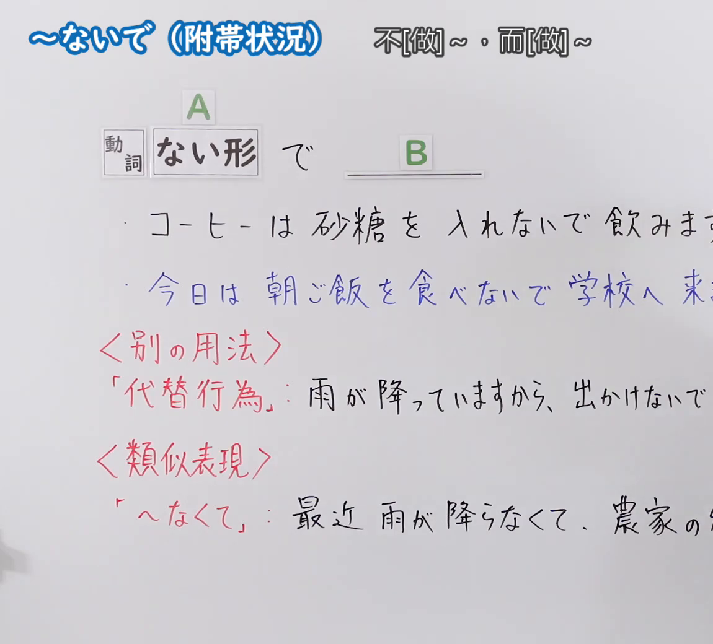
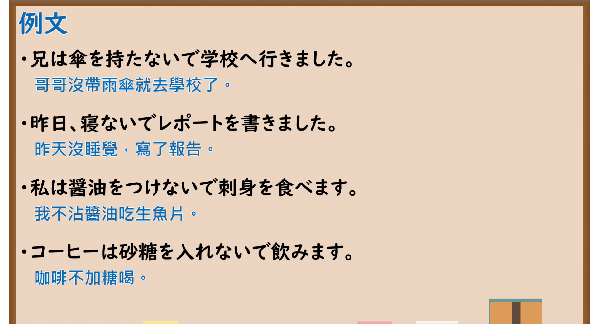

---
{
  "id": "N5-G-0093",
  "kind": "grammar",
  "level": "N5",
  "title": "～ないで（附带状况）",
  "card_revision": 2,
  "schema_version": 1,
  "source": {
    "lesson": "N5 第93个语法",
    "material": "出口日語原视频板书（学习者截取的接续图与例句图）与毎日のんびり日本語教師「【Ｎ５文法】～ないで／ずに」正文",
    "video": "https://www.youtube.com/watch?v=tKPNE9CJ9LM",
    "screenshot": "assets/grammar/n5/N5-G-0093-connection.png",
    "screenshot_crop": {
      "x": 0,
      "y": 0,
      "width": 1150,
      "height": 1040
    }
  },
  "tags": [
    "ないで",
    "附带状况",
    "否定",
    "N5"
  ],
  "confusions": [
    "ないで／なくて",
    "ないで／ずに",
    "ないで／ないでください",
    "代替行为"
  ]
}
---

# N5 第93个语法：～ないで（附带状况）

# 视频学习资料整理

- 课程：[出口日語「～ないで（附帯状況）」](https://www.youtube.com/watch?v=tKPNE9CJ9LM)
- 视频 ID：`tKPNE9CJ9LM`
- 视频时长：7分27秒

## 接续图

- 实际时间：未记录（图片由学习者从原视频截取并提供）
- 成品图尺寸：1150×1040，固定左上角 `(0, 0)`，右下角 `(1150, 1040)`
- 板书内容：标题「～ないで（附帯状況）」，右侧标注“不[做]～，而[做]～”；公式「A：動詞 ない形 で B：＿＿」；例句：「コーヒーは砂糖を入れないで飲みます。」「今日は朝ご飯を食べないで学校へ来…」（蓝字，被截断）；红字「＜別の用法＞」「「代替行為」：雨が降っていますから、出かけないで…」（被截断）；红字「＜類似表現＞」「「〜なくて」：最近雨が降らなくて、農家の…」（被截断）。右侧多处被画面右缘截断，未补写。

## 例句图

- 实际时间：未记录（图片由学习者从原视频截取并提供）
- 成品图尺寸：1900×1040，固定左上角 `(0, 0)`，右下角 `(1900, 1040)`
- 板书内容：课程「例文」页，含四条例句及中文翻译（兄は傘を持たないで学校へ行きました／昨日、寝ないでレポートを書きました／私は醤油をつけないで刺身を食べます／コーヒーは砂糖を入れないで飲みます）。四条例句均完整可见。

# 核心

## 功能一：不[做]～，而[做]～（否定的附带状况）

**くわしい意味記述：**

- **～ないで：** 動作・状態の否定、付帯状況を表します。接続は 動詞ない形＋ないで、動詞ない形＋ず（に）（する→せずに）。（表示动作、状态的否定与附带状况。接续为 动词ない形＋ないで，动词ない形＋ず（に）（する→せずに）。）
- **「ずに」との関係：** 「～ないで」は話し言葉で用いられます。それよりも少し硬い表現が「～ずに」です。（「～ないで」用于口语。比它稍生硬的表达是「～ずに」。）

### 例句

1. どちらか一つを選べと言われたら、迷わずＡを選ぶ。

   （如果被要求选其中一个，就毫不犹豫地选A。）

2. 飛んでくる矢を、手を傷つけないで掴み取る。

   （不伤到手地抓住飞来的箭。）

3. ゴールデンウィークも休まず働く。

   （黄金周也不休息地工作。）

4. 睡魔に勝てずに寝落ちした。

   （没能战胜睡魔就睡着了。）

# 来源

- [出口日語原视频](https://www.youtube.com/watch?v=tKPNE9CJ9LM)
- [毎日のんびり日本語教師「【Ｎ５文法】～ないで／ずに」](https://mainichi-nonbiri.com/grammar/n5-naide/)（查询日期：2026-10-16；Hagoromo 未收录，故按流程采用优先级最高的备选网站条目；中文译文取自该页；该页例句偏书面、风格较重，且「～ないで」的口语附带状况例句不多，卡内选取与课程用法相合的 4 条，没有板书中「代替行為」「～なくて」用法的解说）
