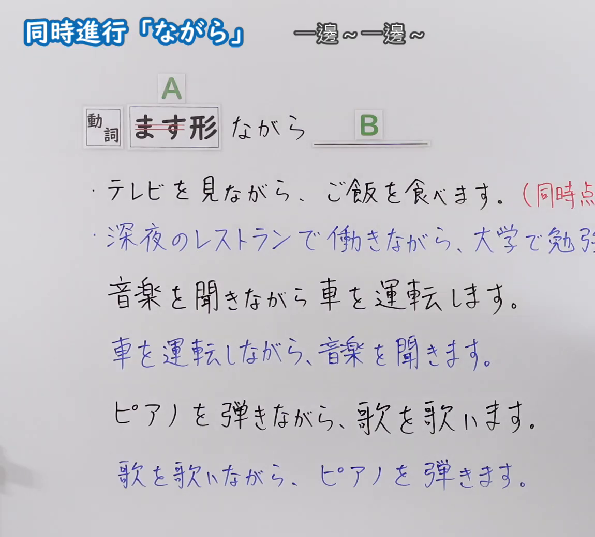
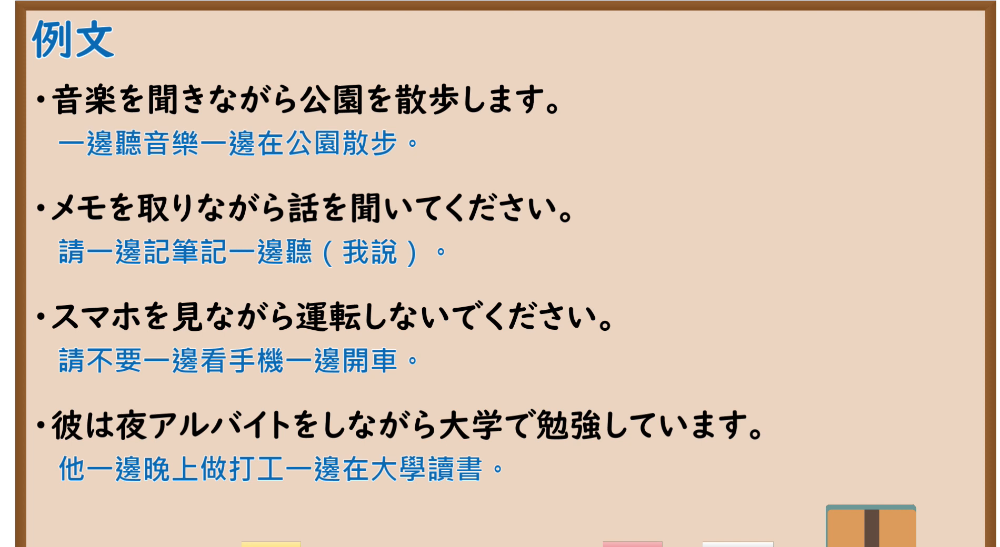

---
{
  "id": "N5-G-0094",
  "kind": "grammar",
  "level": "N5",
  "title": "助词：同时进行「ながら」",
  "card_revision": 2,
  "schema_version": 1,
  "source": {
    "lesson": "N5 第94个语法",
    "material": "出口日語原视频板书（学习者截取的接续图与例句图）与毎日のんびり日本語教師「【Ｎ５文法】～ながら」正文",
    "video": "https://www.youtube.com/watch?v=AigFy-kufZI",
    "screenshot": "assets/grammar/n5/N5-G-0094-connection.png",
    "screenshot_crop": {
      "x": 0,
      "y": 0,
      "width": 1150,
      "height": 1040
    }
  },
  "tags": [
    "ながら",
    "同时进行",
    "ます形",
    "N5"
  ],
  "confusions": [
    "ながら／ながら（逆接）",
    "主语须相同",
    "后项为主要动作",
    "ながら／て"
  ]
}
---

# N5 第94个语法：助词「ながら」（同时进行）

# 视频学习资料整理

- 课程：[出口日語「助詞：同時進行「ながら」」](https://www.youtube.com/watch?v=AigFy-kufZI)
- 视频 ID：`AigFy-kufZI`
- 视频时长：5分33秒

## 接续图

- 实际时间：未记录（图片由学习者从原视频截取并提供）
- 成品图尺寸：1150×1040，固定左上角 `(0, 0)`，右下角 `(1150, 1040)`
- 板书内容：标题「同時進行「ながら」」，右侧标注“一邊～一邊～”；公式「A：動詞 ます形（「ます」划去）ながら B：＿＿」；例句：「テレビを見ながら、ご飯を食べます。（同時点…」（右端被截断）「深夜のレストランで働きながら、大学で勉強…」（蓝字，被截断）；对比：「音楽を聞きながら車を運転します。」「車を運転しながら、音楽を聞きます。」（蓝字）「ピアノを弾きながら、歌を歌います。」「歌を歌いながら、ピアノを弾きます。」（蓝字）。

## 例句图

- 实际时间：未记录（图片由学习者从原视频截取并提供）
- 成品图尺寸：1900×1040，固定左上角 `(0, 0)`，右下角 `(1900, 1040)`
- 板书内容：课程「例文」页，含四条例句及中文翻译（音楽を聞きながら公園を散歩します／メモを取りながら話を聞いてください／スマホを見ながら運転しないでください／彼は夜アルバイトをしながら大学で勉強しています）。四条例句均完整可见。

# 核心

## 功能一：一边～一边～

**くわしい意味記述：**

- **～ながら：** ある動作が他の動作を同時に行われていることを表します。２つの動作のうち、後件が中心的な動作となります。なお、前件と後件の主語は同一でなければいけません。接続は 動詞ます形＋ながら。（表示某个动作与其他动作同时进行。两个动作中，后项是主要动作。另外，前项和后项的主语必须相同。接续为 动词ます形＋ながら。）

### 例句

1. 歌いながら踊る。

   （一边唱歌一边跳舞。）

2. 寝ながらテレビを見る。

   （躺着看电视。）

3. ここは夜景を見ながら飲めるレストランだ。

   （这里是可以边看夜景边喝酒的餐厅。）

4. スマホを見ながら運転するのは法律で禁止されている。

   （法律禁止边看手机边开车。）

5. 泣きながら喜ぶ。

   （边哭边高兴（喜极而泣）。）

# 来源

- [出口日語原视频](https://www.youtube.com/watch?v=AigFy-kufZI)
- [毎日のんびり日本語教師「【Ｎ５文法】～ながら」](https://mainichi-nonbiri.com/grammar/n5-nagara/)（查询日期：2026-10-16；Hagoromo 未收录，故按流程采用优先级最高的备选网站条目；中文译文取自该页）
