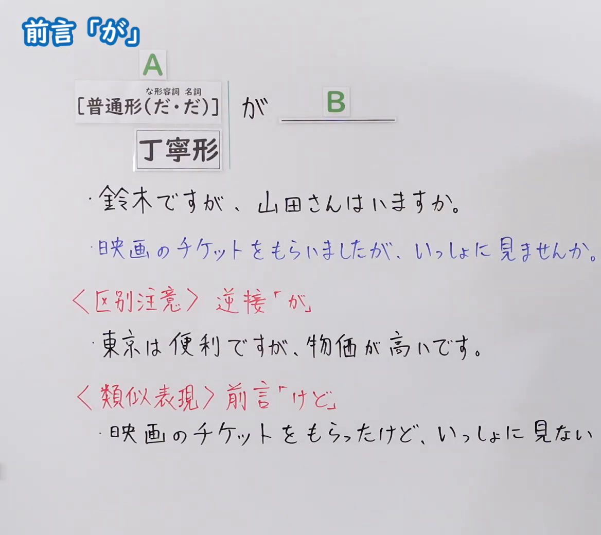
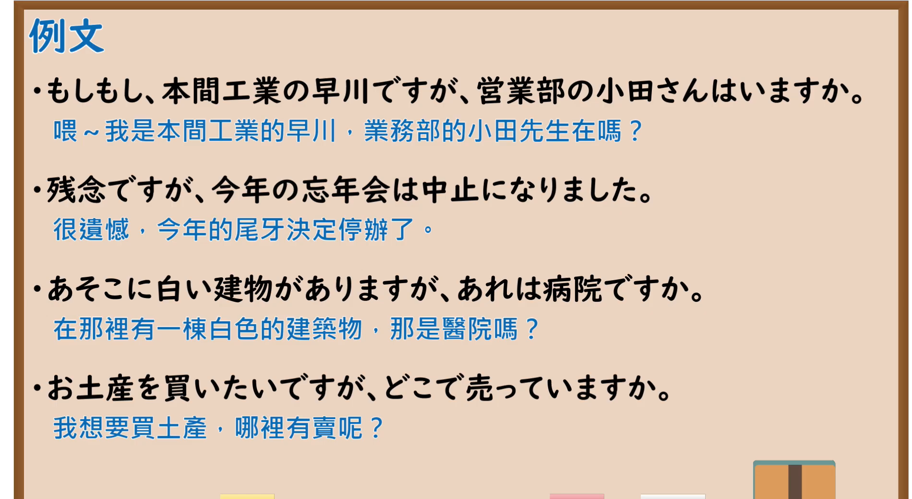

---
{
  "id": "N5-G-0095",
  "kind": "grammar",
  "level": "N5",
  "title": "助词：前言「が」",
  "card_revision": 2,
  "schema_version": 1,
  "source": {
    "lesson": "N5 第95个语法",
    "material": "出口日語原视频板书（学习者截取的接续图与例句图）与东京外国语大学「逆接：解説」正文",
    "video": "https://www.youtube.com/watch?v=CDAG2ybQdQQ",
    "screenshot": "assets/grammar/n5/N5-G-0095-connection.png",
    "screenshot_crop": {
      "x": 0,
      "y": 0,
      "width": 1168,
      "height": 1040
    }
  },
  "tags": [
    "が",
    "前言",
    "前置",
    "N5"
  ],
  "confusions": [
    "前置きの が／逆接の が",
    "が／けど",
    "丁寧形接续",
    "けれども"
  ]
}
---

# N5 第95个语法：助词「が」（前言）

# 视频学习资料整理

- 课程：[出口日語「助詞：前言「が」」](https://www.youtube.com/watch?v=CDAG2ybQdQQ)
- 视频 ID：`CDAG2ybQdQQ`
- 视频时长：7分25秒

## 接续图

- 实际时间：未记录（图片由学习者从原视频截取并提供）
- 成品图尺寸：1168×1040，固定左上角 `(0, 0)`，右下角 `(1168, 1040)`
- 板书内容：标题「前言「が」」；公式「A：［普通形（だ・だ）］（な形容词、名词用「だ」，字小标注在方括号上方）／丁寧形 が B：＿＿」；例句：「鈴木ですが、山田さんはいますか。」「映画のチケットをもらいましたが、いっしょに見ませんか。」（蓝字）；红字「＜区別注意＞逆接「が」」：「東京は便利ですが、物価が高いです。」；红字「＜類似表現＞前言「けど」」：「映画のチケットをもらったけど、いっしょに見ない」（被截断）。

## 例句图

- 实际时间：未记录（图片由学习者从原视频截取并提供）
- 成品图尺寸：1900×1040，固定左上角 `(0, 0)`，右下角 `(1900, 1040)`
- 板书内容：课程「例文」页，含四条例句及中文翻译（もしもし、本間工業の早川ですが、営業部の小田さんはいますか／残念ですが、今年の忘年会は中止になりました／あそこに白い建物がありますが、あれは病院ですか／お土産を買いたいですが、どこで売っていますか）。四条例句均完整可见。

# 核心

## 功能一：前言（提出话题、前提，再提问、请求）

**くわしい意味記述：**

- **「けれども」の前置き用法：** 「けれども」や「けれども」の類義表現には逆接の意味が全くない用法もあります。S1で、S2に述べることがらの話題を示したり、前提となる情報を示したり、相手に質問や依頼などをすることを前もって断ったりします。（「けれども」及其类义表达中也有完全没有逆接意义的用法。用S1提示S2所述事项的话题、提示前提信息，或事先声明要向对方提问、请求等。）
- **「が」：** 「けれども」と同じ意味で、「けれど、けど、が」という表現があります。「～が」は書きことば、話しことば両方で使われます。（与「けれども」意思相同的表达有「けれど、けど、が」。「～が」书面语、口语都可使用。）

### 例句

1. レポートのことですけれども、来週の月曜日に提出してください。

   （关于报告，请下周一提交。）

2. 日本中を旅行しましたけれども、京都が一番すきです。

   （我游遍了日本各地，最喜欢的是京都。）

3. すみませんが、郵便局はこの辺ですか。

   （不好意思，请问邮局在这一带吗？）

4. すみません、パソコンが動かないのですけれども。

   （不好意思，电脑动不了。）

# 来源

- [出口日語原视频](https://www.youtube.com/watch?v=CDAG2ybQdQQ)
- [东京外国语大学「日本語 文法 逆接：解説」](https://www.coelang.tufs.ac.jp/mt/ja/gmod/contents/explanation/082.html)（查询日期：2026-10-16；Hagoromo、毎日のんびり日本語教師、日本語NET 均未找到直接对应条目，按流程采用互联网检索所得的该页；该页把前置用法放在「けれども」下说明，只有「すみませんが、～」是「が」的例句，其余例句用「けれども」，卡内如实照录；只有 4 条，达到下限；例句译文为整理者所译）
