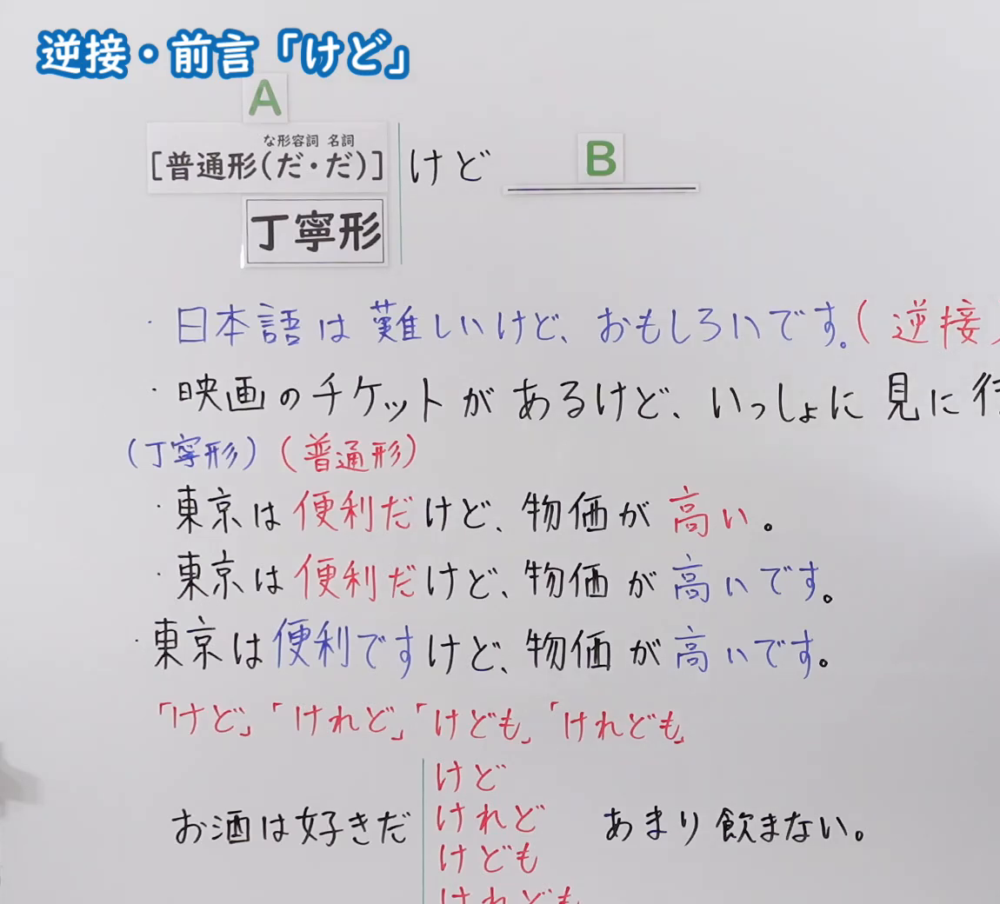
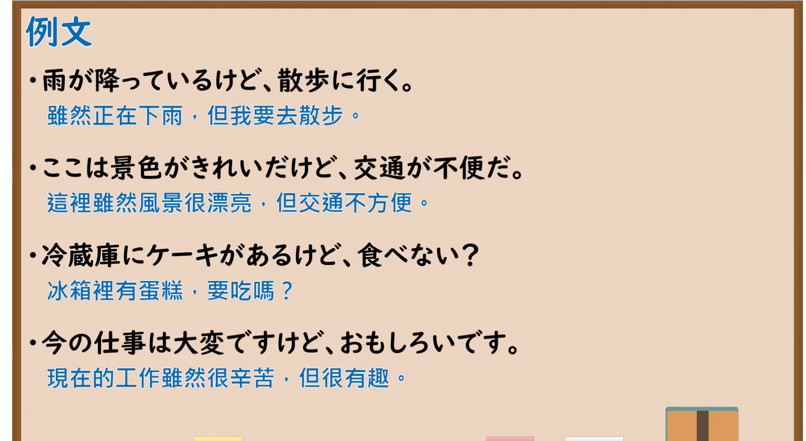

---
{
  "id": "N5-G-0096",
  "kind": "grammar",
  "level": "N5",
  "title": "助词：逆接・前言「けど」",
  "card_revision": 2,
  "schema_version": 1,
  "source": {
    "lesson": "N5 第96个语法",
    "material": "出口日語原视频板书（学习者截取的接续图与例句图）与东京外国语大学「逆接：解説」正文",
    "video": "https://www.youtube.com/watch?v=w9zEbQlW8Oo",
    "screenshot": "assets/grammar/n5/N5-G-0096-connection.png",
    "screenshot_crop": {
      "x": 0,
      "y": 0,
      "width": 1150,
      "height": 1040
    }
  },
  "tags": [
    "けど",
    "逆接",
    "前言",
    "N5"
  ],
  "confusions": [
    "けど／けれど／けども／けれども",
    "けど／が",
    "けど／のに",
    "丁寧形・普通形"
  ]
}
---

# N5 第96个语法：助词「けど」（逆接・前言）

# 视频学习资料整理

- 课程：[出口日語「助詞：逆接・前言「けど」」](https://www.youtube.com/watch?v=w9zEbQlW8Oo)
- 视频 ID：`w9zEbQlW8Oo`
- 视频时长：6分24秒

## 接续图

- 实际时间：未记录（图片由学习者从原视频截取并提供）
- 成品图尺寸：1150×1040，固定左上角 `(0, 0)`，右下角 `(1150, 1040)`
- 板书内容：标题「逆接・前言「けど」」；公式「A：［普通形（だ・だ）］／丁寧形 けど B：＿＿」；例句：「日本語は難しいけど、おもしろいです。（逆接…」（被截断）「映画のチケットがあるけど、いっしょに見に行…」（被截断）；「（丁寧形）（普通形）」下：「東京は便利だけど、物価が高い。」「東京は便利だけど、物価が高いです。」「東京は便利ですけど、物価が高いです。」；红字「「けど」「けれど」「けども」「けれども」」：「お酒は好きだ｛けど／けれど／けども／けれども｝あまり飲まない。」，右半及最下行被画面右缘与下缘截断，未补写。

## 例句图

- 实际时间：未记录（图片由学习者从原视频截取并提供）
- 成品图尺寸：1900×1040，固定左上角 `(0, 0)`，右下角 `(1900, 1040)`
- 板书内容：课程「例文」页，含四条例句及中文翻译（雨が降っているけど、散歩に行く／ここは景色がきれいだけど、交通が不便だ／冷蔵庫にケーキがあるけど、食べない？／今の仕事は大変ですけど、おもしろいです）。四条例句均完整可见。

# 核心

## 功能一：～但是（逆接）；前言

**くわしい意味記述：**

- **「けれども」と類義表現：** 「けれども」と同じ意味で、「けれど、けど、が」という表現があります。「けれども」「けれど」「けど」の順で、より話しことば的になります。「けれども」は普通形、丁寧形両方に接続します。（与「けれども」意思相同的表达有「けれど、けど、が」。按「けれども」「けれど」「けど」的顺序，越来越口语化。「けれども」可接普通形和礼貌形两种。）
- **意味：** 「のに」・「けれども」は、事実的な逆接に使われます。「けれども」はS2が予想と食い違うことがらであることに対する驚き・不満・意外感を表わしません。（「のに」「けれども」用于事实性的逆接。「けれども」不表示对S2与预期不符的惊讶、不满、意外。）

### 例句

1. 毎日日本語を勉強しているけれども、なかなか漢字が覚えられません。

   （每天都在学日语，但是汉字怎么也记不住。）

2. 山田さんはいつも元気ですけれども、きょうは静かです。

   （山田总是很有精神，但是今天很安静。）

3. 雨が降ったけれども予定通り運動会をしました。

   （虽然下了雨，但运动会照常举行了。）

4. 日曜日だけれども、学校に行きますか。

   （虽然是星期日，你还去学校吗？）

5. もう夜の12時だけれども、もう少し勉強しよう。

   （虽然已经夜里12点了，但再学一会儿吧。）

# 来源

- [出口日語原视频](https://www.youtube.com/watch?v=w9zEbQlW8Oo)
- [东京外国语大学「日本語 文法 逆接：解説」](https://www.coelang.tufs.ac.jp/mt/ja/gmod/contents/explanation/082.html)（查询日期：2026-10-16；Hagoromo、毎日のんびり日本語教師、日本語NET 均未找到直接对应条目，按流程采用互联网检索所得的该页；该页例句用「けれども」，没有「けど」本身的例句，卡内如实照录；与第 88 课「が」使用同一来源；例句译文为整理者所译）
