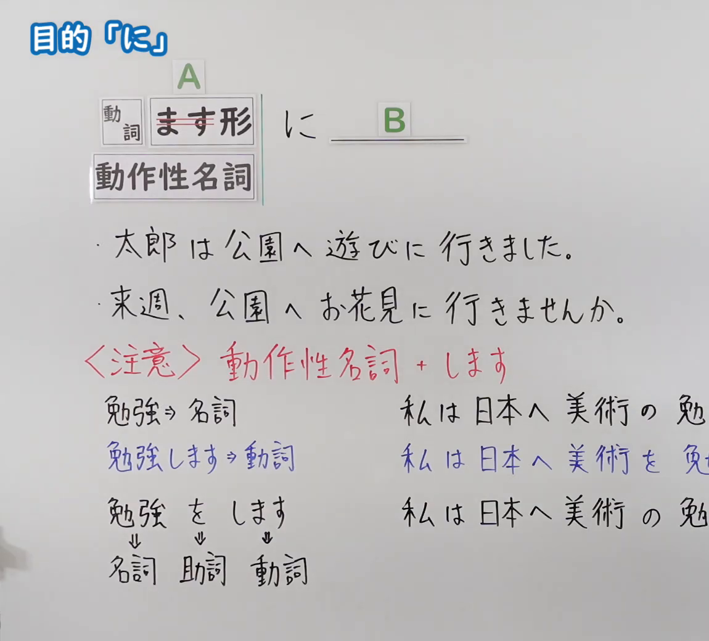
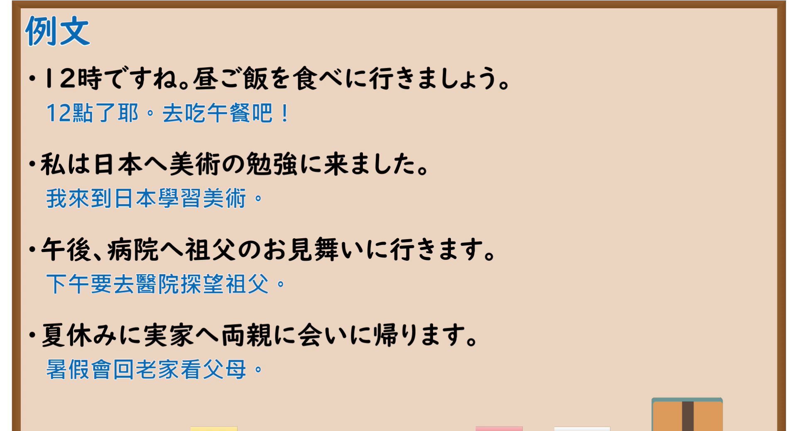

---
{
  "id": "N5-G-0097",
  "kind": "grammar",
  "level": "N5",
  "title": "助词：目的「に」",
  "card_revision": 2,
  "schema_version": 1,
  "source": {
    "lesson": "N5 第97个语法",
    "material": "出口日語原视频板书（学习者截取的接续图与例句图）与毎日のんびり日本語教師「格助詞「に」の用法一覧」正文",
    "video": "https://www.youtube.com/watch?v=UWNPlkI1KTU",
    "screenshot": "assets/grammar/n5/N5-G-0097-connection.png",
    "screenshot_crop": {
      "x": 0,
      "y": 0,
      "width": 1150,
      "height": 1040
    }
  },
  "tags": [
    "に",
    "目的",
    "行く",
    "N5"
  ],
  "confusions": [
    "ます形＋に行く",
    "动作性名词＋に行く",
    "に／ために",
    "勉強をしに／勉強に"
  ]
}
---

# N5 第97个语法：助词「に」（目的）

# 视频学习资料整理

- 课程：[出口日語「助詞：目的「に」」](https://www.youtube.com/watch?v=UWNPlkI1KTU)
- 视频 ID：`UWNPlkI1KTU`
- 视频时长：9分40秒

## 接续图

- 实际时间：未记录（图片由学习者从原视频截取并提供）
- 成品图尺寸：1150×1040，固定左上角 `(0, 0)`，右下角 `(1150, 1040)`
- 板书内容：标题「目的「に」」；公式「A：動詞 ます形（「ます」划去）／動作性名詞 に B：＿＿」；例句：「太郎は公園へ遊びに行きました。」「来週、公園へお花見に行きませんか。」；红字「＜注意＞動作性名詞＋します」：「勉強⇒名詞」「勉強します⇒動詞」「勉強をします」（「名詞・助詞・動詞」分别标注）；右侧对比句「私は日本へ美術の勉…」「私は日本へ美術を勉…」「私は日本へ美術の勉…」均被画面右缘截断，未补写。

## 例句图

- 实际时间：未记录（图片由学习者从原视频截取并提供）
- 成品图尺寸：1900×1040，固定左上角 `(0, 0)`，右下角 `(1900, 1040)`
- 板书内容：课程「例文」页，含四条例句及中文翻译（12時ですね。昼ご飯を食べに行きましょう／私は日本へ美術の勉強に来ました／午後、病院へ祖父のお見舞いに行きます／夏休みに実家へ両親に会いに帰ります）。四条例句均完整可见。

# 核心

## 功能一：为了～（去／来／回去做某事）

**くわしい意味記述：**

- **目的：** 「行く」「来る」などの移動を表す述語のとき、その移動の目的を「に」で表します。「に」の前は目的を表す名詞、あるいは名詞に準じた扱いの動詞連用形が置かれます。（谓语是「行く」「来る」等表示移动的词时，用「に」表示该移动的目的。「に」前面接表示目的的名词，或视同名词的动词连用形。）

### 例句

1. 流れ星を見に行く。

   （去看流星。）

2. 美味しいものを食べに行こう。

   （我们去吃美味的东西吧。）

3. ゴミを捨てに行ってくる。

   （我去倒垃圾。）

4. 保護者の方が次々と生徒を迎えに来ました。

   （家长们一个接一个来接学生。）

5. 買い物に行きたい。

   （我想去购物。）

# 来源

- [出口日語原视频](https://www.youtube.com/watch?v=UWNPlkI1KTU)
- [毎日のんびり日本語教師「格助詞「に」の用法一覧」「目的」](https://mainichi-nonbiri.com/jltct/ni-case-particle/)（查询日期：2026-10-16；Hagoromo 未收录，按流程采用优先级最高的备选网站该页，中文译文取自该页；板书中「動作性名詞＋します」（勉強をします／勉強します）的注意事项该页未解说）
