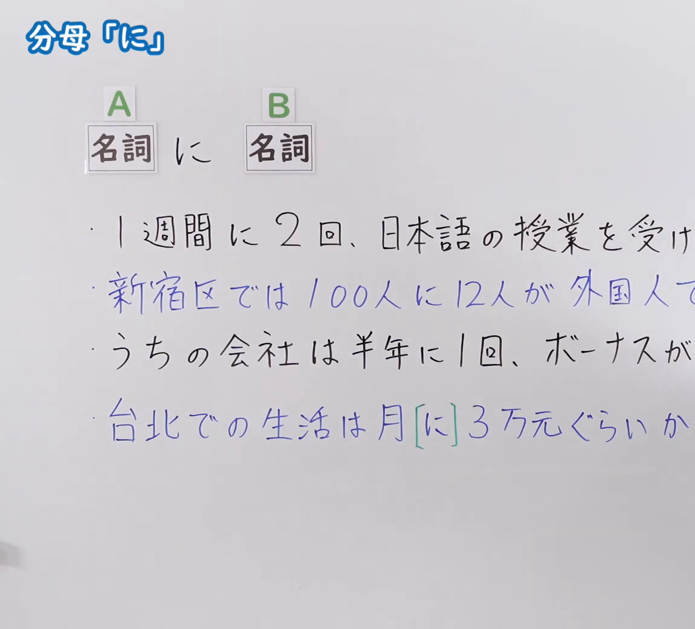
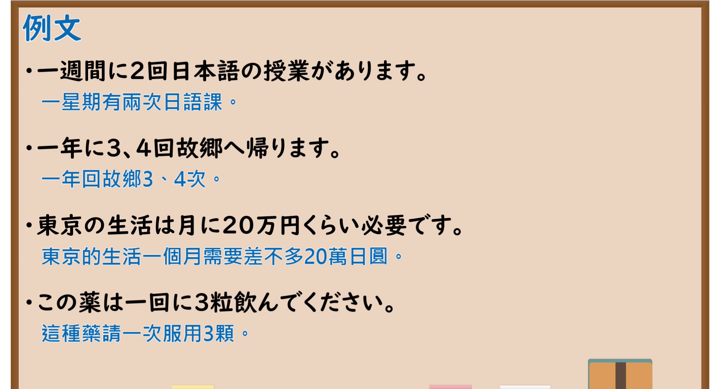

---
{
  "id": "N5-G-0098",
  "kind": "grammar",
  "level": "N5",
  "title": "助词：分母「に」",
  "card_revision": 2,
  "schema_version": 1,
  "source": {
    "lesson": "N5 第98个语法",
    "material": "出口日語原视频板书（学习者截取的接续图与例句图）与毎日のんびり日本語教師「格助詞「に」の用法一覧」正文",
    "video": "https://www.youtube.com/watch?v=dn19hAnoXw8",
    "screenshot": "assets/grammar/n5/N5-G-0098-connection.png",
    "screenshot_crop": {
      "x": 0,
      "y": 0,
      "width": 1150,
      "height": 1040
    }
  },
  "tags": [
    "に",
    "分母",
    "频率",
    "N5"
  ],
  "confusions": [
    "一週間に2回",
    "に／ごとに",
    "100人に12人",
    "月に3万元"
  ]
}
---

# N5 第98个语法：助词「に」（分母）

# 视频学习资料整理

- 课程：[出口日語「助詞：分母「に」」](https://www.youtube.com/watch?v=dn19hAnoXw8)
- 视频 ID：`dn19hAnoXw8`
- 视频时长：6分14秒

## 接续图

- 实际时间：未记录（图片由学习者从原视频截取并提供）
- 成品图尺寸：1150×1040，固定左上角 `(0, 0)`，右下角 `(1150, 1040)`
- 板书内容：标题「分母「に」」；公式「A：名詞 に B：名詞」；例句：「1週間に2回、日本語の授業を受け（ます）」「新宿区では100人に12人が外国人で（す）」（蓝字）「うちの会社は半年に1回、ボーナスが（出る）」「台北での生活は月［に］3万元ぐらいか（かる）」（蓝字，「に」绿框），右端均被画面右缘截断，未补写。

## 例句图

- 实际时间：未记录（图片由学习者从原视频截取并提供）
- 成品图尺寸：1900×1040，固定左上角 `(0, 0)`，右下角 `(1900, 1040)`
- 板书内容：课程「例文」页，含四条例句及中文翻译（一週間に2回日本語の授業があります／一年に3、4回故郷へ帰ります／東京の生活は月に20万円くらい必要です／この薬は一回に3粒飲んでください）。四条例句均完整可见。

# 核心

## 功能一：每～（用「に」表示作为分母的基准数，如频率、比例）

**くわしい意味記述：**

- **割合：** ある数を基準にして数量の割合を表すとき、基準となる数（分母にあたる値）を「に」で表します。（以某个数为基准表示数量的比例时，用「に」表示作为基准的数（相当于分母的值）。）

### 例句

1. １年に１回献血する。

   （每年献血一次。）

2. ５回に１回は失敗する。

   （五次中有一次会失败。）

3. 半年に１回は健康診断をする。

   （每半年进行一次健康检查。）

4. 日本では成人の３人に１人は、脂肪肝だと考えられています。

   （据信，日本每3个成年人中有1人患有脂肪肝。）

5. １００年に一度の大地震にも耐えられる家を建てて、孫の代にまで残してあげたい。

   （想建一座能经受百年一遇大地震的房子，留给子孙后代。）

# 来源

- [出口日語原视频](https://www.youtube.com/watch?v=dn19hAnoXw8)
- [毎日のんびり日本語教師「格助詞「に」の用法一覧」「割合」](https://mainichi-nonbiri.com/jltct/ni-case-particle/)（查询日期：2026-10-16；Hagoromo 未收录，按流程采用优先级最高的备选网站该页，中文译文取自该页）
