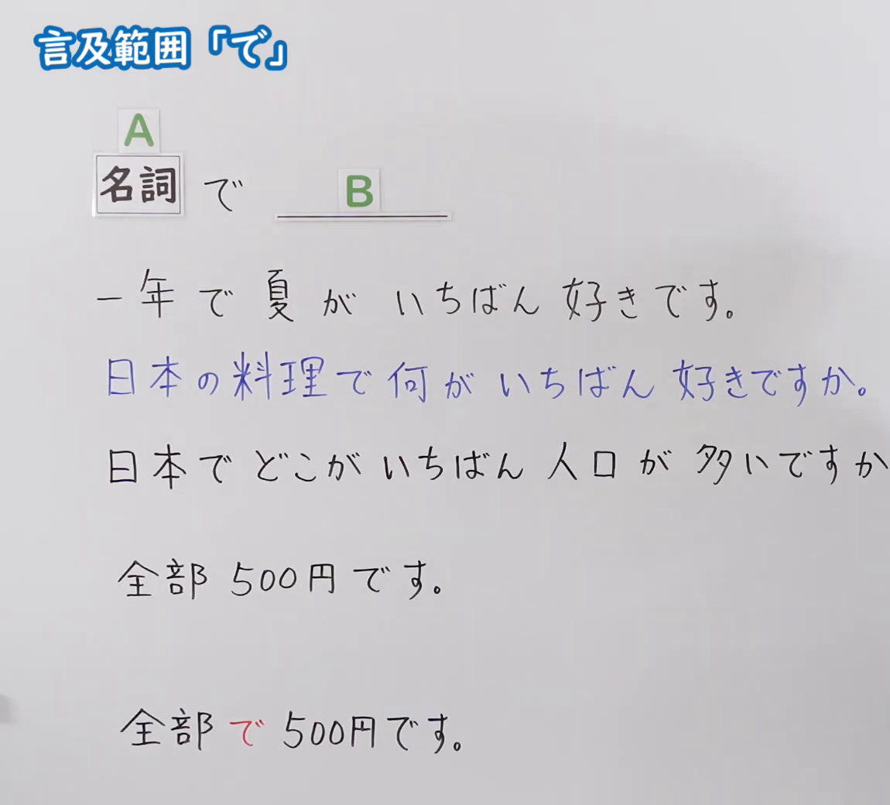
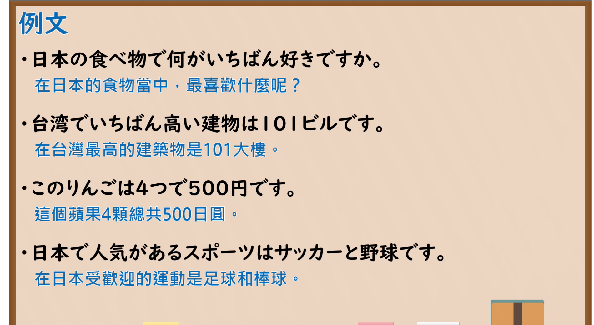

---
{
  "id": "N5-G-0099",
  "kind": "grammar",
  "level": "N5",
  "title": "助词：言及范围「で」",
  "card_revision": 2,
  "schema_version": 1,
  "source": {
    "lesson": "N5 第99个语法",
    "material": "出口日語原视频板书（学习者截取的接续图与例句图）与毎日のんびり日本語教師「格助詞「で」の用法一覧」正文",
    "video": "https://www.youtube.com/watch?v=oM414c0ltUQ",
    "screenshot": "assets/grammar/n5/N5-G-0099-connection.png",
    "screenshot_crop": {
      "x": 0,
      "y": 0,
      "width": 1150,
      "height": 1040
    }
  },
  "tags": [
    "で",
    "范围",
    "最上级",
    "N5"
  ],
  "confusions": [
    "で／に",
    "いちばん",
    "全部で／全部",
    "范围の上限"
  ]
}
---

# N5 第99个语法：助词「で」（言及范围）

# 视频学习资料整理

- 课程：[出口日語「助詞：言及範囲「で」」](https://www.youtube.com/watch?v=oM414c0ltUQ)
- 视频 ID：`oM414c0ltUQ`
- 视频时长：4分43秒

## 接续图

- 实际时间：未记录（图片由学习者从原视频截取并提供）
- 成品图尺寸：1150×1040，固定左上角 `(0, 0)`，右下角 `(1150, 1040)`
- 板书内容：标题「言及範囲「で」」；公式「A：名詞 で B：＿＿」；例句：「一年で夏がいちばん好きです。」「日本の料理で何がいちばん好きですか。」（蓝字）「日本でどこがいちばん人口が多いですか」（句末被截断）；下方对比「全部500円です。」「全部で500円です。」（「で」红字）。

## 例句图

- 实际时间：未记录（图片由学习者从原视频截取并提供）
- 成品图尺寸：1900×1040，固定左上角 `(0, 0)`，右下角 `(1900, 1040)`
- 板书内容：课程「例文」页，含四条例句及中文翻译（日本の食べ物で何がいちばん好きですか／台湾でいちばん高い建物は101ビルです／このりんごは4つで500円です／日本で人気があるスポーツはサッカーと野球です）。四条例句均完整可见。

# 核心

## 功能一：在～当中；一共～（表示言及的范围、总量）

**くわしい意味記述：**

- **範囲の上限：** 述語の事態が成立する数量的な範囲の上限を「で」で表します。（用「で」表示谓语事态成立的数量范围的上限。）
- **時間（期間）：** 期間を表す時間名詞に「で」がつくと、述語の事態成立にかかった動作の時間を表すことができます。（在表示期间的时间名词后加「で」，可以表示完成谓语事态所花的时间。）

### 例句

1. あと１週間で間に合いますか？

   （还有一个星期来得及吗？）

2. 今なら全品２つで１００円です。

   （现在所有商品两件100日元。）

3. ３日で全部暗記する。

   （三天内全部背下来。）

4. 先着１０名で締め切ります。

   （先到的10名截止。）

5. この仕事は２時間でできるだろう。

   （这项工作2小时能完成吧。）

# 来源

- [出口日語原视频](https://www.youtube.com/watch?v=oM414c0ltUQ)
- [毎日のんびり日本語教師「格助詞「で」の用法一覧」「範囲の上限」「時間」](https://mainichi-nonbiri.com/jltct/de-case-particle/)（查询日期：2026-10-16；Hagoromo 未收录，按流程采用优先级最高的备选网站该页，中文译文取自该页；板书的最上级用法（「日本の料理で何がいちばん～」「台湾でいちばん高い～」）该页没有对应例句，卡内未写）
