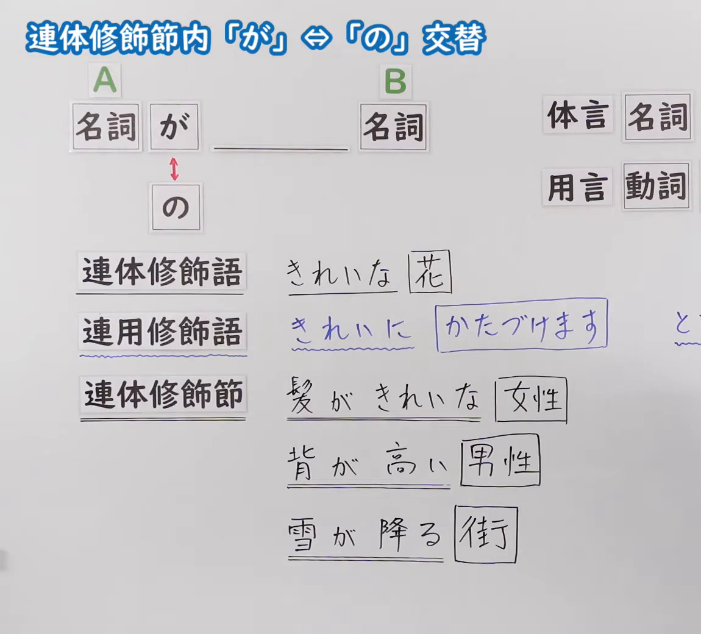
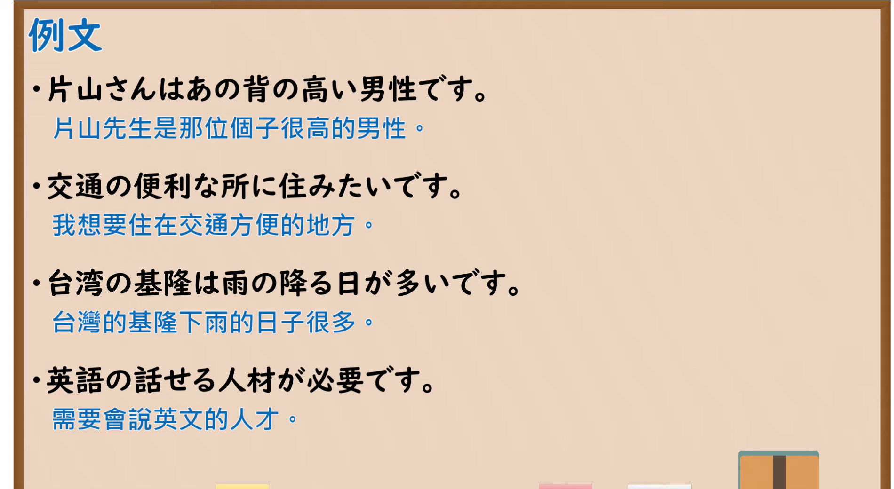

---
{
  "id": "N5-G-0100",
  "kind": "grammar",
  "level": "N5",
  "title": "连体修饰节内「が」⇔「の」交替",
  "card_revision": 2,
  "schema_version": 1,
  "source": {
    "lesson": "N5 第100个语法",
    "material": "出口日語原视频板书（学习者截取的接续图与例句图）与日本語教師N1et「名詞修飾節内の主語に付く「の・が」の使い分け」正文",
    "video": "https://www.youtube.com/watch?v=3hC8yIxB_aY",
    "screenshot": "assets/grammar/n5/N5-G-0100-connection.png",
    "screenshot_crop": {
      "x": 0,
      "y": 0,
      "width": 1150,
      "height": 1040
    }
  },
  "tags": [
    "が",
    "の",
    "连体修饰",
    "主语",
    "N5"
  ],
  "confusions": [
    "が／の",
    "连体修饰语／连用修饰语／连体修饰节",
    "修饰节长度",
    "所有物"
  ]
}
---

# N5 第100个语法：连体修饰节内「が」⇔「の」交替

# 视频学习资料整理

- 课程：[出口日語「連体修飾節内「が」⇔「の」交替」](https://www.youtube.com/watch?v=3hC8yIxB_aY)
- 视频 ID：`3hC8yIxB_aY`
- 视频时长：7分32秒

## 接续图

- 实际时间：未记录（图片由学习者从原视频截取并提供）
- 成品图尺寸：1150×1040，固定左上角 `(0, 0)`，右下角 `(1150, 1040)`
- 板书内容：标题「連体修飾節内「が」⇔「の」交替」；公式「A：名詞 が ＿＿ B：名詞」，「が」下有红色双箭头指向「の」；右上「体言：名詞」「用言：動詞」（被截断）；左侧三栏：「連体修飾語」「きれいな［花］」，「連用修飾語」「きれいに［かたづけます］」，「連体修飾節」「髪がきれいな［女性］」「背が高い［男性］」「雪が降る［街］」（修饰部分下划线，被修饰名词方框）。

## 例句图

- 实际时间：未记录（图片由学习者从原视频截取并提供）
- 成品图尺寸：1900×1040，固定左上角 `(0, 0)`，右下角 `(1900, 1040)`
- 板书内容：课程「例文」页，含四条例句及中文翻译（片山さんはあの背の高い男性です／交通の便利な所に住みたいです／台湾の基隆は雨の降る日が多いです／英語の話せる人材が必要です）。四条例句均完整可见，句中均是修饰节内的「が」换成了「の」的形式。

# 核心

## 功能一：连体修饰节中的主语，「が」可换成「の」

**くわしい意味記述：**

- **が・の交替：** 本来、名詞修飾節内の主語は「これは彼が作ったケーキです」のように「が」になります。この「が」は「の」で言い換え可能な場合と言い換えが難しい場合とがあります。（原本，名词修饰节内的主语是「これは彼が作ったケーキです」这样用「が」。这个「が」有的能换成「の」，有的很难换。）
- **「の」が使いにくい場合：** 修飾節内が長いものほど「の」が使いにくくなります。主語の所有物じゃないものは「の」が使いにくくなります。（修饰节越长越难用「の」。不属于主语所有物的，也难用「の」。）

### 例句

1. これは彼が作ったケーキです。

   （这是他做的蛋糕。）

2. これは彼の作ったケーキです。

   （这是他做的蛋糕（「が」换成「の」）。）

3. Aさんが私に書いた地図（〇）／Aさんの私に書いた地図（✕）

   （A写给我的地图（用「が」自然，用「の」不自然））

4. 彼が連れて来た人（〇）／彼の連れて来た人（△）

   （他带来的人（「の」略不自然））

5. 彼が料理を作る音がする。

   （听得见他做菜的声音。）

# 来源

- [出口日語原视频](https://www.youtube.com/watch?v=3hC8yIxB_aY)
- [日本語教師N1et「名詞修飾節内の主語に付く「の・が」の使い分け」](https://jn1et.com/meisishuushoku-no-ga/)（查询日期：2026-10-16；Hagoromo、毎日のんびり日本語教師、日本語NET、东京外国语大学均未找到直接对应条目，按流程采用互联网检索所得的该页；该页是教师向的解说，没有中文翻译，例句译文为整理者所译；板书中「髪がきれいな女性」「背が高い男性」「雪が降る街」的修饰节例句及「連体修飾語／連用修飾語」的区分该页未列出，课程「例文」页的四条句子也不在该页中，卡内的「例句」取自该页）
