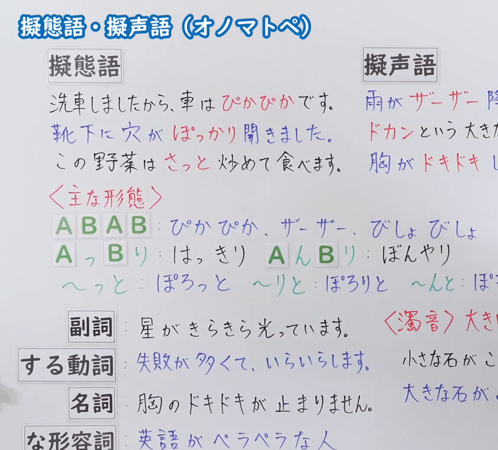
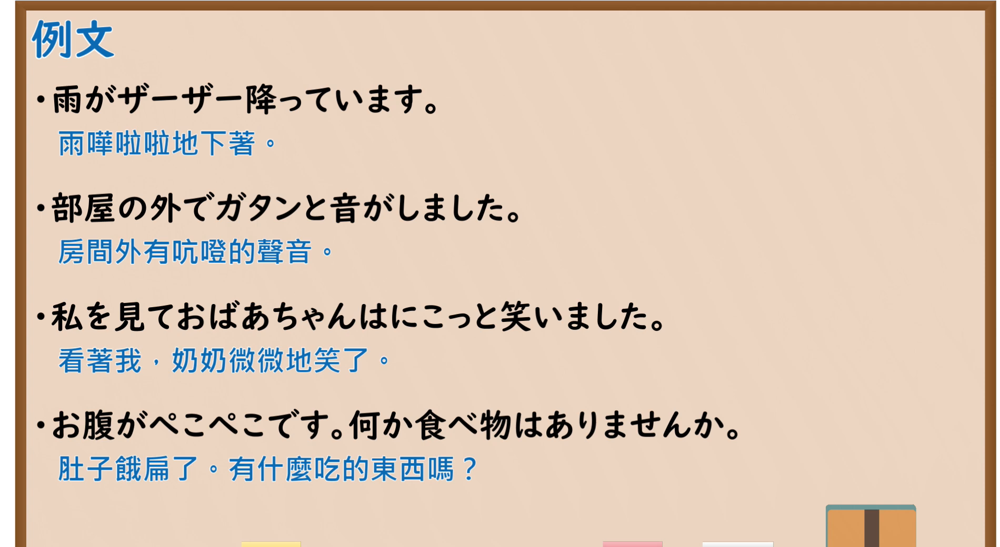

---
{
  "id": "N5-G-0101",
  "kind": "grammar",
  "level": "N5",
  "title": "拟态语・拟声语（オノマトペ）",
  "card_revision": 2,
  "schema_version": 1,
  "source": {
    "lesson": "N5 第101个语法",
    "material": "出口日語原视频板书（学习者截取的接续图与例句图）与国立国語研究所「擬音語・擬態語」コラム正文",
    "video": "https://www.youtube.com/watch?v=VvUwbqtzI0U",
    "screenshot": "assets/grammar/n5/N5-G-0101-connection.png",
    "screenshot_crop": {
      "x": 0,
      "y": 0,
      "width": 1150,
      "height": 1040
    }
  },
  "tags": [
    "オノマトペ",
    "拟态语",
    "拟声语",
    "N5"
  ],
  "confusions": [
    "擬音語／擬態語／擬声語",
    "ABAB型",
    "っと／りと／んと",
    "濁音の大きさ"
  ]
}
---

# N5 第101个语法：拟态语・拟声语（オノマトペ）

# 视频学习资料整理

- 课程：[出口日語「擬態語・擬声語（オノマトペ）」](https://www.youtube.com/watch?v=VvUwbqtzI0U)
- 视频 ID：`VvUwbqtzI0U`
- 视频时长：9分48秒

## 接续图

- 实际时间：未记录（图片由学习者从原视频截取并提供）
- 成品图尺寸：1150×1040，固定左上角 `(0, 0)`，右下角 `(1150, 1040)`
- 板书内容：标题「擬態語・擬声語（オノマトペ）」；左右两栏：「擬態語」例句「洗車しましたから、車はぴかぴかです。」「靴下に穴がぽっかり開きました。」「この野菜はさっと炒めて食べます。」，「擬声語」例句「雨がザーザー降（っています）」「ドカンという大き（な音）」「胸がドキドキ（します）」（右栏被画面右缘截断）；红字「＜主な形態＞」：「ABAB：ぴかぴか、ザーザー、びしょびしょ」「A っ B り：はっきり　A ん B り：ぼんやり」「～っと：ぽろっと　～りと：ぽろりと　～んと：ぽ…」（被截断）；词类用法：「副詞：星がきらきら光っています」「する動詞：失敗が多くて、いらいらします」「名詞：胸のドキドキが止まりません」「な形容詞：英語がぺらぺらな人」；右侧红字「＜濁音＞大き（な音）」「小さな石がこ…」「大きな石が…」被截断，未补写。

## 例句图

- 实际时间：未记录（图片由学习者从原视频截取并提供）
- 成品图尺寸：1900×1040，固定左上角 `(0, 0)`，右下角 `(1900, 1040)`
- 板书内容：课程「例文」页，含四条例句及中文翻译（雨がザーザー降っています／部屋の外でガタンと音がしました／私を見ておばあちゃんはにこっと笑いました／お腹がぺこぺこです。何か食べ物はありませんか）。四条例句均完整可见。

# 核心

## 功能一：拟声语、拟态语（表示声音、状态的象声象态词）

**くわしい意味記述：**

- **擬音語・擬態語の分類：** 「ごろごろ」「しんなり」などの言葉は、一般に「擬音語・擬態語」または「擬声語・擬態語」とも呼ばれています。金田一は、その意味から５つに分類しました。（「ごろごろ」「しんなり」等词语一般称为「擬音語・擬態語」或「擬声語・擬態語」。金田一根据意义将其分为5类。）

### 例句

1. 「擬声語」：わんわん、こけこっこー、おぎゃー、げらげら、ぺちゃくちゃ

   （「擬声語」（人或动物的声音）：汪汪、喔喔喔、哇哇、哈哈大笑、叽叽喳喳）

2. 「擬音語」：ざあざあ、がちゃん、ごろごろ、ばたーん、どんどん

   （「擬音語」（自然界的声音、物体的声音）：哗哗、咔嚓、轰隆隆、砰、咚咚）

3. 「擬態語」：きらきら、つるつる、さらっと、ぐちゃぐちゃ、どんより

   （「擬態語」（事物的状态）：闪闪、光滑、爽利地、乱七八糟、阴沉沉）

4. 「擬容語」：うろうろ、ふらり、ぐんぐん、ばたばた、のろのろ、ぼうっと

   （「擬容語」（动作的样子）：转来转去、飘然、一个劲儿地、忙乱、慢吞吞、发呆）

5. 「擬情語」：いらいら、うっとり、どきり、ずきずき、しんみり、わくわく

   （「擬情語」（心情、感觉）：焦躁、陶醉、怦然、刺痛、沉静、兴奋）

# 来源

- [出口日語原视频](https://www.youtube.com/watch?v=VvUwbqtzI0U)
- [国立国語研究所「日本語の擬音語について １」コラム「擬音語・擬態語」にはどんな種類がある？](https://www2.ninjal.ac.jp/Onomatope/column/nihongo_1.html)（查询日期：2026-10-16；Hagoromo、毎日のんびり日本語教師、日本語NET、东京外国语大学均未找到直接对应条目，按流程采用互联网检索所得的该页；该页是词类分类说明，没有完整例句，卡内「例句」是该页各类词例；词例译文为整理者所译；板书中「ABAB／A っ B り」等形态、词性用法、浊音含义该页未解说）
