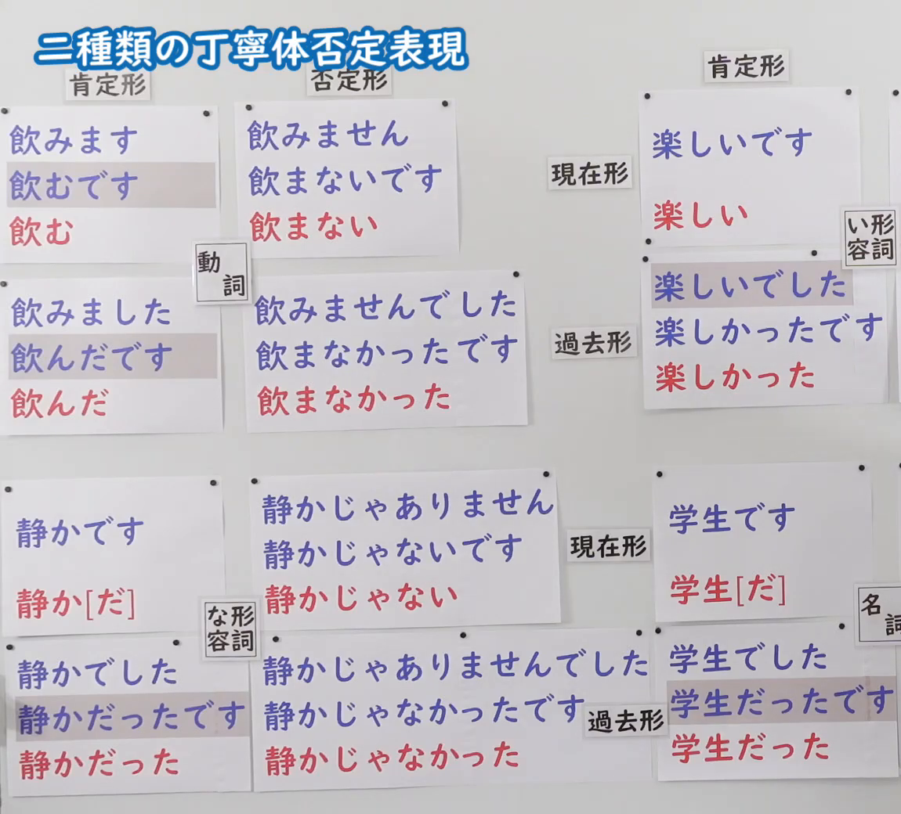
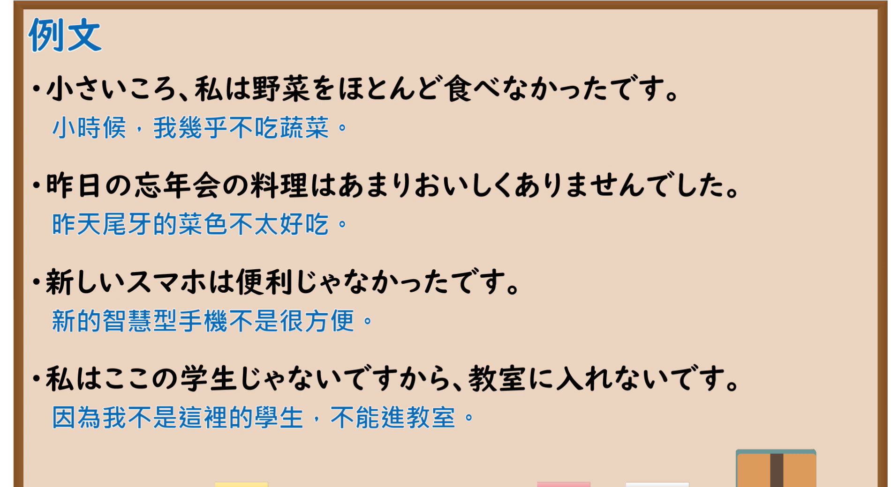

---
{
  "id": "N5-G-0102",
  "kind": "grammar",
  "level": "N5",
  "title": "二种类的丁宁体否定表现",
  "card_revision": 2,
  "schema_version": 1,
  "source": {
    "lesson": "N5 第102个语法",
    "material": "出口日語原视频板书（学习者截取的接续图与例句图）与国立国語研究所「「ません」と「ないです」のどちらを教えたらよいですか」と日本語教師の広場「否定の形「～ません」と「～ないです」」正文",
    "video": "https://www.youtube.com/watch?v=SUGleiQ4Z8s",
    "screenshot": "assets/grammar/n5/N5-G-0102-connection.png",
    "screenshot_crop": {
      "x": 0,
      "y": 0,
      "width": 1150,
      "height": 1040
    }
  },
  "tags": [
    "否定",
    "丁宁体",
    "ません",
    "ないです",
    "N5"
  ],
  "confusions": [
    "ません系／ないです系",
    "ませんでした／なかったです",
    "学生だった／学生でした",
    "い形容词・な形容词・名词"
  ]
}
---

# N5 第102个语法：二种类的丁宁体否定表现

# 视频学习资料整理

- 课程：[出口日語「二種類の丁寧体否定表現」](https://www.youtube.com/watch?v=SUGleiQ4Z8s)
- 视频 ID：`SUGleiQ4Z8s`
- 视频时长：10分48秒

## 接续图

- 实际时间：未记录（图片由学习者从原视频截取并提供）
- 成品图尺寸：1150×1040，固定左上角 `(0, 0)`，右下角 `(1150, 1040)`
- 板书内容：标题「二種類の丁寧体否定表現」，无接续公式；板书为活用表：横列「動詞／い形容詞／な形容詞／名詞」，纵列「肯定形／否定形」，各格上下三行（蓝字丁宁体、红字普通体）：動詞 現在「飲みます／飲むです／飲む」→否定「飲みません／飲まないです／飲まない」，過去「飲みました／飲んだです／飲んだ」→「飲みませんでした／飲まなかったです／飲まなかった」；い形容詞 現在「楽しいです／楽しい」，過去「楽しいでした／楽しかったです／楽しかった」；な形容詞 現在「静かです／静か[だ]」→否定「静かじゃありません／静かじゃないです／静かじゃない」，過去「静かでした／静かだったです／静かだった」→「静かじゃありませんでした／静かじゃなかったです／静かじゃなかった」；名詞 現在「学生です／学生[だ]」，過去「学生でした／学生だったです／学生だった」；灰色高亮行标出「…です」型形式。右上角表格被画面右缘截断，未补写。

## 例句图

- 实际时间：未记录（图片由学习者从原视频截取并提供）
- 成品图尺寸：1900×1040，固定左上角 `(0, 0)`，右下角 `(1900, 1040)`
- 板书内容：课程「例文」页，含四条例句及中文翻译（小さいころ、私は野菜をほとんど食べなかったです／昨日の忘年会の料理はあまりおいしくありませんでした／新しいスマホは便利じゃなかったです／私はここの学生じゃないですから、教室に入れないです）。四条例句均完整可见。

# 核心

## 功能一：丁宁体的两种否定形式（～ません系与～ないです系）

**くわしい意味記述：**

- **二つの形式：** 日本語の述語の否定形には、「〜ません」（マセン系）と「〜ないです」（ナイデス系）の二つの形式があります。（日语谓语的否定形有「〜ません」（マセン系）和「〜ないです」（ナイデス系）两种形式。）
- **使われ方：** 日本語教科書では「ません」が紹介されていますが、実際の日常会話では「ないです」の使用が圧倒的に多いです。マセン系のほうが規範的、標準的であると意識されているが、実際の話しことばではナイデス系のほうがよく使われます。（日语教材介绍的是「ません」，但实际日常会话中「ないです」的使用占压倒性多数。人们认为マセン系更规范、更标准，但实际口语中ナイデス系更常用。）

### 例句

1. A：納豆を食べますか？　B：食べないですね。　C：私も食べません。

   （A：吃纳豆吗？　B：不吃呢。　C：我也不吃。）

2. 「お箸、要りますか？」「いらないです。」

   （“需要筷子吗？”“不用了。”）

3. 学生です → 学生じゃありません／学生じゃないです

   （是学生 → 不是学生（两种否定））

4. 大きいです → 大きくありません／大きくないです

   （大 → 不大（两种否定））

5. 食べます → 食べません／食べないです

   （吃 → 不吃（两种否定））

# 来源

- [出口日語原视频](https://www.youtube.com/watch?v=SUGleiQ4Z8s)
- [国立国語研究所「日本語教育では「ません」と「ないです」のどちらを教えたらよいですか」](https://kotoba.ninjal.ac.jp/qa/yokuaru/qa-77/)、[日本語教師の広場「否定の形「～ません」と「～ないです」」](https://www.tomojuku.com/blog/negativeform/)（查询日期：2026-10-16；Hagoromo、毎日のんびり日本語教師、日本語NET、东京外国语大学均未找到直接对应条目，按流程采用互联网检索所得的两页；两页是论述性文章，只有 2 条口语例句，另 3 条是日本語教師の広場页表 1 的词形对照（学生・大きい・食べる等），不是完整句子；板书中な形容词、名词的过去形等各格本页未全部列表；译文为整理者所译）
