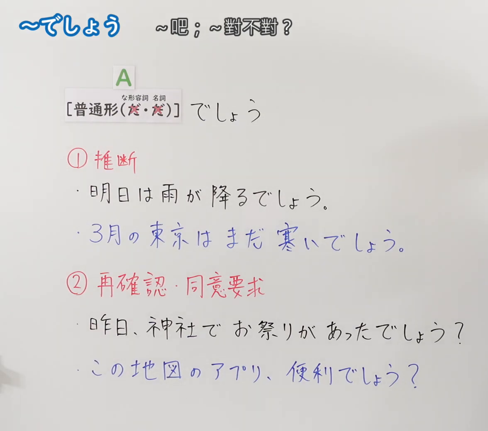
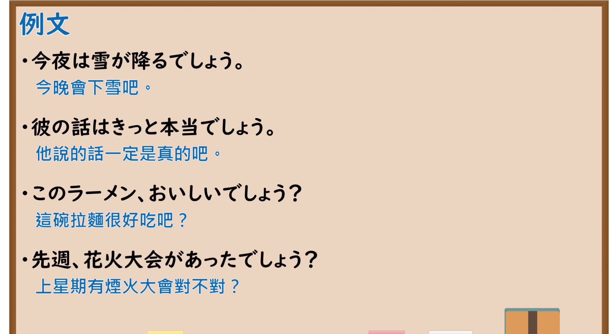

---
{
  "id": "N5-G-0103",
  "kind": "grammar",
  "level": "N5",
  "title": "～でしょう",
  "card_revision": 2,
  "schema_version": 1,
  "source": {
    "lesson": "N5 第103个语法",
    "material": "出口日語原视频板书（学习者截取的接续图与例句图）与东京外国语大学「～でしょう：解説」与日本語NET「〜でしょう（確認・同意）」正文",
    "video": "https://www.youtube.com/watch?v=Q8KXlJ-qzZA",
    "screenshot": "assets/grammar/n5/N5-G-0103-connection.png",
    "screenshot_crop": {
      "x": 0,
      "y": 0,
      "width": 1176,
      "height": 1040
    }
  },
  "tags": [
    "でしょう",
    "推断",
    "确认",
    "同意",
    "N5"
  ],
  "confusions": [
    "でしょう／だろう",
    "推断／确认",
    "でしょうか",
    "かもしれない"
  ]
}
---

# N5 第103个语法：～でしょう

# 视频学习资料整理

- 课程：[出口日語「～でしょう」](https://www.youtube.com/watch?v=Q8KXlJ-qzZA)
- 视频 ID：`Q8KXlJ-qzZA`
- 视频时长：4分31秒

## 接续图

- 实际时间：未记录（图片由学习者从原视频截取并提供）
- 成品图尺寸：1176×1040，固定左上角 `(0, 0)`，右下角 `(1176, 1040)`
- 板书内容：标题「～でしょう」，右侧标注“～吧；～對不對？”；公式「A：［普通形（だ・だ）］（な形容词、名词的「だ」被红叉划去）でしょう」；「①推断」：「明日は雨が降るでしょう。」「3月の東京はまだ寒いでしょう。」（蓝字）；「②再確認・同意要求」：「昨日、神社でお祭りがあったでしょう？」「この地図のアプリ、便利でしょう？」（蓝字）。板书完整，无遮挡。

## 例句图

- 实际时间：未记录（图片由学习者从原视频截取并提供）
- 成品图尺寸：1900×1040，固定左上角 `(0, 0)`，右下角 `(1900, 1040)`
- 板书内容：课程「例文」页，含四条例句及中文翻译（今夜は雪が降るでしょう／彼の話はきっと本当でしょう／このラーメン、おいしいでしょう？／先週、花火大会があったでしょう？）。四条例句均完整可见。

# 核心

## 功能一：推断；再确认・要求同意（～吧；～对不对？）

**くわしい意味記述：**

- **推量：** 「でしょう」（普通形「だろう」）は、話し手が確認していないことを推量して述べるときに使います。「でしょう」で表わされる推測は主観的で、はっきりした根拠をもちません。（「でしょう」（普通形「だろう」）用于说话人叙述自己未确认的事情的推测。「でしょう」表达的推测是主观的，没有明确根据。）
- **確認・同意：** 〜でしょう？は、聞き手に確認を求めたり、同意を求めたりするときに使います。接続は 動詞・イ形容詞・ナ形容詞・名詞の普通形＋でしょう。（「〜でしょう？」用于向听话人寻求确认或同意。接续为 动词・い形容词・な形容词・名词的普通形＋でしょう。）

### 例句

1. あしたは晴れるでしょう。

   （明天会放晴吧。）

2. きょうの試合では、Aチームが勝つでしょう。

   （今天的比赛A队会赢吧。）

3. A：きのう、外語大のチームは勝ちましたか。　B：わかりません。でも、たぶん勝ったでしょう。

   （A：昨天外语大的队赢了吗？　B：不知道。不过大概赢了吧。）

4. あそこに人がいますね。あの人はだれでしょう。たぶん田中さんでしょう。

   （那边有人呢。那个人是谁呢？大概是田中吧。）

5. ねぇ、冷蔵庫にあった私のケーキ食べたでしょう？

   （喂，你吃了冰箱里我的蛋糕吧？）

# 来源

- [出口日語原视频](https://www.youtube.com/watch?v=Q8KXlJ-qzZA)
- [东京外国语大学「日本語 文法 ～でしょう：解説」](https://www.coelang.tufs.ac.jp/mt/ja/gmod/contents/explanation/075.html)（推量，例1–4）、[日本語NET「【JLPT N5】文法・例文：〜でしょう（確認・同意）」](https://nihongokyoshi-net.com/2020/01/29/jlptn5-grammar-deshou/)（确认・同意，例5；查询日期：2026-10-16；Hagoromo、毎日のんびり日本語教師均未找到直接对应条目，按流程采用互联网检索所得的两页；日本語NET 页只有英文翻译；译文为整理者所译）
