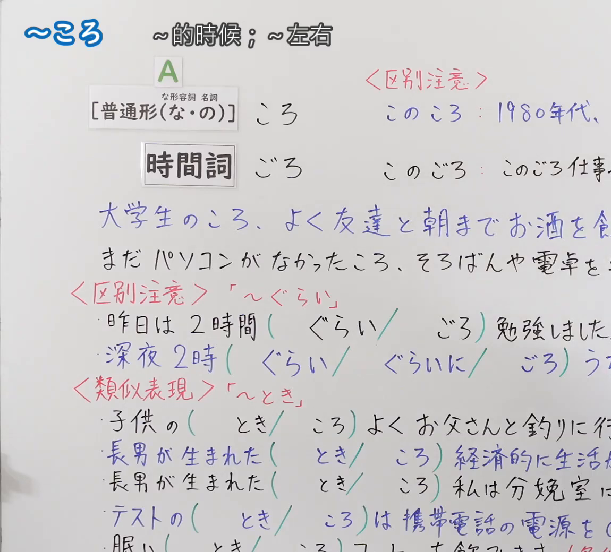
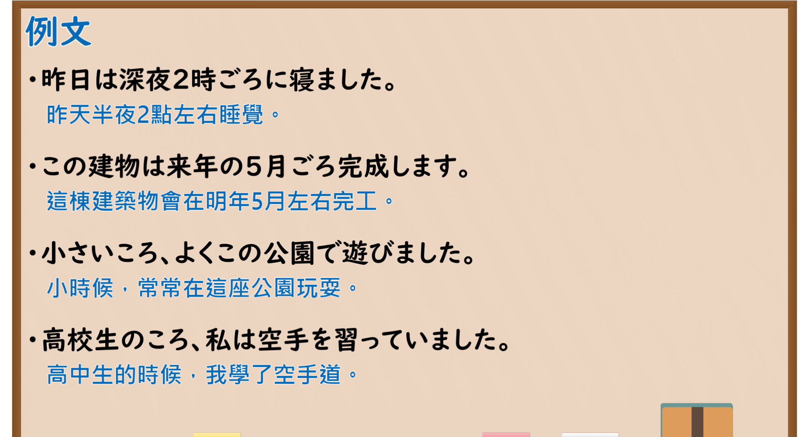

---
{
  "id": "N5-G-0104",
  "kind": "grammar",
  "level": "N5",
  "title": "～ころ",
  "card_revision": 2,
  "schema_version": 1,
  "source": {
    "lesson": "N5 第104个语法",
    "material": "出口日語原视频板书（学习者截取的接续图与例句图）与Iku老師日文「〜ごろ」与e-kotobano「頃（ころ／ごろ）の使い分け」正文",
    "video": "https://www.youtube.com/watch?v=FwSWiOrVntA",
    "screenshot": "assets/grammar/n5/N5-G-0104-connection.png",
    "screenshot_crop": {
      "x": 0,
      "y": 0,
      "width": 1150,
      "height": 1040
    }
  },
  "tags": [
    "ころ",
    "ごろ",
    "时间",
    "N5"
  ],
  "confusions": [
    "ころ／ごろ",
    "ごろ／ぐらい",
    "ころ／とき",
    "このころ／このごろ"
  ]
}
---

# N5 第104个语法：～ころ・～ごろ

# 视频学习资料整理

- 课程：[出口日語「～ころ」](https://www.youtube.com/watch?v=FwSWiOrVntA)
- 视频 ID：`FwSWiOrVntA`
- 视频时长：10分52秒

## 接续图

- 实际时间：未记录（图片由学习者从原视频截取并提供）
- 成品图尺寸：1150×1040，固定左上角 `(0, 0)`，右下角 `(1150, 1040)`
- 板书内容：标题「～ころ」，右侧标注“～的時候；～左右”；公式「A：［普通形（な・の）］ころ」「時間詞 ごろ」；右上红字「＜区別注意＞」「このころ：1980年代、…」「このごろ：このごろ仕事…」（被截断）；例句：「大学生のころ、よく友達と朝までお酒を飲…」「まだパソコンがなかったころ、そろばんや電卓を…」，句末被画面右缘截断；红字「＜区別注意＞「～ぐらい」」：「昨日は2時間（ぐらい／ごろ）勉強しました。」「深夜2時（ぐらい／ぐらいに／ごろ）うた…」；红字「＜類似表現＞「～とき」」：「子供の（とき／ころ）よくお父さんと釣りに行…」「長男が生まれた（とき／ころ）経済的に生活…」「長男が生まれた（とき／ころ）私は分娩室に…」「テストの（とき／ころ）は携帯電話の電源を…」「眠い（とき／ころ）コーヒーを飲みます。（ ×…」，右侧及底部被画面右缘与下缘截断，未补写。

## 例句图

- 实际时间：未记录（图片由学习者从原视频截取并提供）
- 成品图尺寸：1900×1040，固定左上角 `(0, 0)`，右下角 `(1900, 1040)`
- 板书内容：课程「例文」页，含四条例句及中文翻译（昨日は深夜2時ごろに寝ました／この建物は来年の5月ごろ完成します／小さいころ、よくこの公園で遊びました／高校生のころ、私は空手を習っていました）。四条例句均完整可见。

# 核心

## 功能一：～的时候；～左右（大致的时间点）

**くわしい意味記述：**

- **〜ごろ：** 「ごろ」は、漢字で「頃（ころ）」と書き、時間の後ろに接いて「大約在那個時候」、つまり「〜左右」を表します。（「ごろ」汉字写作「頃（ころ）」，接在时间后面，表示“大约在那个时候”，即“～左右”。）
- **ごろ と ぐらい：** 「ごろ」は時間点だけに接続でき、「ぐらい」は量（数量、長さ、金額）に接続します。3時ごろ（3點左右）、3時間ぐらい（3個小時左右）。（「ごろ」只能接时间点，「ぐらい」接量（数量、长度、金额）。）
- **ころ：** 単独で名詞として使うときは「ころ」と読み、時間詞の後ろに付くときは「ごろ」と濁ります。あのころ、子どものころ。（单独作名词用时读「ころ」，接在时间词后面时浊化为「ごろ」。如あのころ、子どものころ。）

### 例句

1. 3時ごろ帰ります。

   （3点左右回家。）

2. 来月ごろ東京へ行きます。

   （下个月左右去东京。）

3. あのころ

   （那时候）

4. 子どものころ

   （小时候）

5. 桜が咲く頃に決まって出かける場所があります。

   （樱花开的时候，我总有固定要去的地方。）

# 来源

- [出口日語原视频](https://www.youtube.com/watch?v=FwSWiOrVntA)
- [Iku老師日文「〜ごろ的中文意思」](https://jp.ikuchannel.com/grammar/pattern-goro)、[e-kotobano「「頃（ころ／ごろ）」の使い分け」](https://e-kotobano.com/4730/)（查询日期：2026-10-16；Hagoromo、毎日のんびり日本語教師、日本語NET、东京外国语大学均未找到直接对应条目，按流程采用互联网检索所得的两页；Iku 页的意义说明是繁体中文，卡里直接采用其中文并附日文原词；例句 3、4 是词组而非完整句；译文为整理者所译；板书的「～とき／～ころ」对比（普通形＋ころ）两页均未解说）
