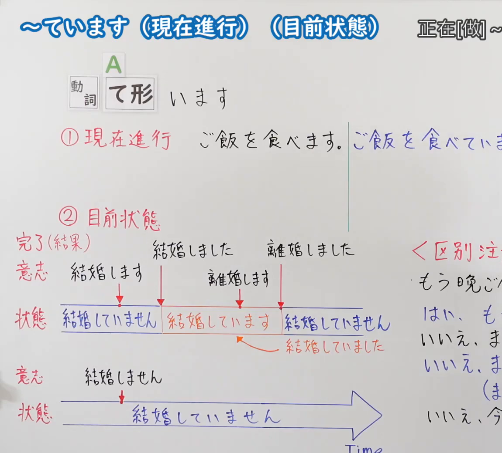
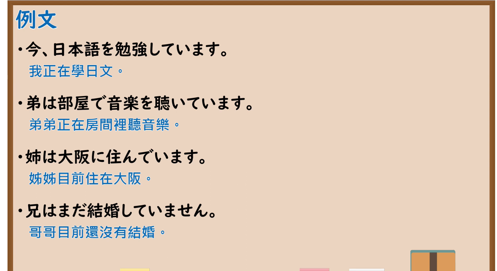

---
{
  "id": "N5-G-0105",
  "kind": "grammar",
  "level": "N5",
  "title": "～ています（现在进行）（目前状态）",
  "card_revision": 2,
  "schema_version": 1,
  "source": {
    "lesson": "N5 第105个语法",
    "material": "出口日語原视频板书（学习者截取的接续图与例句图）与东京外国语大学「Vています（進行）／Vていません」「Vています（状態）」解说正文",
    "video": "https://www.youtube.com/watch?v=9BWX8AERuCQ",
    "screenshot": "assets/grammar/n5/N5-G-0105-connection.png",
    "screenshot_crop": {
      "x": 0,
      "y": 0,
      "width": 1150,
      "height": 1040
    }
  },
  "tags": [
    "ています",
    "现在进行",
    "结果状态",
    "N5"
  ],
  "confusions": [
    "进行／结果状态",
    "着ています／知っています",
    "結婚しています",
    "ている／てある"
  ]
}
---

# N5 第105个语法：～ています（现在进行・目前状态）

# 视频学习资料整理

- 课程：[出口日語「～ています（現在進行）（目前状態）」](https://www.youtube.com/watch?v=9BWX8AERuCQ)
- 视频 ID：`9BWX8AERuCQ`
- 视频时长：8分57秒

## 接续图

- 实际时间：未记录（图片由学习者从原视频截取并提供）
- 成品图尺寸：1150×1040，固定左上角 `(0, 0)`，右下角 `(1150, 1040)`
- 板书内容：标题「～ています（現在進行）（目前狀態）」，右侧标注“正在[做]～…”（右端被画面右缘截断）；公式「A：動詞 て形 います」；「①現在進行」：「ご飯を食べます。｜ご飯を食べていま（す）」（蓝字，被截断）；「②目前状態」：时间轴图——「完了（結果）」：「意志：結婚します」→「結婚しました」→「離婚します」→「離婚しました」，下方状态条「結婚していません／結婚しています（橙框）／結婚していません」，橙箭头指「結婚していました」；另一条时间轴「意志：結婚しません」，状态「結婚していません」，箭头标「Time」；右侧红字「＜区別注（意）＞」「もう晩ご…／はい、も…／いいえ、ま…」被画面右缘截断，未补写。

## 例句图

- 实际时间：未记录（图片由学习者从原视频截取并提供）
- 成品图尺寸：1900×1040，固定左上角 `(0, 0)`，右下角 `(1900, 1040)`
- 板书内容：课程「例文」页，含四条例句及中文翻译（今、日本語を勉強しています／弟は部屋で音楽を聴いています／姉は大阪に住んでいます／兄はまだ結婚していません）。四条例句均完整可见。

# 核心

## 功能一：正在[做]～（现在进行）；～着（结果状态）

**くわしい意味記述：**

- **現在進行：** 「て形」に「います」をつけて、動きが継続していることを表わします。（在「て形」后加「います」，表示动作持续进行。）
- **変化の結果の状態：** 「Vています」は、変化の結果の状態を表わすことがあります。「Nは／が」がさす人やものが変化して、結果を残すタイプの動詞に限られます。（「Vています」有时表示变化结果的状态。限于「Nは／が」所指的人或物发生变化并留下结果的那类动词。）
- **その他：** 動きのくりかえし、過去の経験や記録が存在していること、「行く」「来る」などの移動の結果移動先にいること、なども表わします。（也表示动作的反复、过去的经历或记录的存在，以及「行く」「来る」等移动后位于目的地。）

### 例句

1. 今、小林さんは図書館で本を読んでいます。

   （现在，小林在图书馆看书。）

2. A：田中さんは今何をしていますか。　B：ごはんを食べています。

   （A：田中现在在做什么？　B：在吃饭。）

3. 体育館の前に小林さんが立っています。

   （体育馆前站着小林。）

4. 窓が開いています。

   （窗户开着。）

5. わたしは毎朝ジョギングをしています。

   （我每天早上都在慢跑。）

# 来源

- [出口日語原视频](https://www.youtube.com/watch?v=9BWX8AERuCQ)
- 东京外国语大学「日本語 文法」解说：[「Vています（進行）／Vていません」](https://www.coelang.tufs.ac.jp/mt/ja/gmod/contents/explanation/044.html)、[「Vています（状態）」](https://www.coelang.tufs.ac.jp/mt/ja/gmod/contents/explanation/045.html)（查询日期：2026-10-16；Hagoromo、毎日のんびり日本語教師、日本語NET 均未找到直接对应条目，按流程采用互联网检索所得的两页；例句译文为整理者所译；板书中「もう～ました／まだ～ていません」的区别本页未解说）
