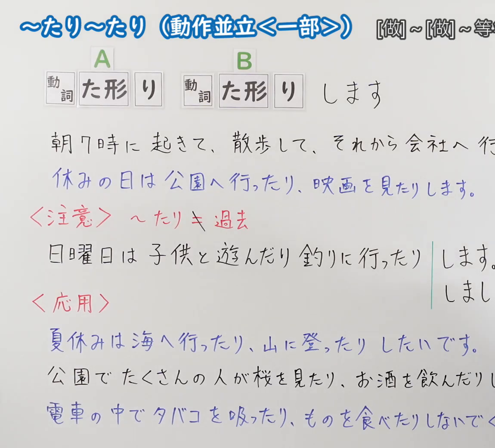
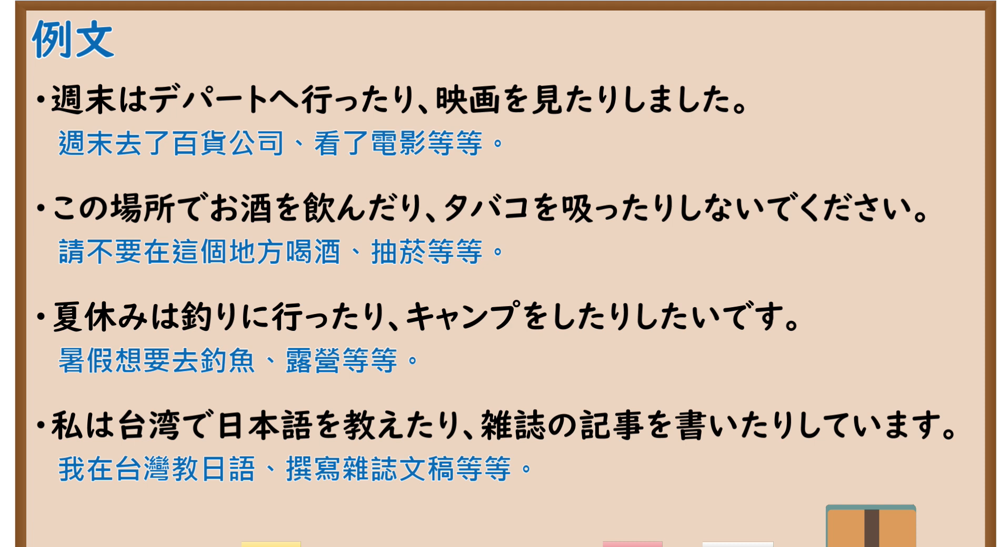

---
{
  "id": "N5-G-0106",
  "kind": "grammar",
  "level": "N5",
  "title": "～たり～たり（动作并立〈一部〉）",
  "card_revision": 2,
  "schema_version": 1,
  "source": {
    "lesson": "N5 第106个语法",
    "material": "出口日語原视频板书（学习者截取的接续图与例句图）与日本語NET「【JLPT N5】文法・例文：〜たり〜たり」正文",
    "video": "https://www.youtube.com/watch?v=g1lb4vnh4yo",
    "screenshot": "assets/grammar/n5/N5-G-0106-connection.png",
    "screenshot_crop": {
      "x": 0,
      "y": 0,
      "width": 1150,
      "height": 1040
    }
  },
  "tags": [
    "たり",
    "动作并立",
    "列举",
    "N5"
  ],
  "confusions": [
    "たり／て",
    "たりする／たりしない",
    "过去形",
    "たり（一个）"
  ]
}
---

# N5 第106个语法：～たり～たり

# 视频学习资料整理

- 课程：[出口日語「～たり～たり（動作並立〈一部〉）」](https://www.youtube.com/watch?v=g1lb4vnh4yo)
- 视频 ID：`g1lb4vnh4yo`
- 视频时长：7分0秒

## 接续图

- 实际时间：未记录（图片由学习者从原视频截取并提供）
- 成品图尺寸：1150×1040，固定左上角 `(0, 0)`，右下角 `(1150, 1040)`
- 板书内容：标题「～たり～たり（動作並立＜一部＞）」，右侧标注“[做]～[做]～等”（右端被画面右缘截断）；公式「A：動詞 た形（「形」外加「り」框）B：動詞 た形（「り」框）します」；例句：「朝7時に起きて、散歩して、それから会社へ行（きます）」（被截断）「休みの日は公園へ行ったり、映画を見たりします。」（蓝字）；红字「＜注意＞～たり＋過去」：「日曜日は子供と遊んだり釣りに行ったり」后接花括号「します。／しまし（た）」（被截断）；红字「＜応用＞」：「夏休みは海へ行ったり、山に登ったりしたいです。」「公園でたくさんの人が桜を見たり、お酒を飲んだりし（ています）」「電車の中でタバコを吸ったり、ものを食べたりしないでく（ださい）」，右端被画面右缘截断，未补写。

## 例句图

- 实际时间：未记录（图片由学习者从原视频截取并提供）
- 成品图尺寸：1900×1040，固定左上角 `(0, 0)`，右下角 `(1900, 1040)`
- 板书内容：课程「例文」页，含四条例句及中文翻译（週末はデパートへ行ったり、映画を見たりしました／この場所でお酒を飲んだり、タバコを吸ったりしないでください／夏休みは釣りに行ったり、キャンプをしたりしたいです／私は台湾で日本語を教えたり、雑誌の記事を書いたりしています）。四条例句均完整可见。

# 核心

## 功能一：[做]～[做]～等（从多个动作中列举代表性的几个）

**くわしい意味記述：**

- **〜たり〜たり：** 複数ある事柄の中から代表的なものを２、３挙げて言う表現。接続は V1（タ形）＋り＋V2（タ形）＋り。「たり」１つでも使うことができる。（从多件事中列举两三个代表性事项的表达。接续为 V1（た形）＋り＋V2（た形）＋り。也可只用一个「たり」。）

### 例句

1. 土曜日は買い物したり、映画を見たりしました。

   （星期六购物、看电影等等。）

2. 休みの日は、たいてい家でYouTubeを見たり、音楽を聞いたりしています。

   （休息日一般在家看看YouTube、听听音乐。）

3. 今度の夏休みは、花火を見たり、海へ泳ぎにいったりするつもりです。

   （这次暑假打算看烟花、去海里游泳等。）

4. 今日は宿題をしたり、部屋の掃除をしたり、忙しいです。

   （今天做作业、打扫房间，很忙。）

5. 留学中に現地の料理を食べたり、旅行したりしました。

   （留学期间吃了当地菜、旅行等。）

# 来源

- [出口日語原视频](https://www.youtube.com/watch?v=g1lb4vnh4yo)
- [日本語NET「【JLPT N5】文法・例文：〜たり〜たり」](https://nihongokyoshi-net.com/2019/06/18/jlptn5-grammar-taritari/)（查询日期：2026-10-16；Hagoromo 未收录，毎日のんびり日本語教師没有「たり」的 N5 条目，按优先级采用日本語NET 该条目；该页只有英文翻译，中文译文为整理者所译；板书中「～たり＋過去」与「応用」（～たりしたいです）的用法该页没有专门解说，仅例句中可见）
