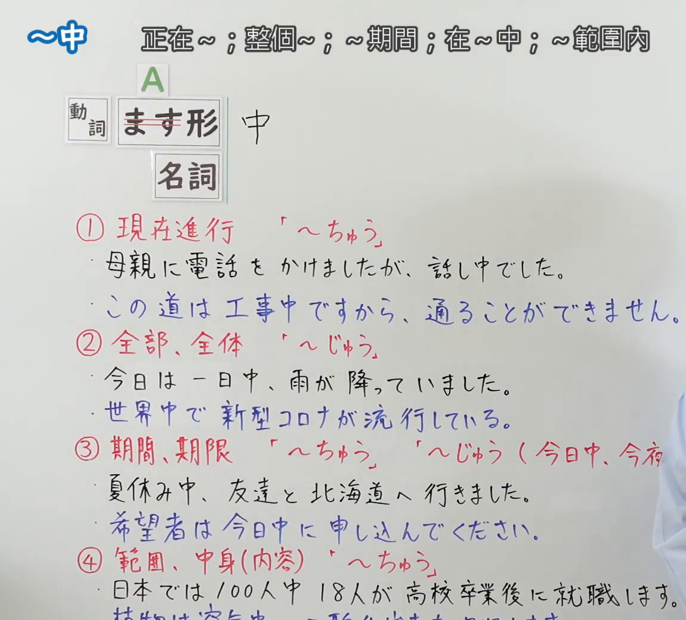
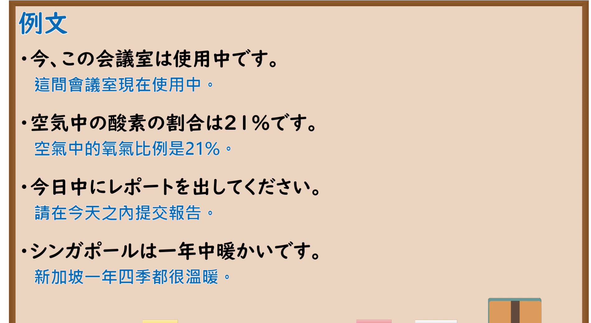

---
{
  "id": "N5-G-0107",
  "kind": "grammar",
  "level": "N5",
  "title": "～中",
  "card_revision": 2,
  "schema_version": 1,
  "source": {
    "lesson": "N5 第107个语法",
    "material": "出口日語原视频板书（学习者截取的接续图与例句图）与日本語教師の広場「~中（ちゅう・じゅう）」とおにぎり君の日本語教室「〜中」正文",
    "video": "https://www.youtube.com/watch?v=FDrYbQBOEVw",
    "screenshot": "assets/grammar/n5/N5-G-0107-connection.png",
    "screenshot_crop": {
      "x": 0,
      "y": 0,
      "width": 1150,
      "height": 1040
    }
  },
  "tags": [
    "中",
    "ちゅう",
    "じゅう",
    "N5"
  ],
  "confusions": [
    "ちゅう／じゅう",
    "午前中／今日中",
    "一日中／世界中",
    "使用中／工事中"
  ]
}
---

# N5 第107个语法：～中

# 视频学习资料整理

- 课程：[出口日語「～中」](https://www.youtube.com/watch?v=FDrYbQBOEVw)
- 视频 ID：`FDrYbQBOEVw`
- 视频时长：7分35秒

## 接续图

- 实际时间：未记录（图片由学习者从原视频截取并提供）
- 成品图尺寸：1150×1040，固定左上角 `(0, 0)`，右下角 `(1150, 1040)`
- 板书内容：标题「～中」，右侧标注“正在～；整個～；～期間；在～中；～範圍內”；公式「A：動詞 ます形（「ます」划去）／名詞 中」；①「現在進行『～ちゅう』」：「母親に電話をかけましたが、話し中でした。」「この道は工事中ですから、通ることができません。」；②「全部、全体『～じゅう』」：「今日は一日中、雨が降っていました。」「世界中で新型コロナが流行している。」；③「期間、期限『～ちゅう』『～じゅう（今日中、今夜（中））』」：「夏休み中、友達と北海道へ行きました。」「希望者は今日中に申し込んでください。」；④「範囲、中身（内容）『～ちゅう』」：「日本では100人中18人が高校卒業後に就職します。」「植物は空気中の…」（被截断）。画面右下角有老师衣服露出一小部分。

## 例句图

- 实际时间：未记录（图片由学习者从原视频截取并提供）
- 成品图尺寸：1900×1040，固定左上角 `(0, 0)`，右下角 `(1900, 1040)`
- 板书内容：课程「例文」页，含四条例句及中文翻译（今、この会議室は使用中です／空気中の酸素の割合は21%です／今日中にレポートを出してください／シンガポールは一年中暖かいです）。四条例句均完整可见。

# 核心

## 功能一：正在～；整个～；～期间；在～之中；～范围内

**くわしい意味記述：**

- **〜中（ちゅう）：** 「〜中（ちゅう/じゅう）」は、名詞に接続して、その時間や範囲内で物事が進行していることや、特定の期間・場所全体にわたることを表す接尾語です。（「〜中（ちゅう/じゅう）」接在名词后，表示在该时间或范围内事物正在进行，或遍及特定的期间、场所整体。）
- **読み分け：** 「～ちゅう」と読むのは数詞、物を表す名詞、期間を表す名詞、状態・動きを表す名詞など。「～じゅう」と読むのは範囲や場所を表す名詞、時を表す名詞など。使い分けははっきりとは解明されておらず、個人差、地域差も大きい項目です。（读「～ちゅう」的有数词、表示物的名词、表示期间的名词、表示状态・动作的名词等。读「～じゅう」的有表示范围或场所的名词、表示时间的名词等。读法区分尚未完全弄清，个人差异、地区差异也大。）

### 例句

1. 仕事中は電話に出られません。

   （工作时不能接电话。）

2. 一日中雨が降っています。

   （下了一整天的雨。）

3. 勉強中は静かにしてください。

   （学习时请保持安静。）

4. 彼女は世界中を旅行しました。

   （她游遍了世界各地。）

5. 夏休み中に宿題を終わらせます。

   （暑假期间做完作业。）

# 来源

- [出口日語原视频](https://www.youtube.com/watch?v=FDrYbQBOEVw)
- [おにぎり君の日本語教室「〜中」](https://aiueo.cc/pages_v2/ja/grammar/web/45.php)（例句，只有英文翻译）、[日本語教師の広場「~中（ちゅう・じゅう）」](https://www.tomojuku.com/blog/chuju/)（读法区分说明）（查询日期：2026-10-16；Hagoromo、毎日のんびり日本語教師、日本語NET、东京外国语大学均未找到直接对应条目，按流程采用互联网检索所得的两页；译文为整理者所译）
