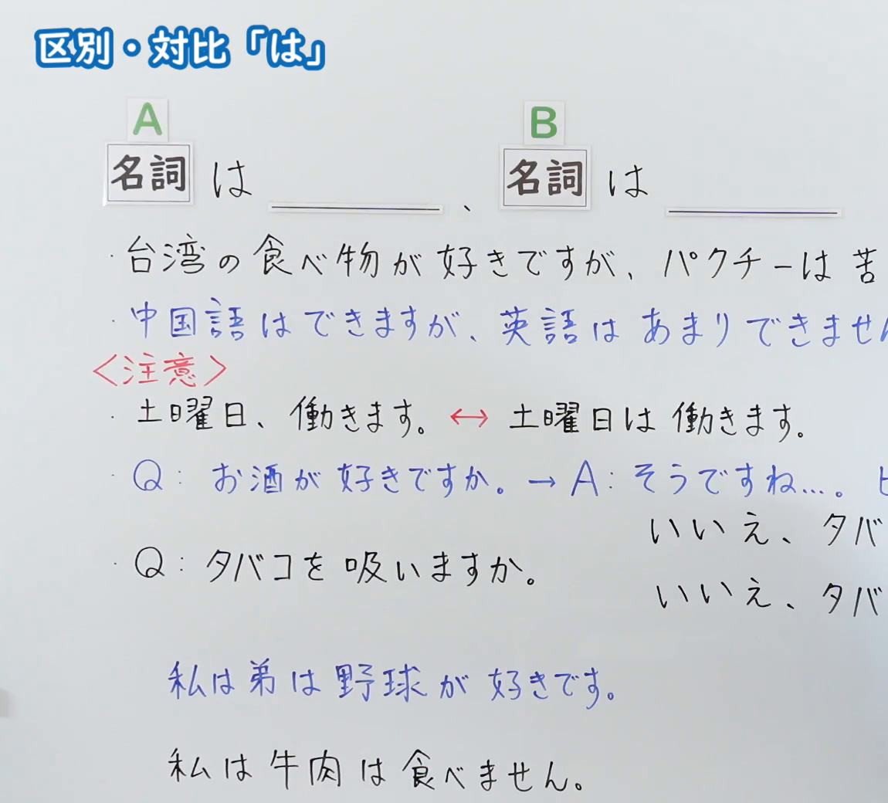
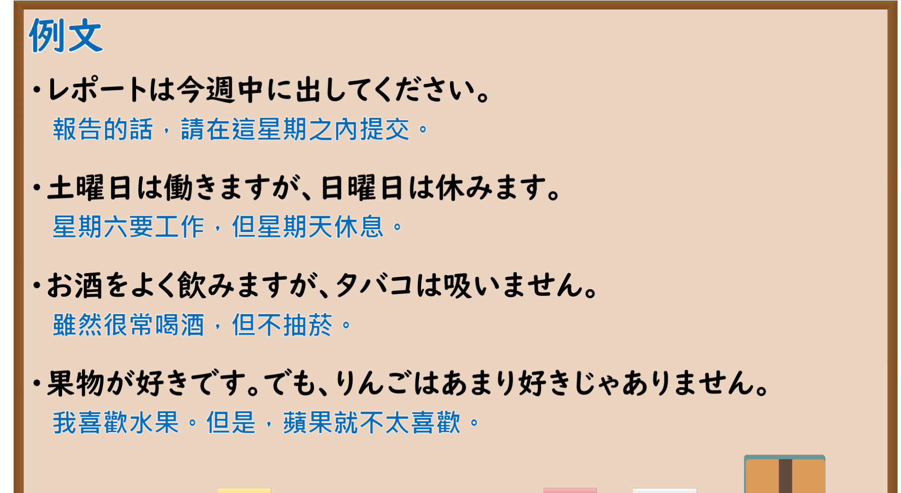

---
{
  "id": "N5-G-0108",
  "kind": "grammar",
  "level": "N5",
  "title": "助词：区别・对比「は」",
  "card_revision": 2,
  "schema_version": 1,
  "source": {
    "lesson": "N5 第108个语法",
    "material": "出口日語原视频板书（学习者截取的接续图与例句图）与东京外国语大学「副助詞：解説」正文",
    "video": "https://www.youtube.com/watch?v=bjfgS1MJi-A",
    "screenshot": "assets/grammar/n5/N5-G-0108-connection.png",
    "screenshot_crop": {
      "x": 0,
      "y": 0,
      "width": 1150,
      "height": 1040
    }
  },
  "tags": [
    "は",
    "对比",
    "区别",
    "N5"
  ],
  "confusions": [
    "は／が",
    "对比の は／主题の は",
    "数量词＋は",
    "～は～が、～は～"
  ]
}
---

# N5 第108个语法：助词「は」（区别・对比）

# 视频学习资料整理

- 课程：[出口日語「助詞：区別・対比「は」」](https://www.youtube.com/watch?v=bjfgS1MJi-A)
- 视频 ID：`bjfgS1MJi-A`
- 视频时长：10分30秒

## 接续图

- 实际时间：未记录（图片由学习者从原视频截取并提供）
- 成品图尺寸：1150×1040，固定左上角 `(0, 0)`，右下角 `(1150, 1040)`
- 板书内容：标题「区別・対比「は」」；公式「A：名詞 は ＿＿、B：名詞 は ＿＿」；例句：「台湾の食べ物が好きですが、パクチーは苦（手です）」「中国語はできますが、英語はあまりできません（。）」（蓝字，被截断）；红字「＜注意＞」：「土曜日、働きます。⇔ 土曜日は働きます。」；「Q：お酒が好きですか。→A：そうですね…。ビ（ールは）」「Q：タバコを吸いますか。」「いいえ、タバ（コは）…」（被截断）；下方：「私は弟は野球が好きです。」（蓝字）「私は牛肉は食べません。」。右侧多处句末被画面右缘截断，未补写。

## 例句图

- 实际时间：未记录（图片由学习者从原视频截取并提供）
- 成品图尺寸：1900×1040，固定左上角 `(0, 0)`，右下角 `(1900, 1040)`
- 板书内容：课程「例文」页，含四条例句及中文翻译（レポートは今週中に出してください／土曜日は働きますが、日曜日は休みます／お酒をよく飲みますが、タバコは吸いません／果物が好きです。でも、りんごはあまり好きじゃありません）。四条例句均完整可见。

# 核心

## 功能一：表示区别、对比（与其他事项相对照）

**くわしい意味記述：**

- **対比：** 「～は」を含むことがらを、他のことがらと対比する意味を付け加えます。（附加「把含有『～は』的事项与其他事项对比」的意义。）
- **主題の「は」：** 「が」や「を」がつくことのできる名詞（ガ格、ヲ格）に「は」がつくと、とくに他と対比する意味を持たず、「それについて言えば」という意味を表わすことが多いです。（在可接「が」「を」的名词（ガ格、ヲ格）后加「は」时，多半不带有与其他对比的意义，而表示“就此而言”。）

### 例句

1. ここにえんぴつがあります。赤いえんぴつは３本あります。青いえんぴつは２本あります。

   （这里有铅笔。红铅笔有3支，蓝铅笔有2支。）

2. A：そこにかさとかばんがありますか。　B：かさはありますが、かばんはありません。

   （A：那里有伞和包吗？　B：伞有，包没有。）

3. 春は来ましたが、まだ暖かくなりません。

   （春天虽然来了，但还没有变暖。）

4. 山田さんはドイツ語は上手です。（フランス語は上手ではありません。）

   （山田德语很好。（法语不好。））

5. きょうの会議に20人は集まりました。（それ以上集まったかどうかはわかりません。）

   （今天的会议至少来了20个人。（是否超过20人不清楚。））

# 来源

- [出口日語原视频](https://www.youtube.com/watch?v=bjfgS1MJi-A)
- [东京外国语大学「日本語 文法 副助詞：解説」「は」](https://www.coelang.tufs.ac.jp/mt/ja/gmod/contents/explanation/095.html)（查询日期：2026-10-16；Hagoromo、毎日のんびり日本語教師、日本語NET 均未找到直接对应条目，按流程采用互联网检索所得的该页；例句译文为整理者所译；板书的「土曜日、働きます。⇔ 土曜日は働きます。」对比该页未解说）
