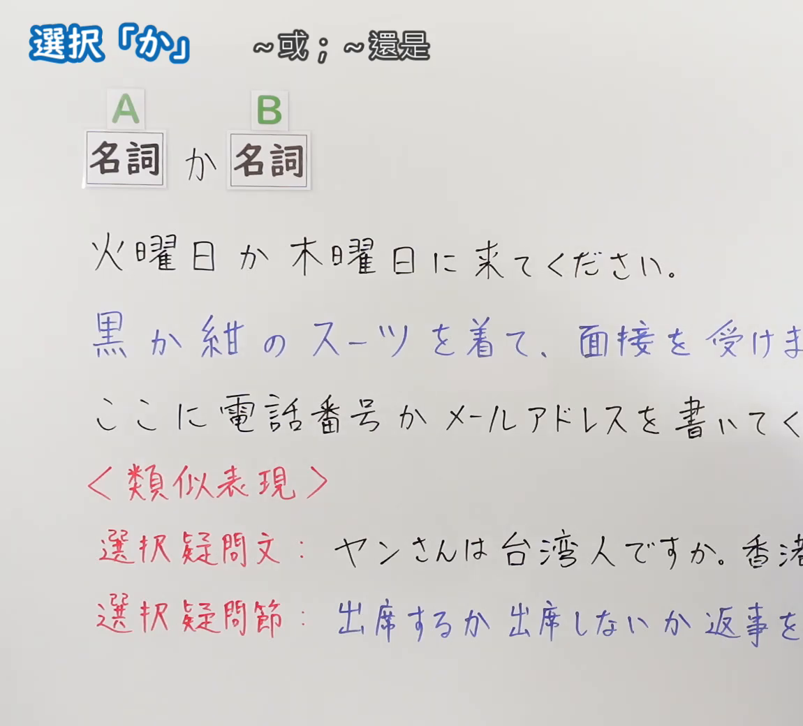
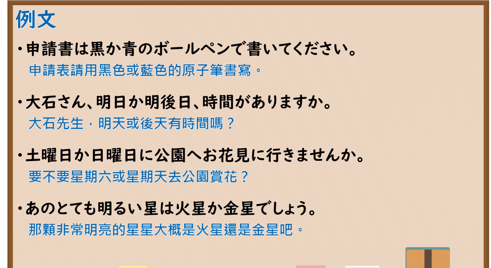

---
{
  "id": "N5-G-0109",
  "kind": "grammar",
  "level": "N5",
  "title": "助词：选择「か」",
  "card_revision": 2,
  "schema_version": 1,
  "source": {
    "lesson": "N5 第109个语法",
    "material": "出口日語原视频板书（学习者截取的接续图与例句图）与おにぎり君の日本語教室「〜か（並立）」正文",
    "video": "https://www.youtube.com/watch?v=gYbsd4jAMAg",
    "screenshot": "assets/grammar/n5/N5-G-0109-connection.png",
    "screenshot_crop": {
      "x": 0,
      "y": 0,
      "width": 1150,
      "height": 1040
    }
  },
  "tags": [
    "か",
    "选择",
    "并立",
    "N5"
  ],
  "confusions": [
    "Nか／NとN",
    "选择疑问句",
    "选择疑问节",
    "AかB"
  ]
}
---

# N5 第109个语法：助词「か」（选择）

# 视频学习资料整理

- 课程：[出口日語「助詞：選択「か」」](https://www.youtube.com/watch?v=gYbsd4jAMAg)
- 视频 ID：`gYbsd4jAMAg`
- 视频时长：5分10秒

## 接续图

- 实际时间：未记录（图片由学习者从原视频截取并提供）
- 成品图尺寸：1150×1040，固定左上角 `(0, 0)`，右下角 `(1150, 1040)`
- 板书内容：标题「選択「か」」，右侧标注“～或；～還是”；公式「A：名詞 か B：名詞」；例句：「火曜日か木曜日に来てください。」「黒か紺のスーツを着て、面接を受け（ます）」（蓝字，被截断）「ここに電話番号かメールアドレスを書いてく（ださい）」（被截断）；红字「＜類似表現＞」：「選択疑問文：ヤンさんは台湾人ですか。香港（人ですか）」「選択疑問節：出席するか出席しないか返事を（してください）」（蓝字），右端被画面右缘截断，未补写。

## 例句图

- 实际时间：未记录（图片由学习者从原视频截取并提供）
- 成品图尺寸：1900×1040，固定左上角 `(0, 0)`，右下角 `(1900, 1040)`
- 板书内容：课程「例文」页，含四条例句及中文翻译（申請書は黒か青のボールペンで書いてください／大石さん、明日か明後日、時間がありますか／土曜日か日曜日に公園へお花見に行きませんか／あのとても明るい星は火星か金星でしょう）。四条例句均完整可见。

# 核心

## 功能一：～或～；～还是～（并列选择）

**くわしい意味記述：**

- **〜か（並立）：** 「〜か」は、名詞を並列させて選択肢を示すために使われる助詞です。二つ以上の名詞をつなげて、そのうちの一つの選択肢を選ぶことを示します。接続は 名詞1か＋名詞2（＋か）。（「〜か」是并列名词、提示选项的助词。连接两个以上的名词，表示从中选择其一。接续为 名词1か＋名词2（＋か）。）

### 例句

1. 朝ごはんは、パンかおにぎりを食べます。

   （早饭吃面包或饭团。）

2. 今日は電車かバスで行きます。

   （今天坐电车或公交去。）

3. コーヒーか紅茶を飲みますか？

   （喝咖啡还是红茶？）

4. 昼ご飯はラーメンか寿司を食べます。

   （午饭吃拉面或寿司。）

5. 赤か青か、迷っています。

   （红色还是蓝色，我在犹豫。）

# 来源

- [出口日語原视频](https://www.youtube.com/watch?v=gYbsd4jAMAg)
- [おにぎり君の日本語教室「〜か（並立）」](https://aiueo.cc/pages_v2/ja/grammar/web/22.php)（查询日期：2026-10-16；Hagoromo、毎日のんびり日本語教師、日本語NET 均未找到直接对应条目，按流程采用互联网检索所得的该页；该页只有英文翻译，中文译文为整理者所译；板书中「選択疑問文」「選択疑問節」的类似表现该页未解说）
