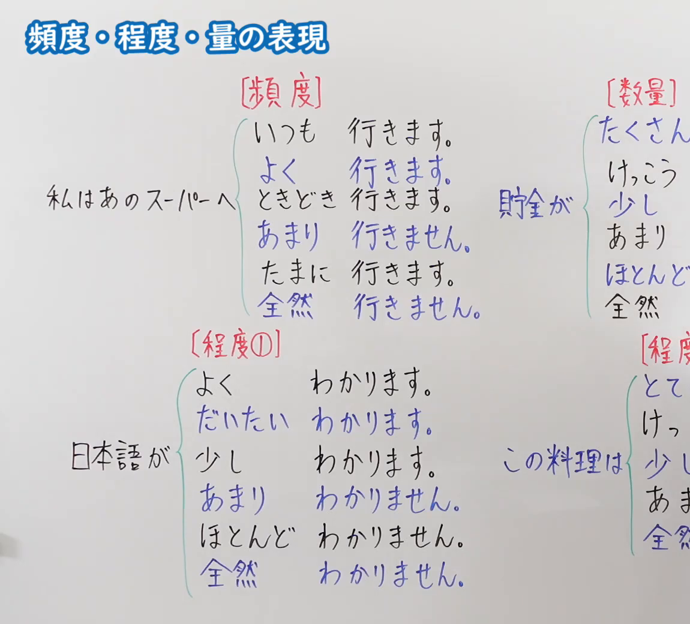
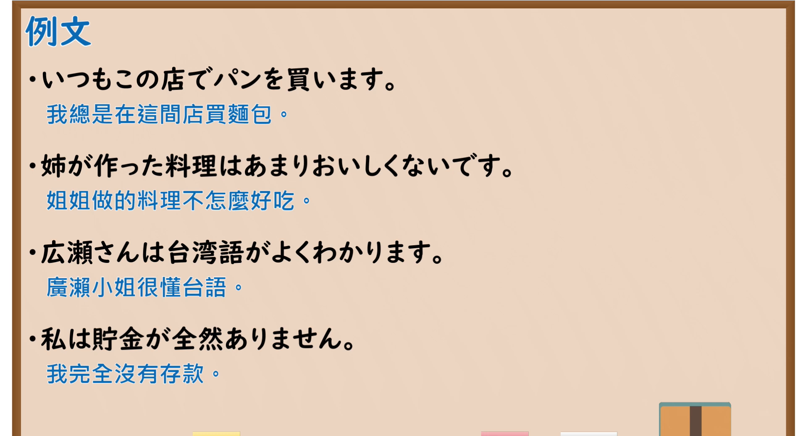

---
{
  "id": "N5-G-0110",
  "kind": "grammar",
  "level": "N5",
  "title": "频度・程度・量的表现",
  "card_revision": 2,
  "schema_version": 1,
  "source": {
    "lesson": "N5 第110个语法",
    "material": "出口日語原视频板书（学习者截取的接续图与例句图）与东京外国语大学「毎日・毎週など」「とても・あまり」解说正文",
    "video": "https://www.youtube.com/watch?v=x32zi7cGVQg",
    "screenshot": "assets/grammar/n5/N5-G-0110-connection.png",
    "screenshot_crop": {
      "x": 0,
      "y": 0,
      "width": 1150,
      "height": 1040
    }
  },
  "tags": [
    "频度",
    "程度",
    "副词",
    "数量",
    "N5"
  ],
  "confusions": [
    "いつも／よく／ときどき／たまに",
    "あまり＋否定",
    "全然＋否定",
    "たくさん／少し"
  ]
}
---

# N5 第110个语法：频度・程度・量的表现

# 视频学习资料整理

- 课程：[出口日語「頻度・程度・量の表現」](https://www.youtube.com/watch?v=x32zi7cGVQg)
- 视频 ID：`x32zi7cGVQg`
- 视频时长：10分25秒

## 接续图

- 实际时间：未记录（图片由学习者从原视频截取并提供）
- 成品图尺寸：1150×1040，固定左上角 `(0, 0)`，右下角 `(1150, 1040)`
- 板书内容：标题「頻度・程度・量の表現」，无接续公式；板书分四栏：「［頻度］」：「私はあのスーパーへ」后列「いつも行きます。／よく行きます。／ときどき行きます。／あまり行きません。／たまに行きます。／全然行きません。」；「［数量］」：「貯金が」后列「たくさん（ある）／けっこう／少し／あまり／ほとんど／全然」（右半被画面右缘截断）；「［程度①］」：「日本語が」后列「よくわかります。／だいたいわかります。／少しわかります。／あまりわかりません。／ほとんどわかりません。／全然わかりません。」；「［程度②］」：「この料理は」后列「とて（も）／けっ（こう）／少し／あま（り）／全然」（被截断）。

## 例句图

- 实际时间：未记录（图片由学习者从原视频截取并提供）
- 成品图尺寸：1900×1040，固定左上角 `(0, 0)`，右下角 `(1900, 1040)`
- 板书内容：课程「例文」页，含四条例句及中文翻译（いつもこの店でパンを買います／姉が作った料理はあまりおいしくないです／広瀬さんは台湾語がよくわかります／私は貯金が全然ありません）。四条例句均完整可见。

# 核心

## 功能一：频度、程度、数量的副词表现

**くわしい意味記述：**

- **いつも：** 「いつも」は特定の時ではなく、「つねに～です」という状態や、「つねに～します」という習慣や傾向を表わすときに使います。（「いつも」不指特定时间，用于表示“总是～”的状态，或“总是做～”的习惯、倾向。）
- **とても・あまり：** 「とてもAいです」で、程度が高いことを示します。「あまりAくありません」で程度が高くないことを示します。「とても」「あまり」は「Vます」「Vません」を修飾することもあり、その場合も程度や頻度が高いこと（高くないこと）を示します。（「とてもAいです」表示程度高，「あまりAくありません」表示程度不高。也可修饰「Vます」「Vません」，此时表示程度或频率高（不高）。）
- **程度副詞：** 「Aいです」が続く：非常に、たいへん、きわめて、大分、相当、かなり、けっこう、なかなか、比較的、少し、ちょっと、やや、多少。「Aくありません」が続く：さほど、たいして、ちっとも。（后接「Aいです」的有：非常に、たいへん、きわめて、大分、相当、かなり、けっこう、なかなか、比較的、少し、ちょっと、やや、多少。后接「Aくありません」的有：さほど、たいして、ちっとも。）

### 例句

1. 太郎君の犬はとても大きいです。

   （太郎的狗很大。）

2. わたしの部屋はあまり広くありません。

   （我的房间不太宽敞。）

3. とてもつかれました。

   （非常累。）

4. あまり勉強しません。

   （不太学习。）

5. このあたりには、あまり高い建物がありません。

   （这一带没有什么高大的建筑。）

# 来源

- [出口日語原视频](https://www.youtube.com/watch?v=x32zi7cGVQg)
- 东京外国语大学「日本語 文法」解说：[「毎日・毎週など」](https://www.coelang.tufs.ac.jp/mt/ja/gmod/contents/explanation/021.html)、[「とても・あまり」](https://www.coelang.tufs.ac.jp/mt/ja/gmod/contents/explanation/034.html)（查询日期：2026-10-16；Hagoromo、毎日のんびり日本語教師、日本語NET 均未找到直接对应条目，按流程采用互联网检索所得的两页；这两页没有「よく」「ときどき」「たまに」「全然」「ほとんど」「だいたい」「たくさん」的分项解说和例句，板书这些词本卡未补写；与第 51 课共用「とても・あまり」页，例句相同；译文为整理者所译）
