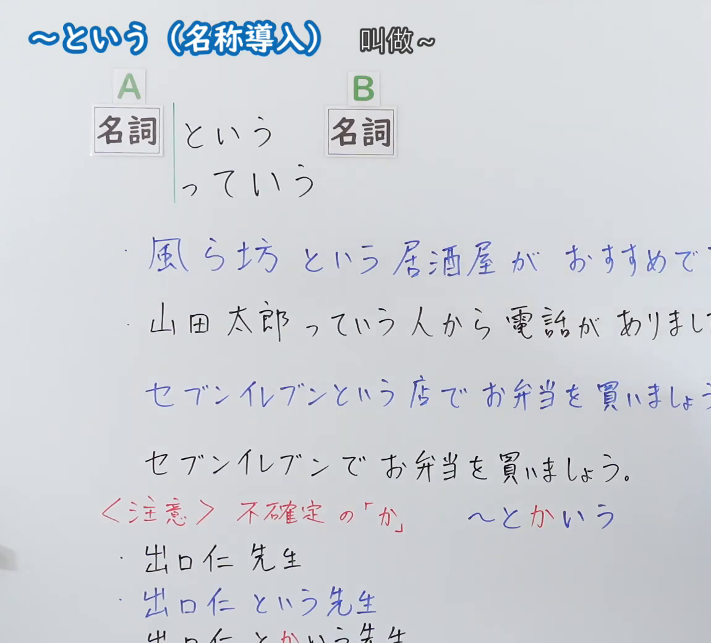
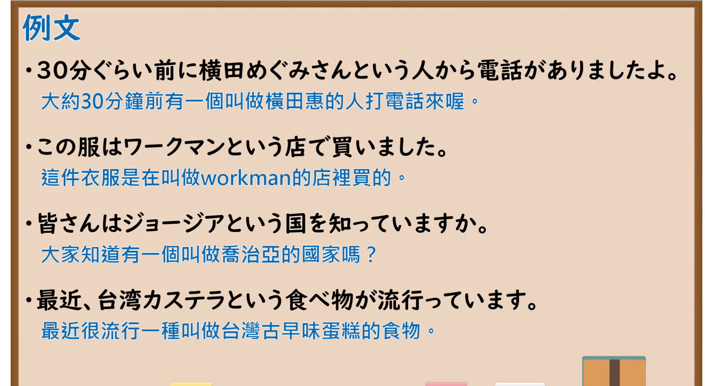

---
{
  "id": "N5-G-0111",
  "kind": "grammar",
  "level": "N5",
  "title": "～という（名称导入）",
  "card_revision": 2,
  "schema_version": 1,
  "source": {
    "lesson": "N5 第111个语法",
    "material": "出口日語原视频板书（学习者截取的接续图与例句图）与毎日のんびり日本語教師「【Ｎ３文法】～という」与日本語教師のN1et「JLPT文法解説：という（って）」正文",
    "video": "https://www.youtube.com/watch?v=4ddcTf2CFf8",
    "screenshot": "assets/grammar/n5/N5-G-0111-connection.png",
    "screenshot_crop": {
      "x": 0,
      "y": 0,
      "width": 1150,
      "height": 1040
    }
  },
  "tags": [
    "という",
    "名称",
    "って",
    "N5"
  ],
  "confusions": [
    "という／っていう／って",
    "とかいう",
    "Nという＋N",
    "名称／内容说明"
  ]
}
---

# N5 第111个语法：～という（名称导入）

# 视频学习资料整理

- 课程：[出口日語「～という（名称導入）」](https://www.youtube.com/watch?v=4ddcTf2CFf8)
- 视频 ID：`4ddcTf2CFf8`
- 视频时长：7分26秒

## 接续图

- 实际时间：未记录（图片由学习者从原视频截取并提供）
- 成品图尺寸：1150×1040，固定左上角 `(0, 0)`，右下角 `(1150, 1040)`
- 板书内容：标题「～という（名称導入）」，右侧标注“叫做～”；公式「A：名詞 という／っていう B：名詞」；例句：「風ら坊という居酒屋がおすすめで（す）」「山田太郎っていう人から電話がありまし（た）」「セブンイレブンという店でお弁当を買いましょう。」「セブンイレブンでお弁当を買いましょう。」（对比，右端被画面右缘截断）；红字「＜注意＞不確定の「か」〜とかいう」：「出口仁先生」「出口仁という先生」「出口仁とかいう先生」（最后一行下缘被截断）。

## 例句图

- 实际时间：未记录（图片由学习者从原视频截取并提供）
- 成品图尺寸：1900×1040，固定左上角 `(0, 0)`，右下角 `(1900, 1040)`
- 板书内容：课程「例文」页，含四条例句及中文翻译（30分ぐらい前に横田めぐみさんという人から電話がありましたよ／この服はワークマンという店で買いました／皆さんはジョージアという国を知っていますか／最近、台湾カステラという食べ物が流行っています）。四条例句均完整可见。

# 核心

## 功能一：叫做～（用「という」引入名称）

**くわしい意味記述：**

- **～という：** 話し手と聞き手のどちらか一方の理解が進んでいない場合に、その物事や人などを説明、定義することを表します。口語では「って」や「っていう」が用いられます。（在说话人与听话人有一方不了解的情况下，说明、定义该事物或人。口语中使用「って」「っていう」。）
- **名前の紹介：** 『相手が知らないであろう事』を伝える時に使います。「といいます」は「という」の丁寧形、「と申します」は謙譲語です。（用于告知“对方可能不知道的事”。「といいます」是「という」的礼貌形，「と申します」是谦让语。）

### 例句

1. 佐藤さんという人から電話が来ていましたよ。

   （有个叫佐藤的人来过电话。）

2. モンサンミッシェルっていうところに一度は行ってみたい。

   （想去一次叫圣米歇尔的地方。）

3. 東京の浅草という所へ行って来ました。

   （去了东京一个叫浅草的地方。）

4. 本田宗一郎という人に会ったことがありますか。

   （你见过一个叫本田宗一郎的人吗？）

5. 私はカキアゲという者です。

   （我是一个叫掻き揚げ的人。）

# 来源

- [出口日語原视频](https://www.youtube.com/watch?v=4ddcTf2CFf8)
- [毎日のんびり日本語教師「【Ｎ３文法】～という」](https://mainichi-nonbiri.com/grammar/n3-toiu/)（例1、2，中文译文取自该页）、[日本語教師のN1et「JLPT文法解説：という（って）」](https://jn1et.com/toiu/)（名称介绍的说明与例3–5）（查询日期：2026-10-16；Hagoromo 未收录，毎日のんびり日本語教師该站将「という」归入 N3，故同时采用 N1et 的名称用法解说；例3–5 译文为整理者所译；板书中「～とかいう」（不确定）该两页未解说，卡内未写）
